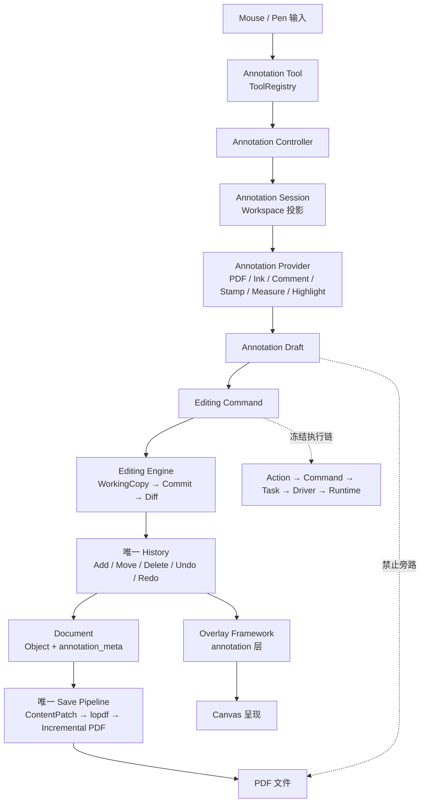

# 规范 21 · 第20章 Annotation Workspace R1

Version：R1.0
Compatible with: Architecture Freeze **R1.1**
Scope：Annotation Workspace / Annotation Provider / Annotation Session / Annotation Layer / Annotation Review / Desktop Freeze
Status：RFC Freeze
Depends：`00` / `01` / `04` / `05` / `15` / `16` / `18` / `19` / `20`

> 文件编号 21，对应标题中的“第20章”。沿用 18C C-7：后续章节标题编号与 `docs/spec/` 文件编号允许错位，但不得反向修改既有规范。

---

## 一、章节定位（Why）

### 1. 为什么需要这一章

第19章已完成 OCR Workspace，并把 Desktop UI 冻结为 V1.0：Tool / Overlay / Inspector / Ribbon / ContextMenu / Cursor / Shortcut / Theme / Dock / Status 十类 Framework 全部注册表驱动，后续能力只能 `registerFeature()`。

但批注能力有一类特殊风险：它天然涉及“鼠标绘制、图形对象、属性面板、评论、审阅、保存、撤销重做”。如果没有统一规范，最容易出现四套旁路：

1. 自建画布绘制，绕过 Overlay Framework；
2. 自建属性面板，绕过 Inspector Registry；
3. 自建历史栈，绕过唯一 History；
4. 自建保存逻辑，绕过 Save Pipeline。

第20章的目的不是重新实现编辑能力，而是建立统一的 **Annotation Workspace**，让批注、评论、图形标记、测量等能力全部复用既有 Editing Framework、Overlay Framework、History、Capability、Save Pipeline。

### 2. 与上一章的关系

- 第19章解决“OCR 结果如何进入 Desktop 并写回对象”；
- 第20章解决“用户手写的 Annotation 如何进入 Desktop 并写回对象”；
- 两者共享同一条设计范式：**Provider 只产出结果，Workspace 管会话与审阅，写回统一经 Editing Engine**。

第20章不得修改第19章冻结的 Desktop Framework，也不得复用 OCR Provider trait 作为批注 Provider。两者同构但领域不同，各自独立。

### 3. 完成后解决什么问题

完成后解决：

- 批注入口分散：统一到 Annotation Workspace 的 Toolbar / Canvas / Inspector / Sidebar / StatusBar；
- 批注对象绕过编辑链：统一生成 Editing Command；
- 批注图层自成体系：统一进入 Overlay Framework 的 `annotation` 层；
- 批注历史与保存分叉：统一进入 History 与 Save Pipeline；
- 后续 AI / Search / Plugin 扩展无预留：统一通过 Provider / Feature 注册。

---

## 二、章节目标（Goal）

本章完成：

- ✔ Annotation Workspace
- ✔ Annotation Provider
- ✔ Annotation Session
- ✔ Annotation Layer
- ✔ Annotation Object
- ✔ Annotation Review
- ✔ Annotation Tool
- ✔ Annotation Sidebar
- ✔ Annotation Inspector
- ✔ Annotation Save
- ✔ Annotation History

其中：

- “Annotation Save”不是新增保存器，而是批注数据经唯一 Save Pipeline 落盘；
- “Annotation History”不是新增历史栈，而是批注操作生成 Editing Command 后进入唯一 History；
- “Annotation Inspector”不是新增属性面板，而是向 Inspector Registry 注册 PropertyGrid Schema；
- “Annotation Layer”不是新增 Overlay 实现，而是 Overlay Framework 中的逻辑分组元数据。

---

## 三、Architecture Freeze（AD-01 ~ AD-15）

| 编号 | 强制裁决 | 落地口径 |
|---|---|---|
| **AD-01** | Annotation 不得修改 Editing Engine；所有写入必须统一为 Editing Command。 | `dw-annotation` 只生成 Command 意图，不实现 WorkingCopy / Commit / ContentPatch 重写。`AnnotationCommand` 最终归一到 18 章 Editing Engine。 |
| **AD-02** | Annotation 不得新增第二套 Overlay；必须统一使用 Overlay Framework。 | 只向既有 `annotation` 层注册 OverlayContribution；禁止 Annotation 自建 Canvas、自管 z-order、自绘选中框。 |
| **AD-03** | Annotation 不得新增第二套 Inspector；必须统一使用 Inspector Registry。 | 只注册 InspectorContribution，渲染统一 PropertyGrid；禁止 `AnnotationPropertyPanel` 之类独立面板。 |
| **AD-04** | Annotation 不得新增第二套 History；必须统一进入 History。 | Add / Move / Delete / Update / Reply / Resolve 均生成 CommandRecord；`history.rs` 只是 Command 构造器与投影适配器，不保存副本。 |
| **AD-05** | Annotation 不得新增第二套 Save；必须统一进入 Save Pipeline。 | 几何与样式经 ContentPatch 落盘；`annotation_meta` 随 Document 既有序列化进入 Save；禁止 annotation 模块直接写 PDF。 |
| **AD-06** | Annotation Provider 是唯一能力来源；不得在 UI / Session 中硬编码类型分支。 | 六类内建 Provider：`PDF` / `Ink` / `Comment` / `Stamp` / `Measure` / `Highlight`；后续 Provider 通过 Feature 注册。 |
| **AD-07** | Provider 只产出结果或 Command 意图，不得写 Object、不得调用 Save、不得改 History。 | Provider 输出 `AnnotationDraft`；Session 校验后转 Editing Command；与 19 章 OCR Provider 同构。 |
| **AD-08** | AnnotationSession 是 Workspace 投影，不是第二真值源；不得新增 AnnotationManager。 | Session 实例生命周期挂靠既有 SessionManager；真值为 Document Object + `annotation_meta` + History。 |
| **AD-09** | AnnotationObject 不得新增第二对象库，必须映射到既有 Object Model。 | `AnnotationObject` 是对象投影：持有 `object_id` 与 annotation 元数据；几何落为 Path/Text/Image 等既有对象形态，不新增 ObjectKind。 |
| **AD-10** | AnnotationLayer 是逻辑分组，不得成为独立 Overlay 层集合。 | Layer 只存 name / visible / locked / order；渲染仍由 Overlay Framework 的 `annotation` 层统一完成。 |
| **AD-11** | AnnotationReview 状态必须属于 AnnotationObject 元数据，不得单独建 Store。 | `Pending / Accepted / Rejected / Resolved` 与 Reply 列表存 Document 的 `annotation_meta`；状态变更也生成 Command。 |
| **AD-12** | Capability 判定必须统一走 needs 谓词，禁止散落 `if`。 | Toolbar / Canvas / ContextMenu / Inspector 全部通过 Framework `needs` 决定启用；无能力时只给统一禁用原因。 |
| **AD-13** | ContextMenu、Notification、StatusBar 必须复用 18B / 18C 既有注册点。 | ContextMenuProvider / ToastStack / StatusItem 注册；禁止 `alert`、自绘菜单、自建状态条。 |
| **AD-14** | Annotation Tool 必须通过 `registerFeature()` 注册，不新增 Framework 扩展点。 | Tool / Cursor / Shortcut / Overlay / Inspector / ContextMenu / Status 等均挂既有 Registry；Ribbon 不新增页签与主按钮。 |
| **AD-15** | 第20章冻结后，后续章节只能扩展 Provider / Feature，不得修改本章冻结链。 | 21 Search 只读 Annotation Index；22 AI 只注册 Annotation AI Provider；23 Plugin 只注册第三方 Provider；任何改链行为按 R2.0 处理。 |

### 3.1 冲突裁决（C-1 ~ C-10）

| 编号 | 冲突 | 裁决 |
|---|---|---|
| C-1 | 用户要求 Annotation Session / Layer / Object，但架构冻结只有 3 Manager / 3 Store | 不新增 Manager / Store。Session 挂靠 SessionManager 生命周期；Layer / Review 是 `annotation_meta` 元数据；Object 映射到既有 Object Model。 |
| C-2 | Annotation Object 需要写回，但 18 章禁止 Object 直改 PDF | Object 只生成 Editing Command，必须经 `EditingEngine → ContentPatch → Save`；禁止 annotation 模块直接写 lopdf。 |
| C-3 | Provider 需要产出批注，但 Provider 不应承担写回 | Provider 只产出 `AnnotationDraft`；Session 校验后转 Command。与 19 章 OCR Provider 同构，但 trait 独立，不强行合并。 |
| C-4 | 用户要求 `history.rs`，同时要求不得有第二套 History | `history.rs` 只放 Command 构造器与只读投影适配器，不存 `Vec<CommandRecord>`，不维护 cursor。 |
| C-5 | 用户要求 Annotation Save，同时要求不得有第二套 Save | “Annotation Save”指批注数据复用唯一 Save Pipeline；几何进 ContentPatch，元数据随 Document 序列化。 |
| C-6 | 用户要求 Workspace Toolbar，16 章又已有 Annotation Ribbon 页签 | Ribbon 不再新增页签/主按钮；既有页签仅作入口跳转，主操作放在 Workspace Toolbar。 |
| C-7 | 用户要求 Annotation Object，但 18 章 ObjectKind 已冻结 | 不新增 ObjectKind；`AnnotationObject` 是投影对象，底层仍为 Path / Text / Image 等既有对象形态，新增字段按 R1.1 补录。 |
| C-8 | 用户要求 Annotation Session，但 18 章 EditingSession 是唯一编辑事务 | `AnnotationSession` 是 Workspace 投影与状态机，不持有 WorkingCopy、不替代 EditingSession；真值在 Document + History。 |
| C-9 | Review / Reply / Resolve 是否进入 History | 进入。它们是 AnnotationObject 属性变更，必须生成 Command、可撤销；不得只在 Sidebar 本地状态里改。 |
| C-10 | Capability Matrix 示例写 ✅，但本章仍为 RFC | 矩阵中的 ✅ 表示“冻结要求”；实际实现状态写“待实现”，PASS 只在实施记录 / 测试报告中标记。 |

---

## 四、数据流（必须画图）

主线：



读法：

1. 用户输入先被 Tool 识别为 Annotation Action；
2. Controller 只转发，不解析 PDF、不改对象；
3. Provider 产出 Draft；
4. Session 校验 Capability 与 Review 状态后生成 Editing Command；
5. Editing Engine 生成 Diff / Patch；
6. History 记录 CommandRecord；
7. Overlay 只消费只读投影；
8. Save 是唯一写盘点。

横切通道：

- Capability：在 Tool → Controller 之前解析 `needs`；
- Notification：History / Save 结果经 EventBridge 只读游标进入 Toast；
- StatusBar：只消费 Annotation 状态投影；
- Inspector / Sidebar：只消费 AnnotationObject 投影，不写真值。

---

## 五、目录结构

```text
D:\DocumentWorkbench\
├─ crates\
│  └─ dw-annotation\
│     ├─ Cargo.toml
│     ├─ src\
│     │  ├─ lib.rs             # OcrDriver 式 Driver 声明：Capability::Annotation
│     │  ├─ annotation.rs      # AnnotationObject / AnnotationLayer / AnnotationMeta
│     │  ├─ provider.rs        # AnnotationProvider trait + 六类内建 Provider
│     │  ├─ session.rs         # AnnotationSession 状态机（Workspace 投影）
│     │  ├─ tool.rs            # Tool 意图定义与 needs 声明
│     │  ├─ history.rs         # Command 构造器 / History 投影适配，不存第二历史
│     │  ├─ review.rs          # Review / Reply / Resolve 状态机
│     │  └─ cache.rs           # 进程内解析与测量缓存，不落盘、不是 Store
│     └─ tests\
│        └─ annotation_core_tests.rs
│
├─ apps\dw-desktop\src\
│  ├─ annotation_ipc.rs        # annotation_* 命令组装层，不改 Core Manager
│  └─ lib.rs                   # 注册 annotation_* 命令
│
└─ ui\src\
   ├─ ipc\annotation.ts        # annotation_* IPC 前端封装
   ├─ annotation\
   │  ├─ annotationController.ts
   │  ├─ annotationFeature.tsx # 唯一 registerFeature 入口
   │  ├─ AnnotationOverlay.tsx # 注册到 OverlayRegistry 的渲染函数
   │  ├─ AnnotationSidebar.tsx
   │  ├─ AnnotationInspector.tsx
   │  └─ AnnotationWorkspace.tsx
   └─ framework\
      └─ builtins.tsx          # 不新增注册表；initializeFramework 注册 annotationFeature
```

目录约束：

- `history.rs` 不得定义 `Vec<CommandRecord>` 字段；
- `cache.rs` 不得持久化；
- `AnnotationManager` / `AnnotationStore` 禁止出现；
- Desktop 不新增第十一类 Framework；
- `Ribbon` 不新增页签，只在既有页签中保留入口。

---

## 六、Provider（统一）

### 6.1 内建 Provider

```text
AnnotationProvider
├─ PdfAnnotationProvider      # 读取既有 PDF annotation 子集并映射
├─ InkProvider                # 自由笔迹
├─ CommentProvider            # 便签 / 评论
├─ StampProvider              # 图章
├─ MeasureProvider            # 距离 / 面积测量
└─ HighlightProvider          # 文本 / 区域高亮
```

### 6.2 统一 trait 口径（R1.1 类型补录）

```rust
pub trait AnnotationProvider: Send + Sync + std::fmt::Debug {
    fn name(&self) -> &str;
    fn kind(&self) -> AnnotationKind;
    fn is_available(&self) -> bool;
    fn capabilities(&self) -> AnnotationCapabilities;
    fn build_draft(&self, input: &AnnotationInput) -> Result<AnnotationDraft, DwError>;
}
```

约束：

- Provider 只产出 `AnnotationDraft`；
- Draft 必须包含几何、样式、作者/时间、Provider 名与可选文本；
- Provider 不得写 Object、不得写盘、不得进入 History；
- AI / Plugin 后续 Provider 必须实现同一 trait 并经 Feature 注册；
- PDF Provider 只承诺常见子集（Highlight / Text / Ink / Stamp），复杂外观流不承诺完全还原。

---

## 七、Workspace

统一结构：

```text
Workspace
├─ Toolbar       # 在当前工作区内，不扩展 Ribbon
├─ Canvas        # PDF.js + Overlay Framework
├─ Inspector     # PropertyGrid，统一注册
├─ Sidebar       # 批注列表 / 图层 / Review
└─ StatusBar     # 统一 StatusItem
```

约束：

- 所有工具入口来自 ToolRegistry；
- Canvas 不自己画批注，只把只读投影交给 OverlayRegistry；
- Sidebar 只展示 `AnnotationObject` 投影与 Review 状态；
- Inspector 只注册 Schema；
- StatusBar 只注册 StatusItem；
- 禁止出现“每加一个能力就多一个 Ribbon 页签/分组”的实现。

---

## 八、Capability

统一 needs，禁止散落 `if`：

| Need | 含义 | 典型操作 |
|---|---|---|
| `annotation` | 有活动文档且 Annotation 能力可用 | 进入批注工作区 |
| `annotationProvider` | 指定 Provider 可用 | Highlight / Measure / Ink 等工具 |
| `annotationSelected` | 当前有选中批注对象 | Reply / Resolve / Delete |
| `annotationEditable` | 选中批注可编辑 | 修改颜色 / 透明度 / 文本 |
| `annotationReviewable` | 选中批注可审阅 | Accept / Reject / Resolve |
| `annotationMeasure` | Measure Provider 可用 | 距离 / 面积测量 |

裁决：

- Highlight 可用不代表 Measure 可用；
- Measure 在缺少 Provider 时只禁用，不隐藏；
- `Delete` 在 Annotation 中指“删除批注对象 Command”，可撤销；它不是 18A C-9 排除的通用对象删除能力；
- 禁用原因必须写入 Tooltip / title。

---

## 九、History

统一命令：

```text
AddAnnotation
MoveAnnotation
DeleteAnnotation
UpdateAnnotation
ReplyAnnotation
ResolveAnnotation
Undo
Redo
```

约束：

- 每个命令生成 `CommandRecord`，Diff 进入既有 History；
- Add / Move / Delete / Update / Reply / Resolve 都可撤销；
- Review 状态变更属于属性变更，必须进 History；
- `history.rs` 只做命令构造与只读投影，不保存第二份历史；
- Undo / Redo 复用既有 History cursor，禁止 Annotation 自算 cursor。

---

## 十、Overlay

统一层次，沿用 16 章八层与 18B OverlayRegistry：

```text
text → selection → editing → annotation → ocr → ai → debug
```

约束：

- 只在 `annotation` 层注册贡献；
- Hover / Selection 继续来自 Selection 与 HitTest，不另建命中链；
- Layer 的 visible / locked / order 只作为渲染输入；
- Annotation Overlay 不改 Selection 框、Caret、OCR BBox；
- 动画统一使用 `--dw-motion-*` Token。

---

## 十一、Inspector

统一 PropertyGrid 字段：

| 字段 | 来源 |
|---|---|
| 类型 | AnnotationProvider.kind |
| 图层 | AnnotationLayer.name |
| 颜色 / 透明度 | Object style |
| 作者 | AnnotationMeta.author |
| 创建时间 / 修改时间 | AnnotationMeta |
| 评论文本 | Object text 或 AnnotationMeta.comment |
| Review 状态 | AnnotationMeta.review |
| Reply 数 | AnnotationMeta.replies |
| ObjectId / 版本 | 18 章 Object Model |

约束：

- 不新增独立属性面板；
- 属性修改生成 `UpdateAnnotation` Command；
- 多选只展示共有属性；
- 不可编辑字段以 muted 形式展示，不允许就地改真值。

---

## 十二、Context Menu

统一 Provider 注册：

| 菜单项 | needs | 行为 |
|---|---|---|
| Reply | `annotationSelected` + `annotationReviewable` | 新增回复 Command |
| Resolve | `annotationSelected` + `annotationReviewable` | 状态切为 Resolved |
| Delete | `annotationSelected` + `annotationEditable` | 删除批注 Command，可撤销 |

约束：

- 菜单项由 ContextMenuRegistry Provider 贡献；
- 不硬编码 DOM 菜单；
- AI 后续可直接注册新 Provider，不改本章代码；
- 空白处右键不显示批注菜单。

---

## 十三、Notification

统一 NotificationCenter：

| 事件 | 文案方向 |
|---|---|
| AnnotationAdded | 新增批注成功 |
| AnnotationUpdated | 属性已更新 |
| AnnotationDeleted | 已删除（可撤销） |
| AnnotationResolved | 已标记为解决 |
| AnnotationFailed | 明确失败原因 |

约束：

- 禁止 `alert` / `confirm` / 自建提示条；
- 复用 18C 的 `core_events(cursor)` 只读事件游标；
- 事件只驱动 Toast，不写真值；
- 成功后仍以命令返回快照为准。

---

## 十四、StatusBar

统一 StatusItem 注册，显示：

```text
Annotation: Selected(n) · Comment(m) · Reply(k) · Review(state)
```

约束：

- 只显示投影，不含可写控件；
- 无数据时显示 0 / 占位符；
- 与 OCR / Save / Selection 状态项并列，不新增状态条；
- 状态变化来自 AnnotationObject 投影与 History cursor。

---

## 十五、Desktop Polish

每章都必须写，不再单独做一次“Desktop 重构”。

| 能力 | 第20章落点 |
|---|---|
| Cursor | 新增 Annotation 绘制 / 评论 / 测量光标规则，仍走 `data-cursor` |
| Overlay | 只注册 `annotation` 层贡献，统一动画与层级 |
| Tool | ToolRegistry / ShortcutRegistry / CursorRegistry 注册 |
| Animation | 使用 `--dw-motion-fast` / `--dw-motion-normal` |
| Selection Handle | 复用 `.dw-handle`，不新建批注手柄体系 |
| Tooltip | 统一 Tooltip 组件 + Ribbon reason + ContextMenu title |
| Empty / Error / Loading | 统一 PanelEmpty / ErrorPanel / Skeleton / Progress |
| Theme | 所有颜色走 CSS Token |
| HiDPI | 沿用 `--dw-ui-scale`，不新增窗口缩放逻辑 |

---

## 十六、Capability Matrix（冻结基线）

> 本章为 RFC 规范，矩阵记录“冻结要求”；实际实现状态由本章实施记录 / 测试报告标记 PASS。

| Capability | Framework 落点 | UI 落点 | 冻结要求 | 验收状态 |
|---|---|---|---|---|
| Annotation | Provider + Command + Session | Annotation Workspace | ✅ 必须 | 待实现 |
| Provider | Feature 注册 | Toolbar / Workspace | ✅ 必须 | 待实现 |
| Session | SessionManager 生命周期 | Controller / Sidebar | ✅ 必须 | 待实现 |
| Object | 18 章 Object Model | Canvas 投影 | ✅ 必须 | 待实现 |
| History | 唯一 History | Undo / Redo | ✅ 必须 | 待实现 |
| Save | 唯一 Save Pipeline | Save 反馈 | ✅ 必须 | 待实现 |
| Overlay | OverlayRegistry `annotation` 层 | Canvas | ✅ 必须 | 待实现 |
| Inspector | InspectorRegistry | PropertyGrid | ✅ 必须 | 待实现 |
| ContextMenu | ContextMenuRegistry | Reply / Resolve / Delete | ✅ 必须 | 待实现 |
| StatusBar | StatusRegistry | Annotation 状态项 | ✅ 必须 | 待实现 |
| Notification | ToastStack + EventBridge | 统一反馈 | ✅ 必须 | 待实现 |
| Workspace | Dock 六槽位 | Toolbar/Canvas/Inspector/Sidebar/StatusBar | ✅ 必须 | 待实现 |

---

## 十七、测试（AT-01 ~ AT-20）

| 编号 | 层级 | 判据 | 通过标准 |
|---|---|---|---|
| AT-01 | Core | 六类 Provider 可注册、可查询、重复注册报错 | PDF / Ink / Comment / Stamp / Measure / Highlight 全部命中；重复 id 不静默覆盖 |
| AT-02 | Core | Session 状态机合法迁移与非法拒绝 | Idle→Drawing→Selected→Editing→Committed→Idle 通过；Committed→Drawing 等非法迁移被拒 |
| AT-03 | Core | AnnotationObject 与既有 Object 映射无字段丢失 | id / type / geometry / style / meta / review 往返一致 |
| AT-04 | Core | Add / Move / Delete 与 Undo / Redo 复用唯一 History | 三次 Add/Move/Delete 后连续 Undo/Redo 状态完全恢复 |
| AT-05 | Core | 所有操作有 needs，缺失能力时状态零变更 | needs 缺任一项则拒绝，并给出统一禁用原因 |
| AT-06 | UI | 批注只进入 Overlay Framework | z-order / 可见性与既有 Overlay 一致；无自建 Canvas 绘制路径 |
| AT-07 | UI | Inspector 复用 PropertyGrid | 字段齐全；编辑后生成 Command；无独立属性面板 |
| AT-08 | UI | Sidebar 支持列表 / 定位 / 筛选 | 点击条目定位并高亮；空列表为 PanelEmpty |
| AT-09 | IPC | Reply / Resolve 经统一命令链 | 无效 objectId 报错；并发不丢更新；状态可撤销 |
| AT-10 | UI | ContextMenu 只有 Reply / Resolve / Delete | 命中对象正确；空白处不显示批注菜单 |
| AT-11 | UI | 所有提示走 NotificationCenter | 静态扫描零 `alert` / `confirm` |
| AT-12 | UI | StatusBar 显示 Selected / Comment / Reply / Review | 计数与投影一致；变化后及时刷新 |
| AT-13 | IPC | Save 后 RoundTrip 完整 | 几何、样式、评论、回复、Review 状态全部恢复 |
| AT-14 | Integration | PDF Provider 覆盖约定子集 | Highlight / Text / Ink / Stamp 坐标随缩放旋转一致；子集外明确不支持 |
| AT-15 | Integration | Measure / Highlight / Ink / Stamp / Comment 端到端可用 | 五类均可创建、显示、保存、撤销 |
| AT-16 | Core | 无第二套 Framework / Engine / History / Save | 静态扫描无重复 Registry / Engine / History / Save 定义 |
| AT-17 | Integration | 大量批注懒加载与缓存有效 | 视口外对象延迟加载；缓存失效后可重算；无内存持续增长 |
| AT-18 | Integration | 与 18 / 19 章兼容 | 18 编辑链、19 OCR Workspace 无回归 |
| AT-19 | Core | 冻结章节零修改 | 18 / 19 核心文件零 diff；本章均为新增或评审过扩展点 |
| AT-20 | UI | Toolbar / Canvas 统一外壳 | 无独立工具栏与独立画布；Tool / Cursor / Shortcut 一致 |

---

## 十八、Out Of Scope

明确不做：

- AI 自动批注 / AI 改写批注（22 章预留）；
- 全文批注搜索 UI（21 章预留 Annotation Index）；
- Plugin Runtime（23 章预留 Provider 注册）；
- Cloud Sync / 多人协同 / 在线评论；
- Annotation Flatten 导出；
- Form / Signature；
- 复杂 PDF 外观流、混合模式、超复杂图章的完整还原；
- OCR 结果自动生成批注；
- 通用对象删除（18A C-9 仍排除；Annotation Delete 是独立批注 Command）。

---

## 十九、章节冻结

**Annotation Workspace Freeze**：

- Provider 接口冻结；
- AnnotationObject / AnnotationMeta 字段冻结；
- Session 状态机冻结；
- Workspace 五区结构冻结；
- History / Save 复用路径冻结；
- Overlay / Inspector / ContextMenu / Status / Notification 注册方式冻结。

冻结后：

- 21 Search 不得改本章文件，只能消费 Annotation Index；
- 22 AI 不得改本章文件，只能注册 Annotation AI Provider；
- 23 Plugin 不得改本章文件，只能注册第三方 Annotation Provider；
- 任何改链行为必须 Architecture Review，必要时 R2.0。

---

## 二十、下一章预留

| 下一章 | 预留能力 | 约束 |
|---|---|---|
| 21 Search | `AnnotationIndex` 只读投影 | 索引文本 / 几何 / Review 状态，不改 AnnotationObject |
| 22 AI | `AnnotationAIProvider` | 只产出 Draft，经 Editing Engine Apply，可撤销 |
| 23 Plugin | 第三方 `AnnotationProvider` | 经 Feature 注册，不改六类内建枚举、不新增 Registry |
| 24 Collaboration | 远程 Reply / Resolve 事件 | 本章只预留稳定 Command 语义，不实现网络 |

预留只写一次：后续章节直接消费，不得重复定义第二套 Annotation Index / AI Provider / Plugin Provider 协议。

---

## A. Compatibility（兼容性）

- 与 18 章 Object Editing 兼容：Annotation 不改 Editing Engine，所有写入生成 Editing Command。
- 与 18B Desktop Framework 兼容：只 `registerFeature()`，十类 Registry 不新增。
- 与 18C EventBridge 兼容：通知走 `core_events(cursor)`，不新增 emit/listen。
- 与 19 章 OCR Workspace 兼容：Provider 同构但 trait 独立；OCR 结果不自动生成批注。
- 与架构冻结兼容：不新增 Manager / Store，不改执行链，不改技术栈，属于 R1.1 类型/字段补录。

## B. Migration（迁移）

- 新文档：默认 `annotation_meta = {}`；
- 旧文档：无 `annotation_meta` 时按空处理，不强制升级；
- 既有 PDF 批注：通过 PdfAnnotationProvider 读取约定子集并映射为 AnnotationObject；
- 旧独立批注历史：不迁移，视为不可撤销历史；新操作进入唯一 History；
- 旧 Ribbon 批注入口：不删除，但只作为 Workspace 跳转入口，不再承载主操作。

## C. Performance（性能）

- Provider 解析与测量结果进入进程内 `cache.rs`，Document 变更按 ObjectId 失效；
- 批注按页懒加载，视口外对象只保留投影；
- Overlay 只重绘变更对象，不整页重绘；
- Sidebar 大量批注采用虚拟列表；
- 几何命中复用 HitTest Engine 的既有空间索引；
- `AnnotationIndex` 只在 21 Search 实现，本章不建第二索引。

## D. Future Reserved（未来预留）

| 预留方向 | 本章预留形态 | 禁止行为 |
|---|---|---|
| Search | `AnnotationIndexView` 只读投影 | 不改 AnnotationObject，不建第二对象库 |
| AI | `AnnotationAIProvider` 继承统一 trait | 不绕过 Capability / History / Save |
| Plugin | 第三方 Provider Feature 注册 | 不改六类内建枚举 |
| Cloud | Command 语义可序列化 | 不实现网络、不引入账号体系 |
| Collaboration | Reply / Resolve 作为 Command | 不做实时协同光标与在线状态 |
