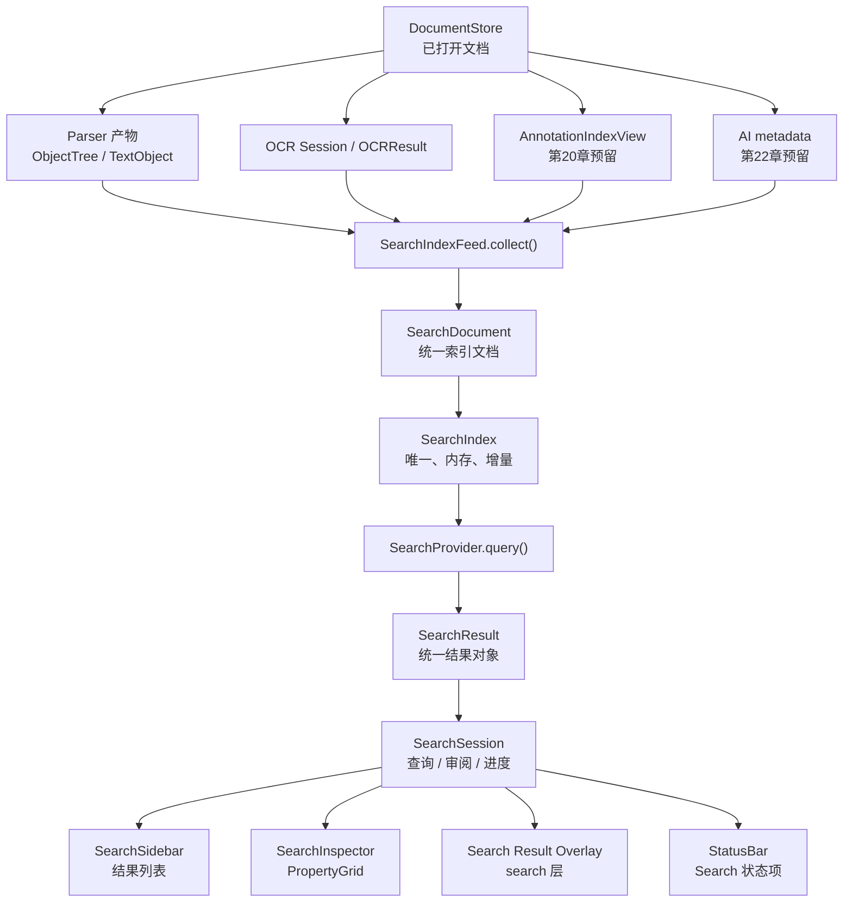
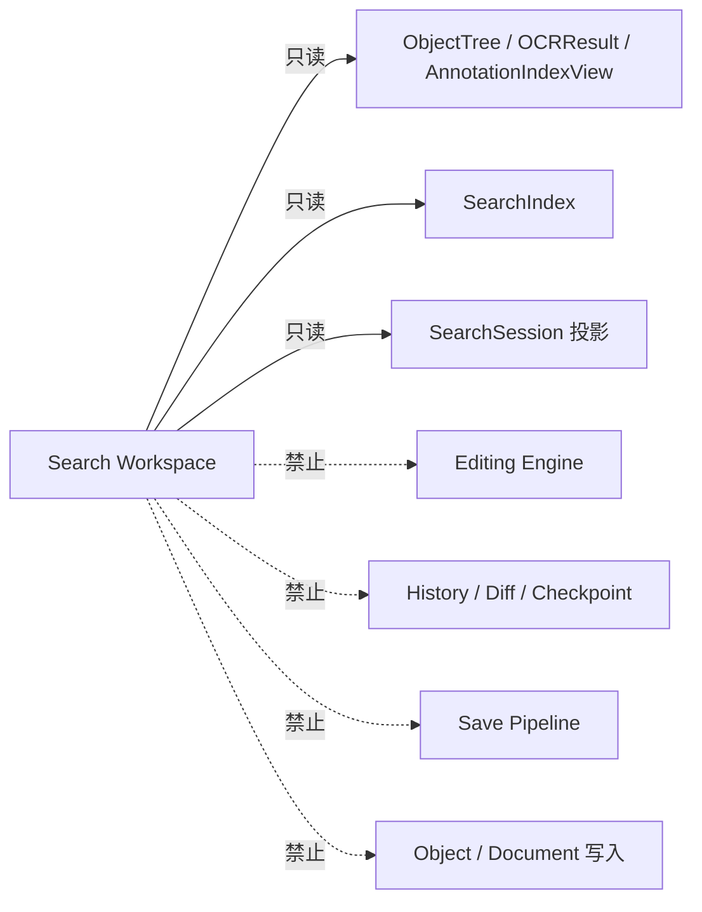

# 规范 22 · 第21章 Search Workspace R1

Version：R1.0
Compatible with: Architecture Freeze **R1.1**
Scope：Search Workspace / Search Provider / Search Index / Search Session / Search Review / Desktop Search Framework
Status：RFC Freeze
Depends：`00` / `01` / `02` / `03` / `04` / `05` / `07` / `08` / `10` / `15` / `16` / `18` / `19` / `20` / `21`

> 文件编号 22，对应标题中的“第21章”。沿用 18C C-7 与 21 章 C-1：章节标题编号与 `docs/spec/` 文件编号允许错位，但不得反向修改既有规范。
>
> 编制说明：用户原文在“三、整体架”处截断。本规范依据已给的定位、章节目标、AD-01~AD-15，以及 `00` / `16` / `18` / `19` / `20` / `21` 的冻结约束补齐；所有推断项均在 C 表中显式裁决。若后续补充原文，以补充原文为准，按 R1.1 补录，不重写本章冻结链。

---

## 一、章节定位（Why）

### 1. 为什么需要这一章

第19章完成 OCR Workspace，并把 Desktop UI 冻结为 V1.0；第20章完成 Annotation Workspace RFC。至此，文档工作台已经具备三条只读数据来源：

- Parser 产出的 Object Tree 与 TextObject；
- OCR Session / OCRResult；
- Annotation Object / AnnotationMeta（第20章预留）。

如果没有统一 Search Workspace，后续必然出现四套搜索：

1. PDF 文本一套；
2. OCR 结果一套；
3. 批注内容一套；
4. AI / Plugin 再各建一套索引与结果面板。

这会造成第二套 Sidebar、第二套 Overlay、第二套 Inspector、第二套 History，甚至第二套保存路径。第21章的目的不是“加一个搜索框”，而是建立整个 Document Workbench 唯一的 **Search Workspace**，让全文、OCR、批注、AI 全部复用同一套 Provider、同一份 SearchIndex、同一套 Result 对象与同一套 Desktop Framework。

### 2. 与上一章的关系

- 第19章解决“OCR 结果如何进入 Desktop 并写回对象”；
- 第20章解决“用户批注如何进入 Desktop 并写回对象”；
- 第21章解决“已有内容如何被统一检索、定位、高亮、审阅”，**不解决任何写回**。

三章共享同一条设计范式：

```text
Provider 只产出领域结果
→ Workspace 管会话、索引、审阅
→ 写回只发生在既有 Editing Engine
```

Search 与 OCR / Annotation 的关键区别是：Search 是**纯只读**能力。它不生成 Command，不生成 Diff，不进入 History，不触发 Save，不修改 Object。它只消费已有数据、建立派生索引、返回统一结果。

### 3. 完成后解决什么问题

完成后解决：

- 搜索入口分散：统一到 Search Workspace；
- 搜索索引分叉：统一为唯一 SearchIndex；
- 搜索结果结构分叉：统一为 SearchResult；
- 搜索高亮绕过 Overlay：统一注册 `search` 层；
- 搜索属性面板分叉：统一 PropertyGrid；
- 搜索历史误入文档 History：明确为查询历史，不是 Undo/Redo 历史；
- 后台索引阻塞 UI：统一后台线程 + 只读状态轮询；
- 后续 AI / Plugin 无扩展点：统一 Provider + Feature 注册。

---

## 二、章节目标（Goal）

本章完成：

- ✔ Search Workspace
- ✔ Search Provider
- ✔ Search Index
- ✔ Search Session
- ✔ Search History
- ✔ Search Review
- ✔ Search Sidebar
- ✔ Search Inspector
- ✔ Search Result Overlay
- ✔ Global Search
- ✔ Incremental Index
- ✔ Background Index
- ✔ Desktop Search Framework 冻结

其中：

- “Search History”是**查询历史**，不是文档 Undo/Redo History；
- “Search Review”是**只读结果审阅**，不是文档批注审阅，不写 Object；
- “Search Sidebar”是 Search Workspace 内部结果侧栏，不是第二套全局 Left Sidebar；
- “Search Inspector”是向 InspectorRegistry 注册的 PropertyGrid 分区，不是独立属性面板；
- “Search Result Overlay”是 OverlayRegistry 的 `search` 层贡献，不是第二套 Overlay；
- “Search Index”是派生缓存，不是 Store，不是真值源，不持久化。

---

## 三、Architecture Freeze（AD-01 ~ AD-15）

| 编号 | 强制裁决 | 落地口径 |
|---|---|---|
| **AD-01** | Search 不得修改 Editing Engine。统一：只读。 | Search 不生成 `EditingCommand`，不进入 WorkingCopy / Commit / FontPatch / ContentPatch；不修改 `EditingSession`。所有结果只用于定位、高亮、跳转、审阅。 |
| **AD-02** | Search 不得新增第二套 Sidebar。统一：Workspace。 | 只新增 `SearchWorkspace` 分类与内部 `SearchSidebar` 结果侧栏；全局 `WorkspaceNav` 仍只有一套，不新增 Dock Window，不新增第二套 Left Sidebar。 |
| **AD-03** | Search 不得新增 Overlay。统一：Overlay Framework。 | 只向 `OverlayRegistry` 注册 `search` 层贡献；禁止 Search 自建 Canvas、自管 z-order、直接绘制高亮框。 |
| **AD-04** | Search 不得新增 History。统一：History Framework。 | Search 不创建 `SearchHistoryStore`、不维护 Undo/Redo cursor、不生成 `CommandRecord`。查询历史是 UI 偏好，不是文档 History。 |
| **AD-05** | Search 不得新增 Inspector。统一：PropertyGrid。 | 只注册 `InspectorContribution`，复用统一 PropertyGrid；禁止 `SearchPropertyPanel` 之类独立面板。 |
| **AD-06** | Search 不得直接修改 Object。只能：定位、高亮、跳转。 | 不调用 `Object::mark_modified`，不改变 `ObjectLifecycle`，不递增 `Object.version`，不写 `Document`。定位与高亮只消费只读投影。 |
| **AD-07** | Search 不得重新解析 PDF。统一：消费 Parser、OCR、Annotation 已有数据。 | 只消费 `ObjectTree` / `TextObject`、`OCRResult`、`AnnotationIndexView`；禁止 Search 内新建 Parser、禁止调用 lopdf 重新解析、禁止以 PDF.js 文本层另建搜索路径。 |
| **AD-08** | Search Index 必须唯一。禁止 OCR 一套、Annotation 一套、AI 一套。统一：SearchIndex。 | 全项目只有一个 `SearchIndex` 类型、一个索引实例；OCR / Annotation / AI 只向它贡献 `SearchDocument`，不得持有自己的索引。 |
| **AD-09** | 全文搜索、OCR 搜索、批注搜索、AI 搜索统一走 Provider。 | 四类查询全部实现统一 `SearchProvider` trait；UI 与 Session 不得出现 `if source == OCR` 之类的硬编码分支。 |
| **AD-10** | Workspace 禁止新增 Ribbon 页签。统一注册 Feature。 | 不新增 Ribbon 页签、不新增主工具栏；Search 入口注册为既有 Home 页签下的 `search.open` 命令与 `Ctrl+F` 快捷键；Search Workspace 内部 Toolbar 只属于 Workspace。 |
| **AD-11** | Provider 可扩展。不得绑定具体搜索实现。 | `SearchProvider` / `SearchIndexFeed` 只依赖统一类型与只读索引；新增 Provider 不改 Search Workspace、不改 SearchIndex、不改 UI 分派。 |
| **AD-12** | 所有搜索结果统一 Result 对象。禁止各模块维护独立结果结构。 | 全项目只有 `SearchResult`；禁止 `OcrSearchResult` / `AnnotationSearchResult` / `AiSearchResult`。Provider 返回前必须映射为统一结果。 |
| **AD-13** | Desktop Framework 不允许新增第二套状态栏、工具栏、右键菜单。 | StatusBar / ContextMenu / Toolbar 全部走既有 Registry；Search 只注册 StatusItem、ContextMenuProvider 与 Workspace 内部 Toolbar，不新增第二套壳层。 |
| **AD-14** | 所有后台索引必须异步。不得阻塞 UI。 | 索引在后台线程按页分批执行；IPC 同步返回 `Indexing` 快照；UI 只读轮询 `search_status`；禁止在 UI 线程做全量索引，禁止 Tauri `async command` 造成入口异常。 |
| **AD-15** | Search Workspace 完成后正式冻结。 | Provider / Index / Session / Result / Workspace / Overlay / Inspector / History 口径冻结；后续 AI / Plugin 只能注册 Provider 或 Feature，不得改本章链路。 |

### 3.1 冲突裁决（C-1 ~ C-16）

| 编号 | 冲突 | 裁决 |
|---|---|---|
| C-1 | 用户要求 `Search Sidebar`，AD-02 又禁止第二套 Sidebar | `SearchSidebar` 是 Search Workspace 内部的结果侧栏，归属 Workspace 面板，不是全局 `WorkspaceNav`，不是 DockPane，不是第二套 Left Sidebar。全局导航仍只有一套。 |
| C-2 | 16 章写“固定分类”，本章又要求新增 Search Workspace | 16 章 §三的十类是 R1.0 基线，同节同时规定“每新增能力 → 新增 Workspace”。本章按 18B AD-18 / C-4“Search 作为 Workspace 分类接入”追加第 11 类 `search`；不改六区布局、不新增 Dock Window、不新增 Ribbon 页签，并在 16 的 R1.1 变更记录中补录，不改既有分类语义。 |
| C-3 | 用户要求 Search History，AD-04 又禁止新增 History | Search History 是**查询历史**（最近查询、范围、来源、时间），上限 50 条，只由 UI `SearchController` 管理与 `localStorage` 持久化；Core 不持历史、不落盘、不生成 `CommandRecord`，不参与 Undo/Redo。 |
| C-4 | 用户要求 Search Review，AD-06 又规定只读 | Search Review 是结果相关性审阅：`Pending / Relevant / Irrelevant`，只影响当前 SearchSession 的排序与筛选；不写 Object、不进 History、不触发 Save。需要修改内容时，跳转到 OCR / Annotation Workspace，由各自 Editing Command 处理。 |
| C-5 | AD-08 要求唯一 Index，但 OCR / Annotation / AI 各有数据 | OCR / Annotation / AI 只提供只读 `SearchDocument` 贡献，不持有索引；唯一 `SearchIndex` 统一存储。禁止 `OcrIndex` / `AnnotationIndex` / `AiIndex` 作为独立索引类型。 |
| C-6 | 用户要求 Global Search，架构只有 Session / DocumentStore | “Global”限定为**当前 Session 内所有已打开文档**，数据来自 `DocumentStore`；不做磁盘全盘扫描、不做资料库/云端搜索、不新建 Store。切换 Session 时清空并重建索引，禁止跨 Session 共享 DocumentStore 或索引。 |
| C-7 | 搜索索引需要快速启动，但新增持久化索引会变成第二 Store | R1.0 的 `SearchIndex` 只驻留进程内存，文档打开时重建，文档关闭时移除；不落盘、不持久化、不做磁盘缓存。持久化索引属未来 R2.0，不在本章。 |
| C-8 | Stage 2 曾规定 PDF.js 前端搜索，AD-07 又禁止重新解析 PDF | Search Workspace 不调用 PDF.js 文本搜索，不把 PDF.js find 暴露为第二套 UI；PDF.js 只负责渲染。统一索引来自 Parser 的 `ObjectTree`。Stage 2 的 PDF.js find 保留为历史能力，但不作为 Search Workspace 实现路径。 |
| C-9 | `Ctrl+F` 当前被 OCR 结果内检索占用 | 第20章 C-7 的 `Ctrl+F=OCR 内检索`是 R1.0 占位裁决；第21章按用户当前路线正式接管 `Ctrl+F` 为 Global Search，OCR 结果内检索迁移到 `Ctrl+Shift+F` 或 OCR Workspace 内按钮。不修改第20章规范正文，只在 16 章 R1.1 变更记录与 Desktop Capability Matrix 补录。仍由 ShortcutRegistry 注册，不新增第二套快捷键系统；AT-20 的“冻结文件零 diff”指 18/19/20 规范文件零 diff，不禁止本章允许的命令与快捷键实现变更。 |
| C-10 | 用户要求 Search Provider，AD-08 又要求唯一 Index，容易出现 Provider 自建索引 | `SearchProvider` 只负责查询；`SearchIndexFeed` 只负责向唯一索引贡献文档。两者可由同一内建 Provider 实现，但都不得持有独立索引。 |
| C-11 | Search 需要“执行”，但执行链固定为 Action → Command → Task → Driver → Runtime | Search 是只读投影路径，不是 Command / Task；与 16 章 C-8 的 `get_object_tree` 只读投影同类，不进入执行链、不生成 Diff、不写 History。`Capability::Search` 只用于能力门控。 |
| C-12 | 00 章已冻结 `Capability::Search`，本章是否新增 Capability | 不新增 Capability 变体。Search 是只读投影路径，不生成 Task、不构造 `ExecutionContext`、不调用 Capability Gate；门控直接读取 `Document.declared_capabilities`（00 §6.1.2 的 Capability 来源），叠加运行期可用性（对象树是否加载、索引是否就绪、OCR/Annotation 是否有投影）。C-12 与 §6.1 统一表述为“声明能力 + 运行期可用性”，不再使用“有效 capability set”以免暗示从 Context 取。加密/权限受限文档不索引，属 Out Of Scope。 |
| C-13 | 用户要求 Search Framework，但 00 §10 固定 Cargo Workspace 成员，不含 `dw-search` | 不新增 crate，不触发 R2.0。Search 落在 `crates/dw-core/src/search/` 模块；`SearchProvider` / `SearchIndex` / `SearchSession` 均属 `dw-core`。OCR / Annotation / AI 的映射适配放 Desktop 组装层，只产出 `SearchDocument`，不形成第二业务层。 |
| C-14 | 16 章 §十三把“21”分配给 AI Workspace，本章标题是第21章 Search | 16 章该表是旧路线记录；18C C-7 已声明不锁定后续章节编号。按用户当前路线：21 Search / 22 AI / 23 Plugin / 24 Collaboration。只补记录，不改 16 既有内容。 |
| C-15 | 16 章 §六冻结 Overlay 顺序，本章又要新增 Search 层 | 16 章顺序是 R1.0 基线；18B AD-10 明确允许后续 Search 注册 Overlay。本章新增 `search` 层，`order=15`，固定在 Text 与 Selection 之间；既有层 id / order 一律不变，并在 16 的 R1.1 变更记录补录。 |
| C-16 | Core 需要 `SearchProviderRegistry`，18B 又要求唯一 `registerFeature` | `SearchProviderRegistry` 是 **Core 内部**的 Provider 声明表，不是 Desktop 第十一类 Framework Registry；Desktop 只通过 `registerFeature()` 注册 Search 的 UI 贡献（命令、快捷键、Inspector、Overlay、StatusItem）。Core Provider 仍由组装层注入，不新增 UI 注册表。 |

---

## 四、数据流（必须画图）

### 4.1 索引流



读法：

1. 索引只消费已打开文档的只读投影；
2. 所有来源统一映射为 `SearchDocument`；
3. 唯一 `SearchIndex` 负责存储与增量更新；
4. 查询只通过 `SearchProvider`；
5. 结果统一为 `SearchResult`；
6. UI 只消费 SearchSession 投影，不写真值。

### 4.2 只读边界



Search 的“执行”是查询与索引，不是文档操作。它不产生 Command，不产生 Task，不产生 Diff，不进入 History，不触发 Save。

---

## 五、目录结构

```text
D:\DocumentWorkbench\
├─ crates\dw-core\src\
│  └─ search\                     # 不新增 Cargo Workspace 成员
│     ├─ mod.rs                  # SearchProvider / SearchIndex / SearchSession 导出
│     ├─ types.rs                # SearchSource / SearchDocument / SearchResult / SearchQuery
│     ├─ provider.rs             # SearchProvider trait + SearchProviderRegistry
│     ├─ index.rs                # SearchIndex 唯一索引 + SearchIndexView 只读视图
│     ├─ indexer.rs              # SearchIndexFeed + 后台分批索引
│     ├─ session.rs              # SearchSession 状态机 / 进度 / Review
│     ├─ query.rs                # 规范化、子串匹配、排序、截断
│     └─ providers\
│        ├─ pdf_text.rs          # 消费 ObjectTree.TextObject
│        ├─ ocr.rs               # 消费 OCR 适配后的 SearchDocument
│        ├─ annotation.rs        # 消费 Annotation 适配后的 SearchDocument
│        └─ ai.rs                # 预留，R1.0 is_available=false
│
├─ crates\dw-core\tests\
│  └─ search_core_tests.rs
│
├─ apps\dw-desktop\src\
│  ├─ search_ipc.rs              # search_* 命令组装层；SearchIpcState 不是 Manager
│  ├─ search_adapters.rs         # OCR / Annotation / AI → SearchDocument 只读适配
│  └─ lib.rs                     # 注册 search_* 命令
│
└─ ui\src\
   ├─ ipc\search.ts              # search_* IPC 前端封装
   ├─ search\
   │  ├─ searchController.ts
   │  ├─ searchHistory.ts        # 查询历史，仅 UI + localStorage
   │  ├─ searchFeature.tsx       # 唯一 registerFeature 入口
   │  ├─ SearchWorkspace.tsx
   │  ├─ SearchSidebar.tsx
   │  ├─ SearchInspector.tsx
   │  └─ SearchOverlay.tsx
   ├─ components\ui\Icon.tsx      # 新增 search 图标名
   ├─ components\workspace\workspaces.ts  # 新增 search 分类
   └─ framework\builtins.tsx              # 注册 search 命令 / 快捷键 / 状态项
```

目录约束：

- 禁止出现 `SearchManager` / `SearchStore`；
- `SearchIpcState` 只是 IPC 组装状态，不是第 4 个 Manager；
- `SearchIndex` 不持久化，不是 Store，不是 Session 六成员；
- 查询历史只在 UI `searchHistory.ts`，Core 不建 `history.rs`、不持 `CommandRecord`；
- `dw-core::search` 不依赖 `dw-ocr` / `dw-annotation` 具体类型；OCR / Annotation / AI 在 Desktop 适配层映射为 `SearchDocument`；
- Desktop 不新增第十一类 Framework；
- 不新增第二套 Overlay / Inspector / StatusBar / Toolbar / ContextMenu。

---

## 六、Provider（统一）

### 6.1 内建 Provider

| Provider | 来源 | 索引内容 | 可用条件 |
|---|---|---|---|
| `PdfTextSearchProvider` | Parser 的 `ObjectTree` / `TextObject.unicode` | 文本、页码、ObjectId、BBox | 文档声明 `Capability::Search` 且对象树已加载 |
| `OcrSearchProvider` | 现有 `OCRResult`（适配为 `SearchDocument`） | 文本、置信度、页码、BBox、来源对象 | 当前文档已有 OCR 结果；不调用 OCR 引擎 |
| `AnnotationSearchProvider` | `AnnotationIndexView`（适配为 `SearchDocument`） | 评论文本、类型、Review 状态、页码、BBox | 当前文档已有批注索引投影；不修改批注 |
| `AiSearchProvider` | 第22章 AI 元数据（适配为 `SearchDocument`） | 预留 | R1.0 `is_available=false`，不假装可用 |

统一规则：

- 全文搜索、OCR 搜索、批注搜索、AI 搜索全部走 Provider；
- Provider 不可用时只禁用，不隐藏，不返回伪造结果；
- Provider 不得写 Object、不得写盘、不得进 History、不得调用 Save；
- Provider 不得自建索引、不得持有 `SearchIndex` 副本；
- Provider 不得重新解析 PDF；只消费已解析投影。

### 6.2 统一类型（R1.1 类型补录）

```rust
pub enum SearchSource {
    PdfText,
    Ocr,
    Annotation,
    Ai,
}

pub struct SearchCapabilities {
    pub full_text: bool,
    pub case_sensitive: bool,
    pub whole_word: bool,
    pub page_scope: bool,
    pub global_scope: bool,
    pub review: bool,
}

pub struct SearchIndexContext<'a> {
    pub document_id: u64,
    pub object_tree: Option<&'a ObjectTree>,
    pub ocr_documents: &'a [SearchDocument],
    pub annotation_documents: &'a [SearchDocument],
    pub ai_documents: &'a [SearchDocument],
}

pub struct SearchResultPage {
    pub results: Vec<SearchResult>,
    pub total: usize,
    pub truncated: bool,
    pub index_version: u64,
}

enum SearchError {
    ProviderUnavailable(String),
    IndexNotReady,
    InvalidQuery(String),
    IndexBuildFailed(String),
    Cancelled,
}
```

```rust
impl From<SearchError> for DwError {
    fn from(error: SearchError) -> Self {
        match error {
            SearchError::ProviderUnavailable(message)
            | SearchError::InvalidQuery(message)
            | SearchError::IndexBuildFailed(message) => DwError::Execution(message),
            SearchError::IndexNotReady => DwError::Execution("索引未就绪".to_string()),
            SearchError::Cancelled => DwError::Cancelled,
        }
    }
}
```

约束：

- `SearchError` 是 `dw-core::search` 模块私有错误；公开 trait 边界只返回 `DwError`，由上述 From 实现映射，符合 05 §3.1；
- `SearchIndexContext` 中的 OCR / Annotation / AI 文档必须已经是统一 `SearchDocument`，不允许再引入第二套来源结果结构；
- `SearchResultPage` 是查询返回类型，`truncated` / `index_version` 必须有承载字段，不允许只写在注释里。
- 命名豁免：`SearchProvider` / `SearchProviderRegistry` / `PdfTextSearchProvider` 沿用第19/20章 `OCRProvider` / `AnnotationProvider` 已冻结的 Provider 后缀，是 Core 的声明/查询抽象，不替代 Driver，不属 05 §2.2 禁止的新 Driver 概念，也不新增 Desktop Framework Registry。

### 6.3 统一 trait 口径

```rust
pub trait SearchProvider: Send + Sync + std::fmt::Debug {
    fn name(&self) -> &str;
    fn source(&self) -> SearchSource;
    fn is_available(&self) -> bool;
    fn capabilities(&self) -> SearchCapabilities;
    fn query(
        &self,
        query: &SearchQuery,
        view: &SearchIndexView,
    ) -> Result<Vec<SearchResult>, DwError>;
}

pub trait SearchIndexFeed: Send + Sync + std::fmt::Debug {
    fn source(&self) -> SearchSource;
    fn collect(
        &self,
        ctx: &SearchIndexContext,
    ) -> Result<Vec<SearchDocument>, DwError>;
}
```

约束：

- `SearchProvider` 只查询，不写索引；`SearchIndexView` 只暴露绑定到本 Provider `source` 的只读视图，Provider 不能读其他来源；
- `SearchIndexFeed` 只产出 `SearchDocument`，不持有索引；
- 内建 Provider 可同时实现两个 trait，但职责仍分离；
- `SearchProviderRegistry` 是 `dw-core` 内部 Provider 声明表，不是 Desktop 第十一类 Framework Registry；
- 只注册 Provider 声明，不持有搜索结果或文档真值；重复 id 注册报错，禁止静默覆盖；
- AI / Plugin 后续 Provider 必须实现同一 trait，经 Core 组装层注册；Desktop 只 `registerFeature()` 注册 UI 贡献。

### 6.4 可用性裁决

| 场景 | 行为 |
|---|---|
| 文档无 `Capability::Search` | `PdfTextSearchProvider` 禁用，StatusBar 显示“不支持搜索” |
| 对象树未加载 | Provider 通过 `DwError::Execution` 返回“索引未就绪”，`SearchSession.error` 记录 `IndexNotReady`，UI 显示索引进度 |
| OCR 未运行 | `OcrSearchProvider` 禁用，不自动触发 OCR |
| Annotation 未实现 / 无索引 | `AnnotationSearchProvider` 禁用，不伪造结果 |
| AI 未接入 | `AiSearchProvider` 禁用，R1.0 不调用任何模型 |
| Provider 运行失败 | 只影响该来源，其他来源继续；错误进入 SearchSession.error |

---

## 七、Search Index（唯一）

### 7.1 统一文档对象

```rust
pub struct SearchDocId {
    pub document_id: u64,
    pub source: SearchSource,
    pub page: u32,
    pub object_id: Option<u64>,
    pub item_id: u64, // 来源内稳定序号：OCR 结果序号 / Annotation id / 文本 run 序号
}

pub struct SearchDocument {
    pub id: SearchDocId,
    pub text: String,
    pub bbox: Option<BBox>,
    pub confidence: Option<f64>,
    pub provider: String,
    pub revision: u64,
}

pub struct SearchResultId {
    pub document: SearchDocId,
    pub match_start: u32,
}
```

约束：

- `SearchDocId` 是稳定键，派生 `Ord + Hash`；`item_id` 保证同一页多条 OCR / 批注 / 文本 run 不互相覆盖；同一 `document_id + source + page + object_id + item_id` 只保留一条；
- `SearchDocument` 是唯一索引文档，不是第二套 OCRResult / AnnotationObject；
- OCR / Annotation / AI 的字段必须映射到该结构，不得新增 `OcrSearchDocument` 等类型；
- `bbox` 来自 Object / OCRResult / Annotation 投影，不由 Search 计算 PDF 几何；
- `revision` 用于增量更新与陈旧结果检测。

### 7.2 索引结构

```rust
pub struct SearchIndex {
    docs: BTreeMap<SearchDocId, SearchDocument>,
    postings: BTreeMap<String, Vec<SearchDocId>>,
    version: u64,
}

pub struct SearchIndexView<'a> {
    index: &'a SearchIndex,
    source: SearchSource,
}

impl SearchIndexView<'_> {
    pub fn version(&self) -> u64;
    pub fn query(&self, query: &SearchQuery) -> Vec<SearchResult>;
}
```

约束：

- 全项目唯一索引实例，同一时刻只服务**当前活动 Session**；按该 Session 的所有已打开文档建立；
- 切换 Session 时清空并重建，禁止跨 Session 共享 `DocumentStore` 或索引；
- `SearchIndex` 是派生缓存，不是 Session 六成员，不是 Store；由 `SearchIpcState` 持有，不进入 `DocumentStore` / `CheckpointStore` / `TabStore`；
- `SearchIndex` 字段全私有；`SearchIndexView` 是唯一只读入口，且绑定单一 `source`，Provider 不能读其他来源；
- `version` 每次 upsert / remove 递增；
- 查询结果携带 `index_version`，UI 可判断是否陈旧；
- 不持久化、不落盘、不写 Recovery、不写 Checkpoint；
- 文档关闭时 `remove_document(document_id)`，不得残留；
- 索引构建失败只影响 Search，不得把 Document 标记为 Dirty。

### 7.3 增量失效

| 触发 | 索引范围 | 动作 |
|---|---|---|
| 文档打开 | 全文档 | `collect` 全量，分批写入 |
| Object 修改 / Undo / Redo | 受影响页 | 删除该页旧文档，重新收集 |
| OCR Apply 后对象变化 | 受影响页 | 重建 PDF 文本 + OCR 文档 |
| OCR 结果新增 / 删除 | 受影响页 | 更新 OCR 文档 |
| Annotation Review / Reply / Resolve | 受影响对象 | 更新 Annotation 文档 |
| 文档关闭 | 全文档 | 移除该文档全部文档 |
| Save | 不触发 | Save 不改变文本；对象变化已由 Object 事件覆盖 |
| Search 查询 / Review | 不触发 | 只读，不改索引 |

约束：

- 增量更新必须幂等；重复触发不产生重复文档；
- 索引更新在后台线程执行，UI 只读进度；
- 不允许 Search 监听并写入 Document / History；
- 事件来源优先复用既有只读事件游标；若事件缺失，按文档 revision / page revision 差异补齐，不新增 EventBus。

---

## 八、Search Session

### 8.1 状态机

```rust
pub enum SearchSessionState {
    Idle,
    Indexing,
    Ready,
    Searching,
    Paused,
    Completed,
    Cancelled,
    Failed,
}
```

```text
Idle
  → Indexing
      → Ready
          → Searching
              → Completed
      → Paused
          → Indexing
  → Cancelled
  → Failed
```

允许：

- `Idle → Indexing`：开始建立索引；
- `Indexing → Ready`：索引完成；
- `Indexing → Paused`：暂停后台索引；
- `Paused → Indexing`：继续；
- `Ready → Searching`：提交查询；
- `Searching → Completed`：查询完成；
- `Completed → Searching`：新查询；
- `Ready → Indexing` / `Completed → Indexing`：文档变化触发增量重建；
- `Cancelled → Indexing` / `Failed → Indexing`：重新开始或重试；
- 任意活动态 → `Cancelled` / `Failed`。

禁止：

- `Idle → Searching`（索引未就绪）；
- `Indexing → Searching`（必须先 Ready）；
- `Paused → Searching`（必须先继续并完成索引）；
- `Cancelled → Searching`（必须重新开始）；
- 任何状态直接写 Document。

### 8.2 会话对象

```rust
pub struct SearchProgress {
    pub completed_documents: usize,
    pub total_documents: usize,
    pub completed_pages: usize,
    pub total_pages: usize,
}

pub enum SearchReviewDecision {
    Pending,
    Relevant,
    Irrelevant,
}

pub struct SearchReview {
    pub decisions: BTreeMap<SearchResultId, SearchReviewDecision>,
}

pub struct SearchSession {
    pub id: u64,
    pub state: SearchSessionState,
    pub query: SearchQuery,
    pub result_page: SearchResultPage,
    pub active_result: Option<SearchResultId>,
    pub review: SearchReview,
    pub progress: SearchProgress,
    pub error: String,
    pub index_version: u64,
}
```

约束：

- `SearchSession` 是 Workspace 投影，不是第二真值源；
- 不新增 `SearchManager`，也不加入 Session 固定六成员；由 `SearchIpcState` 持有，随活动 Session 切换清空；
- `SearchIndex` 可跨 Search Workspace 开关保留，但 Session 切换 / 文档关闭时必须清理对应文档；
- `result_page` 是查询结果快照，不是 Document 数据；
- `active_result` 只是当前导航位置，不写 `SelectionState`；
- `error` 只描述 Search 失败，不改变 DocumentSaveState；
- 关闭 Search Workspace 不销毁 Document / History / OCR / Annotation 状态；
- Desktop 组装层只持有 `SearchIpcState { session, index, providers, next_session_id }`；它是 IPC 组装状态，不是 Manager / Store。

### 8.3 后台索引执行形态

与第19章 OCR 保持一致：

1. `search_index_start` 是同步 Tauri command，立即返回 `Indexing` 快照；
2. 后台线程按页分批收集、写入唯一索引；
3. UI 通过只读 `search_status` 轮询进度；
4. `search_index_pause` / `search_index_resume` / `search_index_cancel` 修改 `SearchSession` 状态，不修改文档 Session；
5. 禁止改回 Tauri `async command`；本机曾触发 `STATUS_ENTRYPOINT_NOT_FOUND`；
6. 禁止在 UI 线程做全量索引；
7. 禁止用 `setTimeout` 轮询代替 Core 状态，轮询只读投影。

---

## 九、Search Query 与 Result

### 9.1 查询对象

```rust
pub enum SearchScope {
    CurrentDocument(u64),
    AllOpenDocuments,
}

pub struct SearchQuery {
    pub text: String,
    pub scope: SearchScope,
    pub sources: Vec<SearchSource>,
    pub page: Option<u32>,
    pub case_sensitive: bool,
    pub whole_word: bool,
}
```

规则：

- R1.0 只做字面量匹配，不做正则、不做模糊、不做语义搜索；
- 默认不区分大小写；`case_sensitive` 只影响拉丁文本；
- `whole_word` 只对拉丁词生效，CJK 按连续子串处理；
- `sources` 为空表示全部可用来源；
- `page` 只在 `CurrentDocument` 下生效；
- 查询文本为空时不发起查询，UI 显示空态。

### 9.2 统一结果对象

```rust
pub struct SearchResult {
    pub id: SearchResultId,
    pub text: String,
    pub snippet: String,
    pub match_start: u32,
    pub match_end: u32,
    pub bbox: Option<BBox>,
    pub confidence: Option<f64>,
    pub source: SearchSource,
    pub provider: String,
    pub score: u32,
}
```

约束：

- 全项目只有 `SearchResult`；禁止模块私建结果结构；
- `SearchResultId` 以 `SearchDocId + match_start` 唯一标识一次命中；同一文档 / 页允许多条结果，UI key 与 Review 都必须用它；
- `match_start` / `match_end` 统一使用规范化文本内的 **Unicode 字符偏移**（不是字节偏移），并与 `snippet` 使用同一规范化规则；
- `snippet` 由 Search 生成，最多 80 字符，保留命中上下文；
- `score` 由 Provider 统一排序：精确匹配 > 前缀匹配 > 子串匹配；同分按文档、页、BBox 排序；
- `confidence` 只对 OCR 来源有意义，其他来源为 `None`；
- `bbox` 缺失时仍可返回结果，但 UI 不画高亮，只显示列表；
- 结果数量上限 500；超过时返回 `SearchResultPage.truncated=true`，UI 提示缩小范围；
- 查询入口统一返回 `SearchResultPage`，携带 `total` / `truncated` / `index_version`。

### 9.3 查询执行

- 索引 `Ready` 时，`search_query` 同步返回 `SearchResultPage`；查询只读内存索引，不解析 PDF；
- 多 Provider 查询由 `SearchSession` 统一调度：逐个 Provider 查询 → 合并 → 去重 → 排序 → 截断；禁止 UI 直接聚合 Provider；
- 索引 `Indexing` 时，返回 `SearchSession.state=Indexing` 与进度，不阻塞等待；
- 查询失败只写 `SearchSession.error`，不改变文档状态；
- 查询不得触发 OCR、Annotation、AI 或 Save；
- 查询不得写 `SelectionState`；当前结果只存在 `SearchSession.active_result`。

---

## 十、Global Search

“Global”定义为**当前 Session 内所有已打开文档**，不是磁盘全盘搜索。

| 范围 | 数据来源 | 结果组织 |
|---|---|---|
| 当前文档 | 当前 `DocumentStore` 文档 | 按页、来源分组 |
| 全部已打开文档 | `DocumentStore` 全部文档 | 按文档 → 页 → 来源分组 |

约束：

- 不扫描文件系统、不扫描未打开文档、不访问云端、不访问资料库；
- 不新增 `GlobalSearchStore`；文档列表来自既有 `DocumentStore`；
- 文档关闭后立即从索引与结果中移除；
- 文档切换不重建全量索引，只切换查询范围；
- 跨文档结果跳转使用既有文档页签切换与页面定位，不新开第二套 Viewer。

---

## 十一、Search Workspace 与 Search Sidebar

### 11.1 Workspace 结构

```text
SearchWorkspace
├─ SearchToolbar     # 查询框 / 范围 / 来源过滤
├─ SearchSidebar     # 查询历史 + 结果列表（Workspace 内部）
└─ 结果详情交给全局 Inspector
```

约束：

- `SearchWorkspace` 是 Workspace 分类，不是浮动 Dock、不是新窗口；
- `SearchSidebar` 是 Workspace 内部结果侧栏，不是全局 `WorkspaceNav`；
- 不新增第二套 Left Sidebar、不新增 DockPane；
- Canvas 仍是唯一 PDF.js 渲染区；Search 不接管 Canvas；
- 选中结果只做页面定位与高亮，不修改 SelectionState；
- 空态、加载态、错误态统一使用 PanelEmpty / Skeleton / ErrorPanel。

### 11.2 Workspace 注册

- `WorkspaceKind` 新增 `search`；
- `WORKSPACES` 新增 `{ id: 'search', label: '搜索', icon: 'search', enabled: true }`；
- `Icon.tsx` 的 `IconName` / `GLYPHS` 新增 `search` 图标；不得在组件内散落图标字符；
- `workspaces.ts` 注释从“固定十类”改为“固定分类，新增能力追加”，与 16 §三“每新增能力 → 新增 Workspace”一致；
- 顺序放在 `objects` 之后、`ocr` 之前；
- 不新增 Ribbon 页签；`search.open` 注册在既有 Home 页签；
- `Ctrl+F` 打开/聚焦 Search Workspace；
- `Esc` 关闭 Search Workspace，返回上一 Workspace；
- Search Workspace 内部 Toolbar 只放查询、范围、来源、清空、关闭，不放文档写操作。

### 11.3 Search Sidebar

| 区域 | 内容 | 约束 |
|---|---|---|
| 查询历史 | 最近 50 条查询 | 可点击回填、可清空；不存文档内容 |
| 来源过滤 | PDF / OCR / Annotation / AI | 不可用来源禁用并显示原因 |
| 结果列表 | 文档 → 页 → 来源分组 | 虚拟列表；显示 snippet / 页码 / 来源 / 置信度 |
| 结果操作 | 定位、复制文本、复制引用、打开来源 Workspace | 不提供编辑、替换、删除 |
| 空态 | 无查询 / 无结果 / 索引中 | 统一 PanelEmpty / Skeleton / Progress |

---

## 十二、Search Inspector

统一注册 `InspectorContribution`，只在 Search Workspace 或选中结果时显示。

| 字段 | 来源 | 可编辑 |
|---|---|---|
| 来源 | `SearchResult.source` | 否 |
| Provider | `SearchResult.provider` | 否 |
| 文档 / 页码 | `SearchDocId.document_id` / `page` | 否 |
| ObjectId | `SearchDocId.object_id` | 否 |
| 文本片段 | `SearchResult.snippet` | 否 |
| 完整文本 | `SearchResult.text` | 否（只读） |
| BBox | `SearchResult.bbox` | 否 |
| 置信度 | `SearchResult.confidence` | 否 |
| 来源 Review 状态 | `AnnotationMeta.review`（第20章） | 否 |
| Search Review 状态 | `SearchReview` | 仅会话内审阅 |
| 索引版本 | `SearchSession.index_version` | 否 |

约束：

- 复用统一 PropertyGrid，不新增独立属性面板；
- 所有字段只读；Review 按钮只改 SearchSession，不写 Object；
- 多选结果只显示共有字段；
- 无结果时 Inspector 不显示 Search 分区，不占位。

---

## 十三、Search Result Overlay

### 13.1 层顺序

在既有 Overlay 顺序中新增 `search` 层，位置固定在 Text 与 Selection 之间：

```text
PDF → Text → Search → Selection → Editing → Annotation → OCR → AI → Debug
```

对应 order：

```text
text=10, search=15, selection=20, editing=30,
annotation=40, ocr=50, ai=60, debug=70
```

约束：

- 只向 `OverlayRegistry` 注册 `search` 层贡献；
- 不新增 OverlayManager，不改 Canvas 绘制；
- Search 高亮不覆盖 Selection 框、Caret、OCR BBox、Annotation 图形；
- 当前命中结果使用强调色，其他结果使用弱强调色；
- 颜色只走 `--dw-*` Token，不写字面色值；
- 动画使用 `--dw-motion-fast` / `--dw-motion-normal`；
- 高亮只读，不写 SelectionState、不写 Object、不写 History。

### 13.2 定位与跳转

- 点击结果 → 切换文档（如跨文档）→ 滚动到页 → 高亮 BBox；
- 有 `object_id` 时可调用既有只读 focus，不写 Selection；
- 无 BBox 时只滚动到页并显示列表选中态；
- 不新开 Viewer、不新开窗口、不复制 PDF 页面；
- `Enter` 下一个结果，`Shift+Enter` 上一个结果，`Esc` 关闭 Search。

---

## 十四、Search History（查询历史）

查询历史只存在于 UI 层，由 `ui/src/search/searchHistory.ts` 管理；Core 不定义 `SearchHistory` 类型，不持历史、不落盘。

```ts
type SearchSource = 'pdf' | 'ocr' | 'annotation' | 'ai';
type SearchScope =
  | { kind: 'document'; documentId: number }
  | { kind: 'allOpen' };

interface SearchHistoryEntry {
  query: string;
  scope: SearchScope;
  sources: SearchSource[];
  at: string;
}
```

约束：

- 上限 50 条，超出淘汰最旧；
- 只存查询文本、范围、来源、时间；不存文档内容、不存结果、不存 BBox；
- 只存 UI `localStorage`（`dw.search.history.v1`），不写入 `SearchSession`、不写入 Core；
- 不进入文档 History，不生成 `CommandRecord`，不参与 Undo/Redo；
- 清空历史只清 UI 偏好，不影响文档、索引、结果；
- 不跨设备同步，不上传云端；
- 单一真值：UI 是查询历史的唯一持有者，Core 不提供历史 API，避免双写。

---

## 十五、Search Review（只读审阅）

| 状态 | 含义 | 行为 |
|---|---|---|
| `Pending` | 未审阅 | 默认 |
| `Relevant` | 与当前查询相关 | 当前会话内提升排序 |
| `Irrelevant` | 与当前查询无关 | 当前会话内降权/折叠 |

约束：

- 只改 `SearchSession.review`，按 `SearchResultId` 记录，不写 Object、不写 AnnotationMeta、不进 History；
- Review 不触发 Save，不改变 DocumentSaveState；
- 需要修改 OCR 文本或批注内容时，跳转对应 Workspace，由 Editing Command 处理；
- Review 结果不持久化，关闭会话即丢弃；
- 不允许 Review 直接“接受并写回”任何内容。

---

## 十六、Context Menu / Notification / StatusBar

### 16.1 Context Menu

结果项与 Search Overlay 统一使用 ContextMenuRegistry：

| 菜单项 | needs | 行为 |
|---|---|---|
| 定位 | `searchResultSelected` | 跳转并高亮 |
| 复制文本 | `searchResultSelected` | 复制 `SearchResult.text` |
| 复制引用 | `searchResultSelected` | 复制文档 / 页 / ObjectId |
| 打开来源 Workspace | `searchResultSelected` | 跳到 OCR / Annotation Workspace |
| 标记相关 / 无关 | `searchResultSelected` | 只改 SearchSession.review |

约束：

- 不硬编码 DOM 菜单；
- 不提供编辑、替换、删除、写回；
- 空白处右键不显示 Search 菜单；
- AI / Plugin 后续只注册 Provider，不新增菜单系统。

### 16.2 Notification

| 事件 | 文案方向 |
|---|---|
| 索引完成 | 已索引 n 个文档 / m 页 |
| 索引失败 | 明确失败原因，可重试 |
| Provider 不可用 | 说明缺少 OCR / Annotation / AI 数据 |
| 无结果 | 建议调整关键词或范围 |
| 索引取消 | 已取消，不提示成功 |

约束：

- 统一 ToastStack，禁止 `alert` / `confirm`；
- 复用只读事件游标或 SearchSession 状态，不新增 EventBus；
- 通知不写真值，不改变查询结果。

### 16.3 StatusBar

注册唯一 StatusItem，显示：

```text
Search: Ready · 12 条 · 3 文档 · Index 100%
```

约束：

- 只显示投影，不含可写控件；
- 索引中显示进度与 Busy；
- 无结果时显示 0；
- 与 OCR / Save / Selection 状态项并列，不新增第二状态栏；
- 状态变化来自 SearchSession 与索引进度。

---

## 十七、Desktop Polish

| 能力 | 第21章落点 |
|---|---|
| Cursor | 索引中 Busy；查询输入 IBeam；结果列表默认 Arrow；不新增光标管理器 |
| Overlay | 只注册 `search` 层贡献；动画与层级统一 |
| Toolbar | Search Workspace 内部 Toolbar；不新增 Ribbon 页签、不新增第二工具栏 |
| Shortcut | `Ctrl+F` 打开/聚焦；`Ctrl+Shift+F` OCR 内检索；`Enter` 下一个；`Shift+Enter` 上一个；`Esc` 关闭 |
| Inspector | 注册 Search 分区；PropertyGrid 只读 |
| ContextMenu | 注册结果项菜单；无第二套右键系统 |
| StatusBar | 注册 Search 状态项；仍只有一个状态栏 |
| Notification | 统一 Toast；无 alert |
| Empty / Error / Loading | PanelEmpty / ErrorPanel / Skeleton / Progress |
| Tooltip | 统一 Tooltip；禁用项写明原因 |
| Theme | 颜色只走 `--dw-*` Token |
| HiDPI | 沿用 `--dw-ui-scale`，不新增窗口缩放逻辑 |

约束：

- 所有新增能力通过 `registerFeature()` 注册；
- 不新增第十一类 Framework；
- 不修改 18B 的十类注册表结构；
- 不新增第二套 Sidebar / Overlay / Inspector / History / StatusBar / Toolbar / ContextMenu。

---

## 十八、Capability Matrix（冻结基线）

> 本章为 RFC 规范，矩阵记录“冻结要求”；实际实现状态由本章实施记录 / 测试报告标记 PASS。

| Capability | Framework 落点 | UI 落点 | 冻结要求 | 验收状态 |
|---|---|---|---|---|
| Search Workspace | Workspace 分类 | SearchWorkspace | ✅ 必须 | 待实现 |
| Search Provider | SearchProviderRegistry | 来源过滤 / Toolbar | ✅ 必须 | 待实现 |
| Search Index | 唯一 SearchIndex | 结果列表 / 进度 | ✅ 必须 | 待实现 |
| Search Session | SessionManager 生命周期 | Controller / StatusBar | ✅ 必须 | 待实现 |
| Search Result | 统一 SearchResult | SearchSidebar / Overlay | ✅ 必须 | 待实现 |
| Search Review | SearchSession.review | 结果项按钮 | ✅ 必须 | 待实现 |
| Search History | UI `searchHistory.ts` + localStorage | SearchSidebar | ✅ 必须 | 待实现 |
| Search Sidebar | Workspace 内部面板 | 查询 / 历史 / 结果 | ✅ 必须 | 待实现 |
| Search Inspector | InspectorRegistry | PropertyGrid | ✅ 必须 | 待实现 |
| Search Result Overlay | OverlayRegistry `search` 层 | Canvas 高亮 | ✅ 必须 | 待实现 |
| Global Search | DocumentStore 范围 | 范围选择 | ✅ 必须 | 待实现 |
| Incremental Index | SearchIndex upsert/remove | 进度 / 状态 | ✅ 必须 | 待实现 |
| Background Index | 后台线程 + 只读轮询 | Progress / Busy | ✅ 必须 | 待实现 |
| StatusBar | StatusRegistry | Search 状态项 | ✅ 必须 | 待实现 |
| ContextMenu | ContextMenuRegistry | 结果项菜单 | ✅ 必须 | 待实现 |
| Notification | ToastStack | 索引 / 查询反馈 | ✅ 必须 | 待实现 |

---

## 十九、测试（AT-01 ~ AT-20）

| 编号 | 层级 | 判据 | 通过标准 |
|---|---|---|---|
| AT-01 | Core | Provider 注册、门控与失败隔离 | PDF / OCR / Annotation 可查询；AI 注册但 `is_available=false`，返回空结果并带原因；重复 id 报错；无 `Capability::Search` 时禁用；单 Provider 失败不影响其他来源 |
| AT-02 | Core | 全项目只有一个 SearchIndex | 运行时单实例；OCR / Annotation / AI 均向同一索引贡献；静态扫描无 `OcrIndex` / `AnnotationIndex` / `AiIndex`；不落盘、不写 Checkpoint / Recovery、不是 Store; 关闭 Search Workspace 后索引保留、重开不重建；切换 Session 时索引清空并重建，旧 Session 结果不跨会话泄漏 |
| AT-03 | Core | SearchDocument 稳定键与增量 upsert/remove | 同一文档 / 来源 / 页 / 对象 / item_id 只保留一条；同页多条 OCR / 批注不互相覆盖；重复触发幂等；删除后不残留；version 单调递增 |
| AT-04 | Core | 查询语义与范围正确 | 当前文档 / 全部已打开文档正确；空文本不发起；`case_sensitive` / `whole_word` / CJK 子串 / `page` 仅当前文档 / `sources` 空=全部；不扫描未打开文件 |
| AT-05 | Core | 增量失效正确且幂等 | Object 修改、OCR Apply、Annotation Review 后结果更新；无陈旧结果；重复事件不产生重复文档；Save / 查询 / Review 不触发索引重建 |
| AT-06 | Core | SearchSession 状态机合法迁移 | Idle→Indexing→Ready→Searching→Completed 通过；Paused→Indexing、Ready/Completed→Indexing、Failed/Cancelled→Indexing 通过；Idle/Indexing/Paused/Cancelled→Searching 被拒 |
| AT-07 | Core | 后台索引不阻塞 UI | 索引期间 UI 可输入 / 滚动；主线程无 >100ms 长任务；进度递增；索引内存设硬上限，超限即停止索引并提示缩小范围，不静默 OOM；Pause / Resume / Cancel 生效 |
| AT-08 | Core | 统一 SearchResult 与截断规则 | 四类来源均返回 `SearchResult`；无模块私建结果结构；跨 Provider 按 `SearchResultId` 去重；`match_start`/`match_end` 为 Unicode 字符偏移（非字节）；结果带 `index_version` 可供 UI 判陈旧；`snippet`≤80；上限 500+`truncated`；score 精确>前缀>子串，同分按文档/页/BBox |
| AT-09 | Core | Search History 不进入文档 History | 查询历史仅 UI，最多 50 条；Core 无 `SearchHistory` 类型；无 CommandRecord；Undo/Redo 不受影响；清空不影响文档 / 索引 |
| AT-10 | Core | Search Review 只读 | 只改 `SearchSession.review`；Relevant 提升排序、Irrelevant 降权/折叠；关闭会话即丢弃；Document / Object / History 零变化 |
| AT-11 | UI | Search Workspace 注册正确 | 新增一个 Workspace 分类，顺序在 objects 后 / ocr 前；`Icon.tsx` 有 search 图标；无新增 Ribbon 页签；全局导航仍一套；Esc 恢复上一 Workspace |
| AT-12 | UI | Search Sidebar 列表 / 分组 / 过滤 / 状态 | 文档→页→来源分组正确；虚拟列表可用；空态 / 加载态 / 错误态齐全；Provider 失败能触发错误态；查询输入防抖 120ms，连续输入只发起最后一次查询 |
| AT-13 | UI | Search Inspector 复用 PropertyGrid | 字段齐全；全部只读；无独立属性面板；无结果不显示分区；多选只显示共有字段 |
| AT-14 | UI | Search Overlay 只注册 `search` 层 | 层 id=`search`、order=15；高亮位置正确；无 BBox 不画高亮；不覆盖 Selection / OCR / Annotation；颜色只走 `--dw-*` Token；Canvas 无直接绘制 |
| AT-15 | UI | Global Search 跨文档 | 跨已打开文档结果正确；关闭文档后结果移除；不访问磁盘 / 云端；切换文档不重建全量索引 |
| AT-16 | UI | ContextMenu / Notification / StatusBar 注册 | 结果菜单项正确；空白处无 Search 菜单；Notification 覆盖完成 / 失败 / 不可用 / 无结果 / 取消；无 alert；只有一个 StatusBar；无结果 0、索引中 Busy |
| AT-17 | IPC | `search_index_start` 同步返回 Indexing | 后台线程分页索引；`search_status` 只读轮询；Pause / Resume / Cancel 可调用；无 async command 入口异常 |
| AT-18 | Integration | 来源统一与溯源 | PDF / OCR / Annotation 结果均带 source / provider / 页码 / BBox（如有）；AI 不可用时只返回禁用原因，不伪造结果 |
| AT-19 | Integration | Search 不写文档 | 查询 / Review / 索引均不产生 Diff、不进 History、不触发 Save；Dirty 不变；Object.version / ObjectLifecycle / SelectionState / EditingSession 不变 |
| AT-20 | Regression | 18 / 19 / 20 冻结链无回归 | 以当前仓库 HEAD `ef49822` 为基线执行 `git diff --exit-code`，18/19/20 冻结规范文件零 diff；tsc / vite / cargo 全绿；无第二 Manager / Store / Index；`Ctrl+F` 迁移与 OCR 快捷键回归通过；2GB/超大页数文档实测列为 Out Of Scope（未实测，不宣称全量无压力） |

---

## 二十、Out Of Scope

明确不做：

- 搜索替换 / 全部替换（写操作归 Editing Engine，后续单独章节）；
- 正则搜索、模糊搜索、拼音搜索、语义搜索；
- 向量索引、Embedding、RAG、AI 问答（22 章预留 Provider）；
- 持久化索引 / 磁盘缓存 / 索引共享（会引入第二 Store，R2.0 再议）；
- 磁盘全盘搜索、未打开文档搜索、资料库搜索、云端搜索；
- PDF.js 内置 find 作为第二套 UI；
- OCR 引擎执行（只消费已有 OCRResult）；
- Annotation 编辑（只消费 AnnotationIndexView）；
- 附件搜索、图片内容搜索、表格结构化搜索；
- 加密文档 / 权限受限文档的越权搜索；
- 跨文档替换、批量写回；
- Plugin Runtime（23 章预留 Provider 注册）。

---

## 二十一、章节冻结

**Search Workspace Freeze**：

- `SearchProvider` / `SearchIndexFeed` 接口冻结；
- `SearchIndex` 唯一性冻结；
- `SearchDocument` / `SearchResult` / `SearchQuery` 字段冻结；
- `SearchSession` 状态机冻结；
- Search Workspace / Search Sidebar / Search Inspector / Search Overlay 结构冻结；
- 只读边界冻结：不写 Object、不写 History、不写 Save；
- Overlay / Inspector / ContextMenu / StatusBar / Notification 注册方式冻结。

冻结后：

- 22 AI 不得改本章文件，只能注册 `AiSearchProvider`；
- 23 Plugin 不得改本章文件，只能注册第三方 `SearchProvider`；
- 24 Collaboration 不得改本章文件，只能消费稳定 SearchResult / Review 语义；
- 任何改索引结构、改执行链、改 Manager / Store 数量的行为必须 Architecture Review，必要时 R2.0。

---

## 二十二、下一章预留

| 下一章 | 预留能力 | 约束 |
|---|---|---|
| 22 AI | `AiSearchProvider` / 语义检索 | 只注册 Provider；不得建第二 SearchIndex；Embedding 缓存不是真值源 |
| 23 Plugin | 第三方 `SearchProvider` | 经 Feature 注册；不新增 Registry；不改四类内建来源枚举 |
| 24 Collaboration | 共享查询 / 共享结果引用 | 只预留 SearchResult 稳定语义；不实现网络、不引入账号体系 |
| Future Library | 持久化索引 / 跨文档库搜索 | 需 R2.0；不得在 R1.0 偷建 Store 或磁盘索引 |

预留只写一次：后续章节直接消费，不得重复定义第二套 SearchIndex / SearchResult / SearchSession 协议。

---

## A. Compatibility（兼容性）

- 与 `00` 兼容：不新增 Cargo Workspace 成员；Search 落 `dw-core::search`；不新增 Capability 变体，复用 `Capability::Search` 与 `Document.declared_capabilities`（Search 不构造 `ExecutionContext`）；不新增 Manager / Store；不改执行链。
- 与 `01` / `02` 兼容：Search 是只读投影路径，不生成 Command / Task / Diff，不进入 `Action → Command → Task → Driver → Runtime`。
- 与 `03` 兼容：不调用 `PdfText` 重新解析；`PdfText` 保留给未来后台批量搜索，若启用必须向同一 SearchIndex 供数，不得形成第二路径。
- 与 `04` 兼容：Stage 2 的 PDF.js find 不再作为 Search Workspace 的实现路径；PDF.js 只负责渲染。
- 与 `05` 兼容：不新增依赖；对外 trait 统一 `DwError`；Rust / TS 代码遵循既有命名与错误处理约定。
- 与 `07` / `08` / `10` / `15` 兼容：只消费 Object Model / Parser / HitTest 的只读投影，不重新解析 PDF，不修改 Object。
- 与 `16` 兼容：新增 Workspace 分类、Inspector 分区、Overlay `search` 层；不新增 Ribbon 页签、不改六区布局；16 的 R1.1 变更记录补录 C-2 / C-15。
- 与 `18`（18B）兼容：只 `registerFeature()` 注册 UI 贡献；十类 Registry 不新增；Core `SearchProviderRegistry` 不是第十一类；无第二套 StatusBar / Toolbar / ContextMenu。
- 与 `19` 兼容：只消费 `OCRResult`（适配为 `SearchDocument`），不调用 OCR 引擎，不建第二 OCR 索引。
- 与 `20` / `21` 兼容：只消费 `AnnotationIndexView`（适配为 `SearchDocument`），不修改 AnnotationObject / AnnotationMeta，不建第二 Annotation 索引。

## B. Migration（迁移）

- 新增 `search` Workspace 分类；既有 Workspace 顺序只插入一项，不重排其他分类；16 的 R1.1 变更记录补录该分类与 `search` Overlay 层。
- `Ctrl+F` 从 OCR 结果内检索改为 Global Search；OCR 内检索迁移到 `Ctrl+Shift+F` 或 OCR Workspace 按钮。
- 既有 OCR 结果不迁移：索引在文档打开 / OCR 结果变化时按需重建。
- 既有 Annotation 数据不迁移：第20章实现后通过 `AnnotationIndexView` 供数；无数据时来源禁用。
- 既有 PDF.js find 不迁移：不保留第二套搜索 UI；渲染能力不变。
- 查询历史为新增 UI 偏好，使用新 `localStorage` 键；无历史数据迁移。
- 无文档格式变更：不新增 `search_meta`，不修改 PDF，不修改 Object 字段。

## C. Performance（性能）

- 索引按页分批，后台线程执行；每批结束检查 Pause / Cancel，避免长任务不可中断。
- 查询使用规范化 token + 倒排候选 + 子串校验；CJK 使用字符 bigram，拉丁使用小写词元；不做全量线性扫描。
- 单次查询结果上限 500；`snippet` 上限 80 字符；超出截断并提示。
- SearchSidebar 使用虚拟列表；结果分组只渲染视口内条目。
- 索引内存设上限；超过上限时停止索引并提示缩小范围，不静默 OOM。
- 文档关闭立即释放该文档索引；Search Workspace 关闭不销毁索引，避免重复构建。
- 查询输入防抖 120ms；连续输入只保留最后一次查询。
- 2GB 样本 / 超大页数文档必须实测；未实测前不得宣称“全量文档无压力”。

## D. Future Reserved（未来预留）

| 预留方向 | 本章预留形态 | 禁止行为 |
|---|---|---|
| AI 语义搜索 | `AiSearchProvider` 实现统一 trait | 不建第二 SearchIndex、不绕过只读边界 |
| Plugin Provider | 第三方 `SearchProvider` 经 Core 组装层注册 + Desktop UI Feature | 不新增 Registry、不改四类内建来源枚举 |
| 持久化索引 | 未来 R2.0 的派生缓存 | R1.0 不落盘、不写 Store、不写 Recovery |
| 资料库 / 云端搜索 | 未来独立数据源适配 | 不把未打开文档塞进当前 SearchIndex |
| 搜索替换 | 未来 Editing Command | 不在 Search 内直接改 Object / PDF |
| 多模态搜索 | 未来 Provider | 不改变 SearchResult 统一结构 |
| 协作共享查询 | 未来稳定 Result 引用 | 不实现网络、不引入账号体系 |
