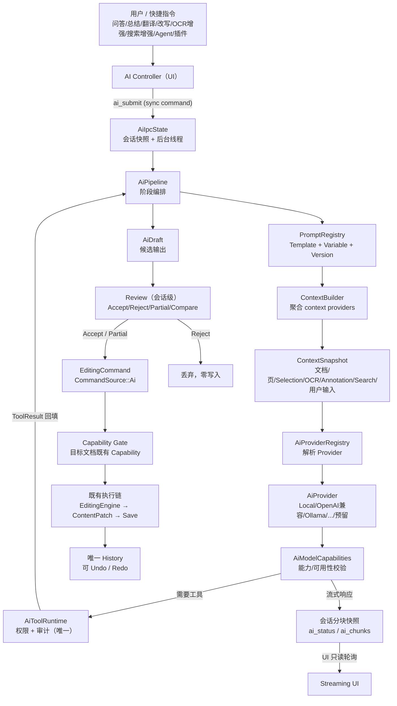

# 规范 23 · 第22章 AI Workspace & Intelligence Platform R1

Version：R1.0
Compatible with: Architecture Freeze **R1.1**
Scope：AI Workspace / Provider Registry / Model Catalog / Prompt Registry / Context Builder / AI Session / Conversation / Pipeline / Tool Calling / Review / Memory / Desktop Freeze
Status：RFC Freeze
Depends：`00` / `01` / `02` / `03` / `04` / `05` / `15` / `16` / `18` / `19` / `20` / `21` / `22`

> 文件编号 23，对应标题中的“第22章”。章节标题编号与 `docs/spec/` 文件编号允许错位，详见第21章 C-14（16 章旧表把“21”分配给 AI，用户当前路线已改为 21 Search / 22 AI / 23 Plugin / 24 Collaboration）；只补记录，不反向修改既有规范。
>
> 编制说明：用户原文要点已全部纳入。凡与冻结架构冲突处，均在 §3.1 冲突裁决中显式裁决；裁决口径以 `00` / `16` / `18` / `19` / `20` / `21` / `22` 的冻结事实为准。本章只写规范，不代表实现已完成，实际状态由实施记录 / 测试报告标记。

---

## 一、章节定位（Why）

### 1. 为什么需要这一章

第19章完成 OCR Workspace，第20章完成 Annotation Workspace，第21章完成 Search Workspace。至此文档工作台已有 Parser / OCR / Annotation / Search 四条**只读数据投影**。但这些能力彼此孤立：用户要“总结这一页”“把 OCR 结果翻译成英文”“按选中批注改写”“检索后再问答”，今天没有统一入口，只能在每个 Workspace 里各接一个模型调用。

如果没有统一的 AI Workspace，后续必然出现如下旁路：

1. 每个功能各自 `fetch()` 一个模型，Prompt / 模型列表 / 密钥管理散落各处；
2. 模型输出直接改 `Document` / 直接调 Runtime，绕过 Editing Command 与 Capability Gate；
3. 每个功能自建聊天面板、自建历史、自建流式渲染，形成第二套 Sidebar / Inspector / History / StatusBar；
4. Tool Calling 直接访问文件系统 / 网络，绕过权限与审计；
5. Search / OCR / Annotation 各自再接一次 AI，形成多套索引、多套 Provider 抽象。

**AI 平台不是“接一个模型”。** 它是一个平台层：后续所有问答、总结、翻译、改写、OCR 增强、搜索增强、Agent、插件工具调用，全部复用本章定义的 Provider / Model / Prompt / Context / Session / Conversation / Pipeline / Tool / Review 链路，不得各建一套。

### 2. 与上一章的关系

- 第21章解决“已有内容如何被统一检索、定位、高亮、审阅”，并明确 Search 是**纯只读**投影路径；
- 第22章解决“如何把 AI 能力统一接入，并让 AI 输出安全地写回文档”，**AI 是唯一被允许生成写回意图的智能来源，但写回仍只能生成 Editing Command**。

两章共享同一条设计范式：

```text
Provider 只产出领域结果（本层为模型响应 / Tool 结果）
→ Workspace 管会话、上下文、审阅
→ 写回统一经 Editing Engine；只读消费统一经既有投影
```

关键区别：Search 全程只读、不生成 Command；AI 在 Review 通过后可生成 Editing Command，因此 AI 必须额外受 Capability Gate 与 Review 双重约束。

### 3. 融合上一章建议，不再单独成章

第21章预留的 Search Hook、OCR Hook、Annotation Hook、Provider Registry、Notification、Cache、Session 管理，本章**统一消费、不再各自写入建议文档、不再单独成文**：

- `AiSearchProvider` 只向第21章唯一 `SearchIndex` 供数，不建第二索引；
- OCR / Annotation 只作为只读 `ContextProvider` 供数，不改其对象与元数据；
- Provider / Notification / Cache / Session 一律复用本章冻结口径与既有 Desktop Framework 注册点。

### 4. 完成后解决什么问题

- 模型入口分散：统一到 Provider Registry + `AiModelCatalog`；
- Prompt 散落：统一到 `PromptRegistry`；
- 上下文拼装随意：统一到 Context Builder 与 `ContextProvider` 注册；
- AI 直改文档：统一为 Review 后生成 Editing Command，进既有执行链；
- 工具调用越权：统一经唯一 `AiToolRuntime` 权限 / 审计口径；
- 多套聊天面板 / 历史 / 状态条：统一到 AI Workspace 与既有 Desktop Framework；
- 后续 Agent / 插件无扩展点：全部通过 Provider / ContextProvider / Tool / Feature 注册。

---

## 二、章节目标（Goal）

本章完成：

- ✔ AI Workspace
- ✔ Provider Registry（`AiProviderRegistry`）
- ✔ Model Manager（落为 `AiModelCatalog`）
- ✔ Prompt Manager（落为 `PromptRegistry`）
- ✔ AI Session（会话状态机）
- ✔ Conversation（Chat / Message）
- ✔ Review（会话级审阅决策）
- ✔ Pipeline（Prompt→Context→Provider→Tool→Review→Apply）
- ✔ Tool Calling（唯一 `AiToolRuntime`）
- ✔ Context Builder
- ✔ Memory（会话级，不持久化）
- ✔ History（复用文档 History，不新增）
- ✔ Inspector（经 `InspectorRegistry` 注册分区）
- ✔ Sidebar（AI Workspace 内部会话侧栏）
- ✔ Output Review（审阅输出，不新增 Framework）
- ✔ Capability Registry（落为 `AiCapabilityRegistry`）
- ✔ Desktop Framework 冻结（不新增任何 Framework）

其中若干名词必须先消歧（详细裁决见 §3.1）：

- “Model Manager”不是 Manager，落为 Core 内部声明表 `AiModelCatalog`；
- “Prompt Manager”不是 Manager，落为 Core 内部声明表 `PromptRegistry`；
- “Capability Registry”不是 Framework，落为 Core 内部声明表 `AiCapabilityRegistry`；
- “Review”不是新 Framework，是 `dw-core::ai` 内的会话级审阅决策；
- “Tool Calling Runtime”不是新 Framework / Manager，是唯一接口 `AiToolRuntime`；
- “History”不是新历史栈，Undo / Redo 复用文档唯一 History；
- “Sidebar”是 AI Workspace 内部会话侧栏，不是第二套全局 Sidebar。

---

## 三、Architecture Freeze（AD-01 ~ AD-15）

| 编号 | 强制裁决 | 落地口径 |
|---|---|---|
| **AD-01** | AI 不改 `Document`；所有输出必须经 Review → Editing Engine。 | AI 只产出 `AiDraft`；Review 通过后由调用方生成 `EditingCommand`，进 `EditingEngine → ContentPatch → Save`；禁止 AI 直接 `Document.mutate()`、直接写 lopdf。 |
| **AD-02** | AI 唯一身份是 Command Generator：`CommandSource::Ai`；禁止 AI Driver、禁止 AI 直接调 Runtime。 | 不新增 Driver 类型、不新增 `Capability` 变体；AI 输出经 Review 后只生成 Editing Command，进既有执行链与 Capability Gate；Undo / Redo 复用文档 History。 |
| **AD-03** | 不新增第二套 History / Review / Search / OCR / Annotation / Sidebar。 | 不建 `AiHistoryStore`、不建 Review Framework、不建第二 SearchIndex / OCR 引擎 / Annotation 对象库、不建第二全局 Sidebar；一律复用既有实现与注册表。 |
| **AD-04** | 所有模型经 Provider Registry；禁止 Workspace / UI 自管模型列表或直连模型 API。 | 唯一 `AiProviderRegistry` + `AiModelCatalog`；UI 只能读取声明表快照，不得硬编码模型 id、不得在前端拼接厂商 API 请求。 |
| **AD-05** | Tool Calling 经唯一 `AiToolRuntime`；禁止直接访问系统资源。 | 全项目只有一个 `AiToolRuntime` 接口；工具调用须经权限判定与审计口径；R1.0 只冻结接口与权限 / 审计，不实现具体工具。UI 的 `ToolRegistry` 是桌面工具模式注册表，与之不同，须明确区分。 |
| **AD-06** | 所有写回必须校验 Capability，且不得新增 `Capability::Ai` 变体。 | 双层门控：Provider / 模型可用性用 `AiModelCapabilities` 声明；文档操作用目标文档已有的 `Capability`（`ObjectEditing` / `Edit` / `Search` / `Ocr`）在 Command Gate 校验。 |
| **AD-07** | AI Session 与 Workspace 生命周期解耦。 | AI Session 不属于 Session 六成员，由 `AiIpcState` 持有，随活动 Session 切换清空；关闭 AI Workspace 不取消后台任务，后台任务随其所属 Session 生命周期结束。 |
| **AD-08** | AI 输出支持 Review / Undo / Redo。 | Review 通过生成 Editing Command，进入唯一 History；产物可撤销、可重做；Review 本身不写 Document。 |
| **AD-09** | Provider 必须支持可用性检测、能力声明与模型元数据。 | 内建 Provider 统一声明模型列表、多模态、Tool Calling、Streaming、Context Length、Embedding、Vision、Availability；不可用时 UI 只给统一禁用原因。 |
| **AD-10** | 冻结 3 Manager / 3 Store，不得新增 Manager / Store。 | `AiModelCatalog` / `PromptRegistry` / `AiCapabilityRegistry` 均为 `dw-core::ai` 内部声明表，不是 Manager / Store / Framework；`AiIpcState` 只是 IPC 组装状态。 |
| **AD-11** | Prompt 统一管理，禁止独立 Prompt；上下文统一聚合，后续只注册 Context Provider。 | 所有 Prompt 经 `PromptRegistry`；所有上下文经 Context Builder；OCR / Annotation / Search / 文档 / 用户输入等以 `ContextProvider` 注册，禁止功能内私有拼串。 |
| **AD-12** | Pipeline 固定为 Prompt→Context→Provider→Tool Calling→Review→Apply，禁止旁路。 | 任何问答 / 总结 / 翻译 / 改写 / Agent / 插件调用都走同一 Pipeline；不允许某功能跳过 Review 直接 Apply，也不允许跳过 Context Builder 私拼输入。 |
| **AD-13** | Streaming 以 Core 会话分块快照 + UI 只读轮询表达；禁止 Tauri async command / emit-listen。 | `ai_*` 同步 command 立即返回 Running 快照，后台线程执行，UI 只读轮询 `ai_status` / `ai_chunks`；本机曾因 async command 触发 `STATUS_ENTRYPOINT_NOT_FOUND`。 |
| **AD-14** | 不新增 crate、不新增 Framework；AI 落 `dw-core::ai`；会话级数据不落盘。 | Cargo Workspace 成员固定；AI 全部模块落 `crates/dw-core/src/ai/`；OCR / Annotation / Search 适配在 Desktop 组装层，只产只读投影；Conversation 历史与 Memory 是会话级、不持久化。 |
| **AD-15** | 第22章完成后正式冻结 AI Framework。 | Provider / Catalog / Prompt / Context / Session / Pipeline / Tool / Review / Workspace 口径冻结；后续 Plugin / Workflow / Collaboration 只能注册扩展，不得重构本章链路；改链按 R2.0 处理。 |

### 3.1 冲突裁决（C-1 ~ C-11）

| 编号 | 冲突 | 裁决 |
|---|---|---|
| C-1 | 用户要求 Model Manager / Prompt Manager / Capability Registry，但冻结架构只有 3 Manager / 3 Store | 不新增 Manager / Store。分别落为 Core 内部声明表 `AiModelCatalog` / `PromptRegistry` / `AiCapabilityRegistry`；`AiIpcState` 只是 IPC 组装状态，不是第 7 个 Manager，也不是 Store。 |
| C-2 | AI 模块落地 vs Cargo Workspace 成员固定、不新增 crate | 不新增 crate，不触发 R2.0。AI 全部落 `crates/dw-core/src/ai/` 模块；OCR / Annotation / Search 的 AI 适配在 Desktop 组装层，只产只读 `ContextProvider` / `SearchDocument` 投影，不形成第二业务层。 |
| C-3 | AI 需要写回，但 00 章冻结 AI 唯一身份是 Command Generator | `CommandSource::Ai`；禁止 AI Driver、禁止 AI 直接调 Runtime。AI 输出经 Review 后只生成 Editing Command，进既有执行链与 Capability Gate；Undo / Redo 复用文档 History。 |
| C-4 | 用户要求校验 Capability，但 `Capability` 枚举无 `Capability::Ai` | 不新增变体。门控分两层：Provider / 模型能力用 `AiModelCapabilities` 声明；文档操作用目标文档已有的 `Capability`（`ObjectEditing` / `Edit` / `Search` / `Ocr`）在 Command Gate 校验。 |
| C-5 | 项目当前无独立 Review Framework、无 Tool Runtime 实现 | Review 落为 `dw-core::ai` 内的会话级审阅决策（复用 OCR / Annotation / Search 既有 Review 模式），不新增 Desktop Framework。Tool Calling 落为唯一 `AiToolRuntime` 接口（Core 内部，不是 Manager / Framework），禁止直接访问系统资源；R1.0 只冻结接口与权限 / 审计口径，不实现具体工具；第23章 Plugin 必须复用同一 ToolRuntime，不得第二套。UI `ToolRegistry` 是桌面工具模式注册表，明确区分。 |
| C-6 | 用户要求 Sidebar / Inspector / History / Output Review，但禁止第二套 UI 框架 | 不新增第二套 Sidebar / Inspector / History / Overlay / StatusBar / ContextMenu / Ribbon 页签。AI 使用既有 AI 页签；Conversation 是 AI Workspace 内部侧栏；Inspector 经 `InspectorRegistry` 注册分区；Conversation 历史是会话内 / UI 级，不进文档 History、不生成 `CommandRecord`；输出 Review 不新增 Framework。 |
| C-7 | AI Session vs Session 六成员固定、后台任务生命周期 | AI Session 不属于六成员，由 `AiIpcState` 持有，随活动 Session 切换清空；Workspace 关闭不取消后台任务。参考第19章 OCR：`ai_*` 同步 command 立即返回 Running 快照，后台线程执行，UI 只读轮询 `ai_status` / `ai_chunks`；禁止 Tauri async command（曾触发 `STATUS_ENTRYPOINT_NOT_FOUND`）。 |
| C-8 | Memory 要求 vs 数据不落盘 | AI Memory 是会话级内存，不持久化；Long-term Memory 属 Future Reserved Hook，R1.0 只留接口不实现。 |
| C-9 | Provider 后缀是否违反冻结抽象 | 沿用 19 / 20 / 21 章 `OCRProvider` / `AnnotationProvider` / `SearchProvider` 的冻结豁免：Provider 是 Core 声明 / 查询抽象，不替代 Driver，不进执行链。 |
| C-10 | Streaming 是否需要新事件通道 | 不新增 Tauri emit / listen。Streaming 以 Core 会话分块快照（`ai_chunks`）+ UI 只读轮询表达，与 OCR 后台任务同构。 |
| C-11 | 与第21章 Search 兼容 | AI 只能注册 `AiSearchProvider` 向唯一 `SearchIndex` 供数，不得建第二 SearchIndex；Embedding 缓存不是真值源，只是派生缓存。 |

---

## 四、数据流（必须画图）

### 4.1 主流水线（Prompt→Context→Provider→Tool→Review→Apply）



### 4.2 只读边界与写回边界

```text
只读来源（ContextProvider，不产生写回）：
  Parser ObjectTree / TextObject
  OCRResult           → OCR ContextProvider
  AnnotationIndexView → Annotation ContextProvider
  SearchResult        → AiSearchProvider（向唯一 SearchIndex 供数）
  用户输入 / Selection / 当前页
        ↓
  ContextBuilder → ContextSnapshot（只读快照）

写回出口（唯一）：
  AiDraft → Review 通过 → EditingCommand(CommandSource::Ai)
        → Capability Gate（目标文档既有 Capability）
        → 既有执行链 → 唯一 History
```

AI 不新增任何真值源：不建第二 SearchIndex、不改 Object / AnnotationMeta / OCRResult、不建第二 History。Review 的 Accept/Reject/Partial/Compare 只决定“是否生成 Editing Command”，不直接写 `Document`。

---

## 五、目录结构

不新增 crate、不新增 Framework。三块落地：

### 5.1 Core（Rust）—— `crates/dw-core/src/ai/`

```text
crates/dw-core/src/ai/
├── mod.rs              # 模块出口，声明表中立在 Core，不导出 Manager
├── types.rs            # AiProviderId/AiModelId/AiDraft/AiMessage/AiCitation 等统一类型
├── provider.rs         # AiProvider trait + AiProviderRegistry + AiModelCapabilities
├── model_catalog.rs    # AiModelCatalog（已安装/当前/默认模型、能力标签、下载状态、来源）
├── prompt_registry.rs  # PromptRegistry（Template/Variable/Version/Category/Preview）
├── context.rs          # ContextBuilder + ContextProvider trait + ContextSnapshot
├── session.rs          # AiSession 状态机（Idle→Running→WaitingTool→Reviewing→Completed→Cancelled→Failed）
├── conversation.rs     # Conversation / AiMessage / Role / Attachment / Citation / ToolResult
├── pipeline.rs         # AiPipeline：Prompt→Context→Provider→Tool→Review→Apply 编排
├── tool_runtime.rs     # 唯一 AiToolRuntime 接口 + 权限/审计口径（R1.0 不实现具体工具）
├── review.rs           # 会话级审阅决策 Accept/Reject/PartialApply/Compare(Diff)
└── memory.rs           # 会话级记忆（不持久化）；Long-term Memory 仅 Hook
```

### 5.2 Desktop 组装层（Rust）—— `apps/dw-desktop/src/`

```text
apps/dw-desktop/src/
├── ai_ipc.rs       # ai_* 同步 command：ai_submit / ai_status / ai_chunks / ai_cancel / ai_retry 等
│                   # AiIpcState：IPC 组装状态（会话快照 + 后台线程），不是 Manager / Store
└── ai_adapters.rs  # OCR / Annotation / Search → ContextProvider 的只读适配
                    # AiSearchProvider → 唯一 SearchIndex 供数；不建第二索引
```

### 5.3 UI（TypeScript）—— `ui/src/ai/` 与 `ui/src/ipc/ai.ts`

```text
ui/src/ai/
├── controller.ts   # AiController：调用 ai_* command、轮询 ai_status / ai_chunks
├── feature.ts      # registerFeature()：AI 页签命令、快捷键、StatusBar / Notification 贡献
├── workspace.tsx   # AI Workspace 外壳（Toolbar / Conversation / Output / Inspector / Status / History 区）
├── sidebar.tsx     # AI Workspace 内部会话侧栏（Conversation 列表，不是全局 Sidebar）
├── inspector.tsx   # 经 InspectorRegistry 注册的运行分区（Provider/Model/Token/...）
├── overlay.tsx     # 复用既有 Overlay Framework（如流式/引用高亮），不建第二套
└── output_review.tsx # 输出审阅视图（Accept/Reject/Partial/Diff），不新增 Framework
ui/src/ipc/ai.ts    # 前端 IPC 封装：只调用同步 command + 只读轮询，不用 async command
```

```mermaid
classDiagram
    class AiProviderRegistry {
        -providers: HashMap~AiProviderId, Box~dyn AiProvider~~
        +register(provider: Box~dyn AiProvider~) Result~(), DwError~
        +resolve(id: AiProviderId) Option~Box~dyn AiProvider~~
        +list_available() Vec~AiProviderDescriptor~
    }
    class AiProvider {
        <<trait>>
        +id() AiProviderId
        +capabilities() AiModelCapabilities
        +list_models() Vec~AiModelMeta~
        +availability() Availability
        +invoke(req: AiRequest, on_chunk: Fn) Result~AiDraft, DwError~
    }
    class AiModelCapabilities {
        +multimodal: bool
        +tool_calling: bool
        +streaming: bool
        +context_length: u32
        +embedding: bool
        +vision: bool
    }
    class AiModelCatalog {
        -installed: Vec~AiModelMeta~
        -current: Option~AiModelId~
        -default: Option~AiModelId~
        +installed() Vec~AiModelMeta~
        +set_current(id: AiModelId)
        +default_model() Option~AiModelId~
        +download_status(id: AiModelId) DownloadStatus
    }
    class PromptRegistry {
        -templates: HashMap~PromptKey, Vec~PromptTemplate~~
        +register(tpl: PromptTemplate) Result~(), DwError~
        +resolve(key: PromptKey, version: Version) Option~PromptTemplate~
        +preview(key: PromptKey, vars: VariableMap) String
    }
    class ContextBuilder {
        -providers: Vec~Box~dyn ContextProvider~~
        +register(p: Box~dyn ContextProvider~)
        +build(scope: ContextScope) ContextSnapshot
    }
    class ContextProvider {
        <<trait>>
        +name() String
        +contribute(scope: ContextScope) ContextFragment
    }
    class AiSession {
        -state: AiSessionState
        -conversation: Conversation
        -drafts: Vec~AiDraft~
        +transition(to: AiSessionState) Result~(), DwError~
        +pause() / resume() / cancel()
    }
    class AiPipeline {
        +run(req: AiRequest) Result~AiDraft, DwError~
        +apply(draft: AiDraft, decision: ReviewDecision) Result~EditingCommand, DwError~
    }
    class AiToolRuntime {
        <<interface>>
        +check_permission(call: ToolCall) Permission
        +execute(call: ToolCall) ToolResult
        +audit(call: ToolCall, result: ToolResult)
    }
    class Review {
        +accept(draft: AiDraft) ReviewDecision
        +reject(draft: AiDraft) ReviewDecision
        +partial_apply(draft: AiDraft, ranges: Vec~Range~) ReviewDecision
        +compare(draft: AiDraft) Diff
    }
    class AiIpcState {
        -sessions: HashMap~SessionId, AiSession~
        -chunks: Vec~AiChunk~
        +active_snapshot() AiStatusSnapshot
        +clear_on_session_switch()
    }
    class AiCapabilityRegistry {
        -declarations: HashMap~AiProviderId, AiModelCapabilities~
        +declare(id: AiProviderId, caps: AiModelCapabilities)
        +supports(id: AiProviderId, cap: CapabilityKind) bool
    }

    AiProviderRegistry o-- AiProvider : 注册/解析
    AiProvider --> AiModelCapabilities : 声明
    AiProviderRegistry --> AiCapabilityRegistry : 能力声明入表
    AiModelCatalog --> AiProvider : 来源 Provider
    AiPipeline --> PromptRegistry : 取模板
    AiPipeline --> ContextBuilder : 建上下文
    AiPipeline --> AiProviderRegistry : 解析 Provider
    AiPipeline --> AiToolRuntime : 工具调用（唯一）
    AiPipeline --> Review : 输出审阅
    AiPipeline --> AiSession : 状态推进
    ContextBuilder o-- ContextProvider : 注册
    AiSession *-- Conversation : 持有
    AiIpcState o-- AiSession : 组装（会话级）
    Review ..> EditingCommand : 通过后生成（CommandSource::Ai）
```

---

## 六、Provider Registry（统一 Provider）

### 6.1 内建 Provider（统一声明）

所有 Provider 统一声明模型列表、多模态、Tool Calling、Streaming、Context Length、Embedding、Vision、Availability：

| Provider | id | 状态 | 说明 |
|---|---|---|---|
| Local Model | `local` | 内建 | 进程内 / 本地权重模型 |
| OpenAI Compatible | `openai-compatible` | 内建 | 任意 OpenAI 兼容 HTTP 端点 |
| Ollama | `ollama` | 内建 | Ollama 本地服务 |
| LM Studio | `lm-studio` | 内建 | LM Studio 本地服务 |
| vLLM | `vllm` | 内建 | vLLM 推理服务 |
| Anthropic | `anthropic` | 预留 | 只声明接口与能力，不实现调用 |
| Gemini | `gemini` | 预留 | 只声明接口与能力，不实现调用 |
| Azure OpenAI | `azure-openai` | 预留 | 只声明接口与能力，不实现调用 |
| Plugin Provider | `plugin` | 预留 | 第23章 Plugin 经注册注入，不硬编码 |

“预留”表示：R1.0 只登记 id、能力声明与配置形状，不发起网络调用、不内置密钥。Provider 后缀沿用 19 / 20 / 21 章冻结豁免：是 Core 声明 / 查询抽象，不替代 Driver，不进执行链。

### 6.2 统一类型（R1.1 类型补录）

```rust
pub struct AiModelCapabilities {
    pub multimodal: bool,
    pub tool_calling: bool,
    pub streaming: bool,
    pub context_length: u32,
    pub embedding: bool,
    pub vision: bool,
}

pub enum Availability { Available, Unavailable(String), NotConfigured }

pub struct AiModelMeta {
    pub id: AiModelId,
    pub provider: AiProviderId,
    pub label: String,
    pub capabilities: AiModelCapabilities,
    pub download: DownloadStatus, // NotDownloaded / Downloading / Ready / Failed
}

pub trait AiProvider {
    fn id(&self) -> AiProviderId;
    fn capabilities(&self) -> AiModelCapabilities;
    fn list_models(&self) -> Vec<AiModelMeta>;
    fn availability(&self) -> Availability;
    fn invoke(&self, req: AiRequest, on_chunk: &dyn Fn(AiChunk)) -> Result<AiDraft, DwError>;
}
```

### 6.3 可用性裁决

- Provider 不可用 / 未配置 / 模型未就绪时，UI 只显示统一禁用原因，不发起调用；
- 能力声明与运行期可用性分离：`AiModelCapabilities` 是静态声明，`Availability` 是运行期状态；
- 禁止 UI 与 Session 中 `if provider == "ollama"` 之类硬编码分支：新增 Provider 不改 Workspace、不改 Catalog、不改 UI 分派。

---

## 七、Model Manager（`AiModelCatalog`）

`AiModelCatalog` 是 Core 内部声明表，**不是 Manager / Store**。职责：

- 维护已安装模型列表（来源 Provider、能力标签、下载状态）；
- 记录当前模型 `current` 与默认模型 `default`；
- 提供 `set_current` / `default_model` / `installed` / `download_status` 查询；
- 数据来源是各 Provider 的 `list_models()`，不自行抓取远端、不保存密钥；
- Workspace / UI 只能读声明表快照，禁止自管模型列表、禁止硬编码模型 id。

模型能力标签直接取 `AiModelCapabilities`，与 `AiCapabilityRegistry` 声明一致，避免两处口径分叉。

---

## 八、Prompt Manager（`PromptRegistry`）

`PromptRegistry` 是 Core 内部声明表，**不是 Manager / Store**。每个 Prompt 具备：

- `Template`：模板正文；
- `Variable`：变量表（名称、类型、是否必填、默认值）；
- `Version`：版本号，按 `PromptKey + Version` 解析，便于 A/B 与回滚；
- `Category`：分类（问答 / 总结 / 翻译 / 改写 / OCR 增强 / 搜索增强 / Agent / 插件）；
- `Preview`：以给定变量预览渲染结果，便于调试。

冻结口径：

- 所有 Prompt 经 `PromptRegistry` 注册与解析，禁止功能内私有 Prompt 字符串；
- 变量渲染在 Core 完成，UI 不拼装最终 Prompt；
- Pipeline 只按 `PromptKey + Version` 取值，不感知模板内容。

---

## 九、Context Builder

Context Builder 统一聚合当前可用上下文，产出只读 `ContextSnapshot`：

- 当前文档 / 当前页；
- `Selection`；
- OCR 结果（经 OCR `ContextProvider`，只读投影）；
- Annotation（经 Annotation `ContextProvider`，只读投影）；
- Search Result（经 `AiSearchProvider` / 第21章唯一 `SearchIndex`）；
- 用户输入；
- 后续能力只注册 `ContextProvider`，不改 Context Builder。

冻结口径：

- `ContextProvider` 只产出 `ContextFragment`（只读），不得改 Object / OCR / Annotation / SearchIndex；
- Token 预算由 Context Builder 统一裁剪，超出按优先级截断，避免超限；
- Context Builder 不是新 Store，快照随会话存在，不持久化。

---

## 十、Session 与 Conversation

### 10.1 AI Session 状态机

```text
Idle → Running → WaitingTool → Reviewing → Completed
                                   │            │
                                   │            └→ Cancelled
                                   └→ Failed
任意运行态可 → Cancelled / Failed
```

- `Idle → Running`：提交请求，后台线程执行；
- `Running ↔ WaitingTool`：Tool Calling 等待回填；
- `Running → Reviewing`：产出 `AiDraft`；
- `Reviewing → Completed`：Review 通过（可生成 Editing Command）；`Reviewing → Cancelled`：Reject；
- 支持 `pause()` / `resume()` / `cancel()`；`cancel()` 由后台线程在阶段边界检查。

生命周期（对应 AD-07 / C-7）：

- AI Session 不属于 Session 六成员，由 `AiIpcState` 持有；
- 随活动 Session 切换清空 AI 会话快照；
- 关闭 AI Workspace 不取消后台任务；后台任务随其所属 Session 生命周期结束。

### 10.2 Conversation

Conversation 管 Chat / Message / Role / Attachment / Citation / Tool Result：

- `Role`：`User` / `Assistant` / `System` / `Tool`；
- `Attachment`：文档片段 / 图片等只读引用；
- `Citation`：指向文档 / 页 / 对象 / SearchResult 的定位引用，UI 可跳转；
- `ToolResult`：工具调用回填结果，进 Tool Call Timeline。

Conversation 历史是**会话内 / UI 级**数据：不进文档 History、不生成 `CommandRecord`、不持久化（见 C-6 / C-8）。

---

## 十一、Pipeline（禁止旁路）

固定阶段：`Prompt → Context → Provider → Tool Calling → Review → Apply`。

- `Prompt`：按 `PromptKey + Version` 从 `PromptRegistry` 取模板并渲染变量；
- `Context`：Context Builder 产出 `ContextSnapshot`；
- `Provider`：`AiProviderRegistry` 解析 Provider，校验 `AiModelCapabilities` 与 `Availability`；
- `Tool Calling`：需要工具时经唯一 `AiToolRuntime`，`ToolResult` 回填后继续；
- `Review`：产出 `AiDraft`，进入会话级审阅；
- `Apply`：仅当 Review 通过，生成 `EditingCommand(CommandSource::Ai)`，进既有执行链。

冻结口径：任何问答 / 总结 / 翻译 / 改写 / OCR 增强 / 搜索增强 / Agent / 插件调用都走同一 Pipeline；不允许跳过 Review 直接 Apply，也不允许跳过 Context Builder 私拼输入。

---

## 十二、Tool Calling（唯一 `AiToolRuntime`）

`AiToolRuntime` 是 Core 内部**唯一接口**，不是 Manager / Framework：

- `check_permission(call)`：权限判定；
- `execute(call)`：执行工具调用；
- `audit(call, result)`：审计记录。

冻结口径：

- 禁止 AI 直接访问文件系统、网络、进程等系统资源，一律经 `AiToolRuntime`；
- R1.0 **只冻结接口与权限 / 审计口径，不实现具体工具**；具体工具由第23章 Plugin 注册，且必须复用同一 `AiToolRuntime`，不得第二套；
- UI 的 `ToolRegistry` 是桌面工具模式（绘制 / 选择等）注册表，与 AI Tool Runtime 不同，代码与文档须明确区分，不得混用。

---

## 十三、Review（会话级审阅决策）

当前项目没有独立 Review Framework。本章 Review 落为 `dw-core::ai` 内的**会话级审阅决策**，复用 OCR / Annotation / Search 既有 Review 模式，不新增 Desktop Framework：

- `Accept`：接受整份 `AiDraft`，生成 Editing Command；
- `Reject`：拒绝，零写入，Conversation 记录原因；
- `Partial Apply`：按选中范围局部接受，仅对选中部分生成 Editing Command；
- `Compare (Diff)`：展示候选与当前内容的差异，供用户判断。

Review 不直接写 `Document`；所有写回出口只有“生成 Editing Command → Capability Gate → 既有执行链”。Review 后的产物可 Undo / Redo（复用文档 History）。

---

## 十四、Memory（会话级）

- AI Memory 是会话级内存，随 AI Session 存在，随会话切换 / 结束清空；
- 不持久化、不进 Checkpoint、不写任何 Store；
- Long-term Memory 属 Future Reserved Hook：R1.0 只预留 `MemoryProvider` 接口形状，不实现、不落盘。

---

## 十五、Workspace / Sidebar / Inspector / StatusBar / History

Workspace 的 Toolbar / Conversation / Output / Inspector / StatusBar / History 区全部走既有 Desktop Framework，不新增第二套壳层：

- **AI 页签**：使用既有 AI 页签，不新增 Ribbon 页签与主按钮；入口经 `registerFeature()` 注册；
- **Sidebar**：Conversation 是 AI Workspace 内部侧栏，不是全局 `WorkspaceNav`，不是第二套 Left Sidebar；
- **Inspector**：经 `InspectorRegistry` 注册运行分区，显示 Provider / Model / Token / Latency / Cost（预留字段）/ Tool Calls / Context Size；不建独立属性面板；
- **StatusBar**：经 `StatusRegistry` 注册状态项，显示 AI Busy / 进度 / 模型状态；不建第二套状态条；
- **History**：AI 输出 Undo / Redo 复用文档唯一 History；Conversation 历史是会话内 / UI 级，不进文档 History；
- **ContextMenu / Notification**：复用既有 `ContextMenuProvider` / ToastStack，禁止自绘菜单与 `alert`；
- **Output Review**：会话级审阅视图，不新增 Framework（见 §十三）。

---

## 十六、Capability（双层门控）

`Capability` 枚举**不含 `Capability::Ai`，且不得新增变体**（见 C-4）。门控分两层：

1. **Provider / 模型能力层**：用 `AiModelCapabilities` 声明（multimodal / tool_calling / streaming / context_length / embedding / vision），叠加 `Availability` 运行期状态，决定某请求能否交给该模型；
2. **文档操作层**：Review 通过生成 Editing Command 后，用目标文档已有的 `Capability`（`ObjectEditing` / `Edit` / `Search` / `Ocr`）在 Command Gate 统一校验。

AI 不构造新的能力变体、不在 Task / Driver 内重复判断；全链路只在 Command Gate 校验一次，与 `00` 章 Capability Gate 口径一致。

---

## 十七、Desktop Polish

每章必写，复用既有 Desktop Framework，不再单独做“Desktop 重构”。

| 能力 | 第22章落点 |
|---|---|
| Streaming UI | Core 会话分块快照 + UI 只读轮询 `ai_chunks`，不新增 emit/listen |
| Markdown Preview | 复用统一 Markdown 组件，不自建渲染 |
| Code Block | 统一代码块样式 / 高亮 Token，不新建组件体系 |
| Citation 跳转 | 基于 `Citation` 定位到文档 / 页 / 对象 / SearchResult，复用既有定位机制 |
| Tool Call Timeline | Conversation 内展示 Tool 调用序列（来自 `ToolResult`），不建新面板 |
| Progress Indicator | 复用统一 Progress / Skeleton / Loading |
| Token Counter | Inspector 分区显示 Token / Context Size，走 `InspectorRegistry` |
| Conversation Search | AI Workspace 内部会话检索，复用既有列表 / 虚拟列表 |
| 自动滚动控制 | 会话流自动滚动 + 用户手动干预，复用既有滚动规则 |
| AI Busy | StatusBar 统一忙碌态，走 `StatusRegistry` |
| Retry / Cancel | `ai_retry` / `ai_cancel` 同步 command，UI 只读刷新 |
| Theme / 动画 / HiDPI | 颜色走 CSS Token，动画走 `--dw-motion-*`，缩放走 `--dw-ui-scale` |

---

## 十八、Capability Matrix（冻结基线）

> 本章为 RFC 规范，矩阵记录“冻结要求”；实际实现状态由本章实施记录 / 测试报告标记 PASS。

| Capability | Framework / Core 落点 | UI 落点 | 冻结要求 | 验收状态 |
|---|---|---|---|---|
| Provider | `AiProviderRegistry` + `AiModelCapabilities` | Provider 状态项 | ✅ 必须 | 待实现 |
| Prompt | `PromptRegistry` | 无独立 UI（内部） | ✅ 必须 | 待实现 |
| Context | `ContextBuilder` + `ContextProvider` | Selection / 引用展示 | ✅ 必须 | 待实现 |
| Review | 会话级 `review.rs` | Output Review 视图 | ✅ 必须 | 待实现 |
| Tool Calling | 唯一 `AiToolRuntime` | Tool Call Timeline | ✅ 必须 | 待实现 |
| Workspace | AI 页签 + Dock 既有槽位 | Toolbar/Conversation/Output/Inspector/Status | ✅ 必须 | 待实现 |
| Session | `AiSession`（`AiIpcState` 持有） | Conversation 侧栏 | ✅ 必须 | 待实现 |
| Conversation | `conversation.rs` | Chat / Message / Citation | ✅ 必须 | 待实现 |

---

## 十九、测试（AIT-01 ~ AIT-20）

| 编号 | 层级 | 判据 | 通过标准 |
|---|---|---|---|
| AIT-01 | Core | Provider 注册/可用/能力声明/模型元数据 | 注册后可枚举 id、可用状态、能力集、模型元数据（名称/上下文长度）；未注册 provider 不可被调用 |
| AIT-02 | Core | 重复 id/厂商绑定/失败隔离 | 重复 id 明确报错不覆盖；provider 不与厂商硬绑定可替换；单个初始化失败不影响其余注册与查询 |
| AIT-03 | IPC | Streaming 分块快照与只读轮询 | 流式按块推送快照、客户端只读消费；无 async command 入口，该入口返回不支持或类型层面不存在 |
| AIT-04 | Core | Context 七源聚合 | 文档/页/Selection/OCR/Annotation/Search/用户输入七源均可辨识无丢失，缺源按空处理不报错 |
| AIT-05 | Core | Context Provider 注册与 Token Budget | 自定义 Provider 可注册并纳入聚合；超预算按优先级截断、输出 token 数不超限 |
| AIT-06 | Core | 唯一 AiToolRuntime 冻结 | 全仓仅一处 AiToolRuntime 接口定义、无直接文件/网络/系统访问入口；本章仅冻结接口不要求运行时实现 |
| AIT-07 | Integration | Tool 权限/审计/失败隔离 | 模式声明权限校验与审计埋点；单工具失败隔离为错误结果不中断会话；均为接口/模式级断言 |
| AIT-08 | UI | Review 四处置 | Accept/Reject/Partial Apply/Compare Diff 接口齐备；Partial 可按 hunk 选择、Diff 可并排对比；仅冻结模式 |
| AIT-09 | Integration | Review 不直写与 Undo/Redo | Review 无 Document 写句柄；采纳结果经 Editing Command 入引擎；可被现有 Undo/Redo 撤销重做不绕过引擎 |
| AIT-10 | Core | Session 状态机 | Idle→Running→Waiting Tool→Reviewing→Completed；Cancel→Cancelled、异常→Failed；非法迁移（如 Cancelled→Running）被拒 |
| AIT-11 | Integration | Pause/Resume/Cancel 与生命周期 | 暂停续跑保上下文；Cancel 及时释放；关闭 Workspace 后台任务继续；切换 Session 清空旧上下文且无 UI 残留 |
| AIT-12 | UI | AI Workspace 注册与 UI 复用 | 作为已有 Workspace 类型注册；无新 Ribbon 页签；复用现有 Sidebar/Inspector/History/StatusBar/ContextMenu，无第二套 |
| AIT-13 | Core | Capability 两层门控 | 枚举无 Capability::Ai 变体（数量同基线）；Provider 能力声明与文档 Capability Gate 独立两层，任一拒绝即阻断 |
| AIT-14 | Integration | AI 身份与输出链 | 输出统一标记 CommandSource::Ai；链路严格 Review→Editing Command→Capability Gate→Editing Engine，跳级/直写被拒 |
| AIT-15 | Core | Prompt 结构冻结 | Template/Variable/Version/Category/Preview 五项齐备且复用文档模型，无独立 Prompt 类型/存储 |
| AIT-16 | Regression | 流式与缓存指标 | 首块延迟/缓存命中可观测；Prompt Cache、Context Cache 命中后开销下降；Token Budget 超限截断 |
| AIT-17 | Regression | 后台/懒加载/资源 | 后台会话不阻塞主线程；会话懒加载；内存占用在阈值内；Cancel 后无残留任务或泄漏 |
| AIT-18 | Regression | 负向-不写回 | AI 不写 Object/Document、不直接改 History/Save；无第二套 SearchIndex/OCR/Annotation；静态检索无对应写入路径 |
| AIT-19 | Regression | 负向-不扩范围 | 维持 3 Manager/3 Store、无新 Manager/Store/crate、无新 Desktop Framework；无云同步/自动 Agent Workflow/长期记忆 |
| AIT-20 | Regression | 18/19/20/21 冻结回归 | 基线 HEAD 1320c39；18/19/20/21 冻结规范文件零 diff；tsc/vite/cargo 三项全绿无错误 |

说明：Tool Runtime 与 Review 按冻结口径只验接口/模式存在与合规，不要求运行时实现；AI 输出必经 Review → Editing Command → Capability Gate → Editing Engine。

---

## 二十、Out Of Scope

明确不做：

- 多人协作 / 云同步 / 在线账号体系；
- 自动执行的 Agent Workflow（仅预留 Pipeline / Hook，不实现自动编排执行）；
- 联邦推理；
- 在线模型市场（仅预留 Provider / Catalog 接口，不上架 / 交易）；
- 第23章 Plugin Runtime 的具体实现（本章只提供可复用的 AI / Tool Runtime 接口）；
- 新增 Manager / Store / crate / Framework；
- Tauri async command / emit-listen（本机曾触发 `STATUS_ENTRYPOINT_NOT_FOUND`）；
- Long-term Memory 持久化（仅 Hook）。

---

## 二十一、章节冻结

**AI Framework Freeze**：

- Provider / `AiModelCatalog` / `PromptRegistry` / Context 口径冻结；
- AI Session 状态机 / Conversation / Pipeline 阶段冻结；
- `AiToolRuntime` 唯一接口与权限 / 审计口径冻结；
- Review（Accept/Reject/Partial/Compare）与写回出口冻结；
- AI Workspace 五区（Toolbar / Conversation / Output / Inspector / StatusBar / History）复用路径冻结；
- Desktop Framework 注册方式冻结。

冻结后：

- 23 Plugin 只能注册 Provider / ContextProvider / Tool / Feature，且必须复用同一 `AiToolRuntime`，不得新增第二套运行时；
- 24 Collaboration / Workflow 只能扩展，不得改本章链路；
- 任何改链行为必须 Architecture Review，必要时 R2.0。

---

## 二十二、下一章预留（23 Plugin Runtime）

下一章 Plugin Runtime 建立在本章 AI、`AiToolRuntime` 与 Desktop Framework 之上，不得新增第二套运行时：

| 预留能力 | 约束 |
|---|---|
| Plugin Registry | 复用既有注册口径，不新增 Manager / Store / Registry 框架 |
| Marketplace | 仅预留接口，不实现在线市场（Out Of Scope） |
| Sandbox | 复用权限 / 审计口径，不新建资源访问通道 |
| Permission | 与 `AiToolRuntime` 权限判定同源 |
| Capability | 不新增 `Capability` 变体；沿用双层门控 |
| Provider | Plugin Provider 经 `AiProviderRegistry` 注册，不改内建 Provider 声明 |
| Workspace / Lifecycle | 经 `registerFeature()` 接入既有 AI 页签，不改冻结 UI 壳层 |

预留只写一次：第23章直接消费本章的 Provider / Context / Tool / Review / Pipeline 协议，不得重复定义第二套运行时。

---

## A. Compatibility（兼容性）

- 与 `00` 兼容：不新增 Manager / Store / crate；AI 唯一身份 `CommandSource::Ai`；不新增 `Capability` 变体；不改执行链；AI 输出经 Review 后生成 Editing Command 进 Capability Gate。
- 与 `01` / `02` 兼容：AI 通过既有 `Action → Command → Task → Driver → Runtime` 写回，不自造执行路径、不直接调 Runtime。
- 与 `03` 兼容：不新增 AI Driver、不建 AI 执行分支；Provider 是声明 / 查询抽象，不替代 Driver。
- 与 `04` / `05` 兼容：不改技术栈；对外错误统一 `DwError`；Rust / TS 遵循既有命名与错误处理约定。
- 与 `15` 兼容：AI 写回经既有测试/回归链验证，不绕过集成回归。
- 与 `16` 兼容：只 `registerFeature()` 注册命令 / 快捷键 / 状态项 / Inspector 分区；AI 使用既有 AI 页签，不新增 Ribbon 页签、不改六区布局。
- 与 `18` 兼容：不新增 Sidebar / Inspector / Overlay / StatusBar / ContextMenu / History / Save；写回经 Editing Engine 与唯一 Save Pipeline。
- 与 `19` 兼容：OCR 结果经只读 `ContextProvider` 供数，不调用 OCR 引擎、不改 OCRResult。
- 与 `20` 兼容：Annotation 经只读 `ContextProvider` 供数，不改 AnnotationObject / AnnotationMeta。
- 与 `21` 兼容：AI 只能注册 `AiSearchProvider` 向唯一 `SearchIndex` 供数，不建第二 SearchIndex；Embedding 缓存不是真值源。
- 与 `22`（第21章 Search）零改动：只消费 `SearchResult`，不改 Search 规范与实现。
- 冻结事实：18 / 19 / 20 / 21（规范文件与冻结链）零改动；本章均为新增模块与评审过的注册扩展点。

## B. Migration（迁移）

- 旧 AI 实现（若有散落模型调用 / 私有 Prompt / 自拼上下文）统一迁到 Provider Registry / `PromptRegistry` / Context Builder；
- 旧硬编码模型列表迁入 `AiModelCatalog`，来源标注 Provider；
- 旧私有 Prompt 字符串迁入 `PromptRegistry`，按 Category / Version 归档；
- 旧直接写文档路径改为生成 `EditingCommand(CommandSource::Ai)`，经 Review → Capability Gate → 既有执行链；
- 旧独立聊天历史 / 记忆视为不可迁移的会话级数据，不落盘、不进文档 History；
- 无文档格式变更：不新增 `ai_meta`，不改 PDF / Object 字段；
- 旧 AI 页签保留为入口，只作为 Workspace 跳转，不承载私有逻辑。

## C. Performance（性能）

- Streaming 以分块快照表达，UI 只读轮询，不建事件通道；分块合并避免频繁重绘；
- Prompt Cache：同 `PromptKey + Version + 变量` 的渲染结果进程内缓存，文档 / 上下文变更时失效；
- Context Cache：`ContextSnapshot` 随会话复用，文档 / Selection / 投影变更按来源失效；
- Token Budget：Context Builder 统一预算裁剪，超限按优先级截断并提示，避免请求失败；
- Background Session：所有模型调用在后台线程执行，阶段边界检查 Pause / Cancel，长任务可中断；
- Lazy Conversation：历史消息懒加载 / 虚拟列表，只渲染视口内消息；
- 超大 Token / 长会话必须实测；未实测前不得宣称“无限上下文无压力”。

## D. Future Reserved（未来预留）

| 预留方向 | 本章预留形态 | 禁止行为 |
|---|---|---|
| Multi-Agent | `ContextProvider` / Pipeline Hook | 不实现自动编排执行 |
| Workflow | Pipeline 阶段 Hook | 不做自动 Workflow 引擎 |
| MCP | Tool 描述形状 Hook | 不实现 MCP 协议栈 |
| RAG | `AiSearchProvider` 供数 | 不建第二 SearchIndex；Embedding 缓存非真值源 |
| Knowledge Graph | `ContextProvider` 扩展 | 不落盘、不建 Store |
| Long-term Memory | `MemoryProvider` 接口形状 | 不持久化、不进 Checkpoint |
| Cloud Execution | Provider 预留（Azure OpenAI 等） | 不内置密钥、不发未授权网络调用 |
| Distributed Agent | 会话 / Tool 接口扩展 | 不引入分布式运行时、不新增第二套 ToolRuntime |
