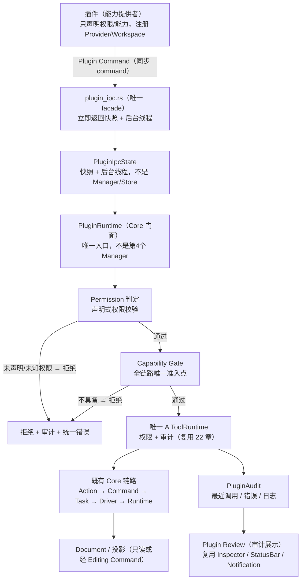
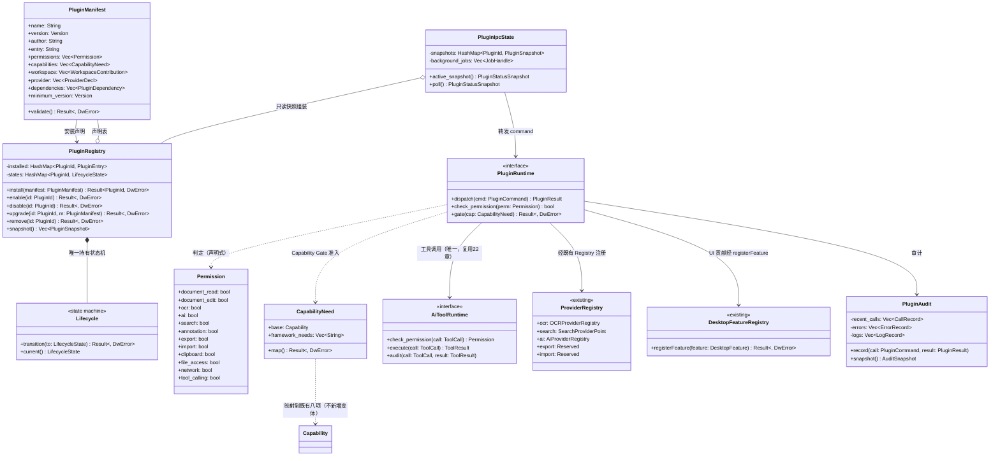

# 规范 24 · 第23章 Plugin Platform & Extension Ecosystem R1

Version：R1.0
Compatible with: Architecture Freeze **R1.1**
Scope：Plugin Platform / Plugin Registry / Manifest / Lifecycle / Sandbox / Permission / Capability / Provider / Marketplace（预留）/ Workspace / IPC / Review / Desktop Integration / Hot Reload（预留）/ Framework Freeze
Status：RFC Freeze
Depends：`00` / `01` / `02` / `03` / `04` / `05` / `15` / `16` / `18` / `19` / `20` / `21` / `22` / `23`

> 文件编号 24，对应标题中的“第23章”。章节标题编号与 `docs/spec/` 文件编号允许错位，编号错位沿用第21章 C-14（16 章旧表把“21”分配给 AI，用户当前路线已改为 21 Search / 22 AI / 23 Plugin / 24 Collaboration）；只补记录，不反向修改既有规范。
>
> 编制说明：第22章已完成 AI Platform RFC。第23章的目标**不是实现插件，而是建立唯一插件平台**——OCR / Annotation / Search / AI / Export / Import 全部可通过 Plugin 扩展。用户原文要点与两条补充已全部纳入；凡与冻结架构冲突处，均在 §3.1 冲突裁决中显式裁决，裁决口径以 `00` / `16` / `18` / `19` / `20` / `21` / `22` / `23` 的冻结事实为准。本章只写规范与冻结口径，不代表实现已完成；实际状态由实施记录 / 测试报告标记。

---

## 一、章节定位（Why）

### 1. 为什么需要这一章

第19章完成 OCR Workspace，第20章完成 Annotation Workspace，第21章完成 Search Workspace，第22章完成 AI Platform。至此文档工作台已有 Parser / OCR / Annotation / Search / AI 五条能力路径，但它们各自的内置实现是封闭的：想接一家新的 OCR 引擎、换一个检索后端、加一种导出格式、接一个第三方 AI 模型，都要改 Core、改 Workspace、改 UI。

如果没有统一的插件平台，后续必然出现如下旁路：

1. 每个功能各自扫目录 / 各自维护启用开关，形成多套“扩展管理器”；
2. 扩展直接 `Document.mutate()` / 直接调 Runtime，绕过 Editing Command 与 Capability Gate；
3. 扩展自建 Sidebar / Inspector / Overlay / StatusBar / Ribbon 页签，形成第二套 UI 框架；
4. 扩展直接访问文件系统 / 网络 / 系统命令，绕过权限与审计；
5. 扩展各自直连 Provider / 各自建 Provider 抽象，形成多套 Registry 与多套索引；
6. 扩展自行管理加载 / 启用 / 卸载状态，与 Workspace 生命周期打架。

**Plugin Platform 不是“写一个能加载 dll 的壳”。** 它是一个平台层：本章的目标不是实现任何具体插件，而是建立全项目**唯一**的扩展契约与运行平台，让后续所有能力扩展都只通过这一条链路接入，不得各建一套。

### 2. 与上一章的关系

- 第22章完成 AI Platform RFC，冻结了唯一 `AiToolRuntime`、Provider Registry、Workspace Registry、Notification、Search Hook、OCR Hook、Annotation Hook 等入口；
- 第23章建立插件平台，**消费而不重构**第22章的这些冻结入口：插件的 Tool Calling 复用同一 `AiToolRuntime`，插件的 Provider 经各既有 Provider Registry 注册，插件的 Workspace 贡献经 `registerFeature()` 接入。

两章共享同一条设计范式：

```text
Provider 只产出领域结果（OCR/Search/AI/Export/Import）
→ 能力经 Capability Gate 准入
→ 所有系统资源经唯一 Runtime（Tool Runtime / Plugin Runtime）授权与审计
→ UI 贡献经唯一 Registry 注册，不改冻结壳层
```

关键区别：第22章解决“AI 能力如何统一接入并安全写回”，本章解决“第三方能力如何作为**能力提供者**接入同一套平台”——插件本身不写文档、不碰核心对象，只注册能力。

### 3. 插件不是第一层，而是“能力提供者”（用户补充一）

插件**不是**凌驾于 Core 之上的第一层运行时，也**不是**第二套系统。插件的真实身份是“能力提供者”：

- 它只注册 Search Provider / AI Provider / Export Provider / Workspace 贡献等**能力项**；
- 它绝不直接操作 `Document` / `Session` / `Task` / `Driver` 等核心对象；
- 它不新增 Capability 类型、不新增 Registry 框架、不新增 UI 壳层。

插件在运行链路中的位置是“能力来源”，不是“执行主体”：真正的执行始终在既有 Core 链路上完成。这条裁决在 §3.1 C-1 显式冻结。

### 4. 权限声明式，执行仍走既有门控（用户补充二）

插件权限采用**声明式**：Manifest 只声明“需要什么权限（permissions）、提供什么能力（capabilities）”，安装时展示给用户确认；**执行时仍严格走 Permission → Capability → Tool Runtime → Core**，与第19/22章已冻结的 Tool Runtime 口径完全一致。

声明不是授权，更不是绕过：声明只决定“能不能进入门控”，不赋予插件任何直接访问权。这条裁决在 §3.1 C-2 显式冻结。

### 5. 融合上一章建议，不再单独成章

第22章冻结的 AI Tool Runtime、Provider Registry、Workspace Registry、Notification、Search Hook、OCR Hook、Annotation Hook，本章**统一消费、不再各自写入建议文档、不再单独成文**：

- 插件 Tool Calling 只经唯一 `AiToolRuntime`，不建第二套工具运行时；
- 插件 Search / AI / OCR 能力只经各既有 Provider Registry 注册，供数给唯一索引与唯一 Pipeline；
- Notification / Workspace / Inspector / StatusBar 贡献只经既有 `registerFeature()` 注册点。

### 6. 完成后解决什么问题

- 扩展入口分散：统一到唯一 Plugin Platform；
- 扩展直改文档：统一为“只声明能力、只注册 Provider，不碰核心对象”；
- 扩展越权访问系统资源：统一经 Permission + Runtime 授权与审计；
- 多套扩展生命周期 / 多套启用开关：统一到 PluginRegistry 唯一状态机；
- 多套 Provider / 多套索引：统一经既有 Provider Registry；
- 多套 UI 框架：统一经既有 `registerFeature()` 十三类注册表；
- Marketplace / 在线更新 / 热重载诉求：只留 Hook，R1.0 不实现，接口先冻结。

---

## 二、章节目标（Goal）

本章完成（建立平台与冻结口径，**不实现具体插件**）：

- ✔ Plugin Platform（Core 内统一门面 / 命名空间）
- ✔ Plugin Registry（唯一声明表，管 Installed / Disabled / Enabled / Upgrade / Remove）
- ✔ Manifest（声明式清单）
- ✔ Lifecycle（唯一状态机）
- ✔ Sandbox（资源边界口径，R1.0 只冻结接口不实现引擎）
- ✔ Permission（声明式权限 + 安装时展示）
- ✔ Capability（只声明，映射到既有 Capability，不新增变体）
- ✔ Marketplace（**预留**，只留接口）
- ✔ Workspace（贡献项经既有 Registry 注册）
- ✔ IPC（唯一 facade，同步快照 + 后台线程 + 只读轮询）
- ✔ Review（审计信息展示，复用既有 UI）
- ✔ Desktop Integration（统一经既有注册表）
- ✔ Hot Reload（**预留**，只留 Hook）
- ✔ Framework 冻结（Plugin Platform Freeze）

其中若干名词必须先消歧（详细裁决见 §3.1）：

- “Plugin Runtime”不是 Manager、不是第二套运行时、不是 Store，是 `dw-core::plugin` 内的**统一门面 / 命名空间**；
- “Plugin Registry”不是 Desktop 第十一类 Framework，是 Core 内部的**声明表**；
- “Sandbox”在 R1.0 是**资源边界口径与审计口径**，不实现真实沙箱引擎、不引入 WASM / JS 运行时；
- “Review”不是新 Framework，是审计信息展示，复用既有 Inspector / StatusBar / Notification，且**不与 AI Review 混淆**；
- “Marketplace / Online Update / Hot Reload”只留 Hook，R1.0 不实现；
- 性能缓存（Plugin Cache / Manifest Cache / Provider Cache）是**派生缓存**，不是 Store，不持久化。

---

## 三、Architecture Freeze（AD-01 ~ AD-15）

| 编号 | 强制裁决 | 落地口径 |
|---|---|---|
| **AD-01** | 插件不直接访问 Core，统一经 Plugin Runtime。 | 插件无 Core 对象句柄；一切请求经 `dw-core::plugin` 内唯一门面 `PluginRuntime`；`PluginRuntime` 是门面 / 命名空间，不是第 4 个 Manager、不是第二套运行时、不是 Store。 |
| **AD-02** | 插件不直接访问 Document，统一经 Capability；不新增 Capability 变体。 | 禁止 `Document.mutate()` / 直写 lopdf / 自建对象库；插件声明的 capabilities 映射到既有 `Capability`（Render / Search / Ocr / Convert / Export / Print / Edit / ObjectEditing）与 Framework needs；**无 `Capability::Plugin`，不得新增变体**。 |
| **AD-03** | 插件不绕过 Tool Runtime，统一经唯一 `AiToolRuntime`。 | 插件 Tool Calling 复用第22章冻结的唯一 `AiToolRuntime` 权限 / 审计口径；不得直接访问文件系统 / 网络 / 进程；禁止第二套 Tool Runtime。 |
| **AD-04** | 不新增第二套 IPC / Workspace / Ribbon / Overlay / Inspector / ContextMenu / Shortcut。 | IPC 经唯一 `plugin_ipc.rs`；UI 贡献经既有 `registerFeature()` 十三类注册表；不新增 Ribbon 页签、不新建第二套 Sidebar / Inspector / Overlay / StatusBar / ContextMenu / Shortcut。 |
| **AD-05** | 所有操作经 Capability Gate 与 Permission。 | 插件任何操作先过 Permission 判定，再过 Capability Gate 准入；Capability Gate 仍是全链路唯一准入点，插件不得在自身逻辑内重复判断或绕过。 |
| **AD-06** | 插件不自行维护生命周期，由 PluginRegistry 唯一持有。 | 状态机 `Installed→Loaded→Enabled→Running→Disabled→Unloaded→Removed` 由 `PluginRegistry` 唯一持有并推进；插件不得自建启用开关、不得自行改状态。 |
| **AD-07** | 不绑定具体 Provider，统一经既有 Provider Registry。 | 插件经 `OCRProviderRegistry` / `SearchProvider` 注册点 / `AiProviderRegistry` 等既有 Provider Registry 注册；ExportProvider / ImportProvider 仅预留扩展点，不新建第二套 Provider 框架或 Registry。 |
| **AD-08** | Manifest 声明式，禁止动态申请未知权限。 | Manifest 必须静态声明 Name / Version / Author / Entry / Permissions / Capabilities / Workspace / Provider / Dependencies / Minimum Version；不在运行期申请声明外的权限，未知权限一律拒绝。 |
| **AD-09** | Plugin Registry 唯一，禁止 Workspace 自扫描。 | 全项目唯一 `PluginRegistry`，管 Installed / Disabled / Enabled / Upgrade / Remove；Workspace / UI 只读声明表快照，不得自行扫目录、不得自建插件列表。 |
| **AD-10** | Sandbox 禁止直接文件系统 / 网络 / 系统命令，所有资源经 Permission + Runtime 授权。 | R1.0 冻结资源边界与审计口径：任何资源访问须经 Permission 判定 + Runtime 授权；不实现真实沙箱引擎、不引入 WASM / JS 运行时。 |
| **AD-11** | 冻结 3 Manager / 3 Store；PluginRuntime 不是第 4 个 Manager，PluginRegistry 不是第 11 类 Framework。 | 既有 SessionManager / TaskManager / DriverManager 与 DocumentStore / CheckpointStore / TabStore 不变；`PluginRuntime` 只是 Core 门面，`PluginRegistry` 只是 Core 声明表，均不进 Manager / Store / Framework 序列。 |
| **AD-12** | 不新增 crate、不新增 Framework；Plugin 落 `dw-core::plugin`。 | Cargo Workspace 成员固定；全部模块落 `crates/dw-core/src/plugin/`；适配在 Desktop 组装层；任何新增 crate / Framework 触发 Architecture Review（必要时 R2.0）。 |
| **AD-13** | Plugin IPC 唯一 facade，同步 command + 后台线程 + 只读轮询。 | 统一在 `apps/dw-desktop/src/plugin_ipc.rs`；沿用第19/22章口径，禁止 Tauri async command（本机曾触发 `STATUS_ENTRYPOINT_NOT_FOUND`），禁止新增 emit / listen 事件系统。 |
| **AD-14** | Provider 扩展复用既有 Registry；Export / Import 仅预留。 | OCRProvider 已有（`dw-ocr`）；SearchProvider / AIProvider 为第21/22章冻结接口；ExportProvider / ImportProvider 当前不存在，仅作本章预留扩展点，不新建第二套 Provider 框架或 Registry。 |
| **AD-15** | 第23章完成后正式冻结 Plugin Platform。 | Manifest / Registry / Permission / Runtime 接口与审计口径冻结；后续 Marketplace / Collaboration / Cloud 只能扩展、不得重构本章链路；改链按 R2.0 处理。 |

### 3.1 冲突裁决（C-1 ~ C-16）

| 编号 | 冲突 | 裁决 |
|---|---|---|
| **C-1** | 用户补充一：插件容易被误解为凌驾 Core 的“第一层”或第二套系统 | **插件不是第一层，而是“能力提供者”。** 插件只注册 Search Provider / AI Provider / Export Provider / Workspace 等能力项，绝不直接操作 `Document` / `Session` / `Task` / `Driver` 等核心对象，不新增 Capability 类型、不新增 Registry / UI 框架，不变成第二套系统。 |
| **C-2** | 用户补充二：声明式权限可能被误解为“声明即授权 / 可绕过门控” | **插件权限采用声明式，但执行仍走 Permission → Capability → Tool Runtime → Core。** Manifest 只声明“需要什么权限、提供什么能力”，安装时展示；声明不构成直接访问权，执行时与第19/22章已冻结的 Tool Runtime 口径完全一致。 |
| C-3 | 用户要求 Plugin Runtime，但冻结架构只有 3 Manager / 3 Store | 不新增 Manager / Store。`PluginRuntime` 是 `dw-core::plugin` 内的统一门面 / 命名空间，不是第 4 个 Manager、不是第二套运行时、不是 Store；只提供请求转发与门面，不持有执行链。 |
| C-4 | 用户要求 Plugin Registry，但 Desktop Framework 已冻结 | `PluginRegistry` 是 Core 内部声明表，不是 Desktop 第十一类 Framework；UI 只读快照。Desktop 侧只有既有 `registerFeature()` 十三类注册表（tools / overlayLayers / overlays / inspectors / ribbonTabs / ribbonGroups / ribbonCommands / contextMenu / cursors / shortcuts / themeTokens / dockPanes / statusItems），插件不新增 Registry。 |
| C-5 | 插件 Tool Calling vs 唯一 `AiToolRuntime` | 插件不得绕过 `AiToolRuntime`（第22章冻结），且不得直接访问文件系统 / 网络 / 进程；本章只冻结 Manifest / Registry / Permission / Runtime 接口与审计口径，不实现真实沙箱引擎、不引入 WASM / JS 运行时。UI `ToolRegistry` 是桌面工具模式注册表，与之区分。 |
| C-6 | 用户要求校验 Capability，但 `Capability` 枚举无 `Capability::Plugin` | 不新增变体（仍为 Render / Search / Ocr / Convert / Export / Print / Edit / ObjectEditing 八项）。插件声明的 capabilities 映射到既有 Capability 与 Framework needs；Capability Gate 仍是唯一准入点。 |
| C-7 | 用户要求 Provider 可扩展，但 Provider 现状不一 | 不新建第二套 Provider 框架 / Registry。`OCRProvider` / `OCRProviderRegistry` 已有（`dw-ocr`）；SearchProvider / AIProvider 为第21/22章冻结接口；ExportProvider / ImportProvider 当前不存在，仅作本章预留扩展点。插件经各既有 Provider Registry 注册。 |
| C-8 | 用户要求 Workspace / Sidebar / Inspector / Toolbar / StatusBar / ContextMenu / Overlay 贡献，但禁止第二套 UI | 不新增第二套 Sidebar / Inspector / Overlay / StatusBar / ContextMenu / Shortcut，不新增 Ribbon 页签。Workspace 分类沿用 `workspaces.ts` 的 `WorkspaceKind` / `WORKSPACES`；一切贡献经 `ui/src/framework/core.ts` 的 `registerFeature()` 注册，重复 id 原子回滚。 |
| C-9 | Plugin IPC 通道选择 vs 本机 async command 事故 | 统一在 `apps/dw-desktop/src/plugin_ipc.rs` 作为唯一 facade；沿用第19/22章“同步 command 立即返回快照 + 后台线程 + 只读轮询”；禁止 Tauri async command（曾触发 `STATUS_ENTRYPOINT_NOT_FOUND`），禁止新增 emit / listen 事件系统。 |
| C-10 | 用户要求插件生命周期，但插件易自行管理状态 | 状态机由 `PluginRegistry` 唯一持有：`Installed→Loaded→Enabled→Running→Disabled→Unloaded→Removed`；插件不得自行管理状态、不得自建启用开关。 |
| C-11 | 用户要求 Hot Reload / Marketplace / Online Update | R1.0 只留 Hook：Hot Reload / Marketplace / Online Update 接口保留不实现；Marketplace 服务端 / 在线商店 / 签名服务器 / 自动更新服务均属 Out Of Scope。 |
| C-12 | 用户要求 Plugin Review，但项目无独立 Review Framework，且已有 AI Review | Plugin Review 是**审计信息展示**（权限 / Provider / Capability / 最近调用 / 错误 / 日志），复用既有 Inspector / StatusBar / Notification，不新增 Review Framework，也不与 AI Review（会话级审阅决策）混淆。 |
| C-13 | 用户要求性能缓存，但 3 Store 冻结 | Plugin Cache / Manifest Cache / Provider Cache 是**派生缓存**，不是 Store，进程内存在、不持久化、不进 Checkpoint；失效随 Manifest / Provider / Session 变更。 |
| C-14 | 与第18/19/20/21/22章兼容 | 18 / 19 / 20 / 21 / 22 零修改；本章仅新增 `dw-core::plugin` 模块与评审过的注册扩展点；下一章 Collaboration 必须复用 Plugin / AI / Desktop 基础设施，不得新增第二套基础设施。 |
| C-15 | “Plugin Registry 管 Upgrade / Remove” 与“不实现在线更新” | Upgrade / Remove 是 Registry 的**本地状态迁移语义**（已安装版本的启用 / 替换 / 移除），不含在线下载 / 自动更新服务；在线更新只留 Hook。 |
| C-16 | 插件落地目录 vs Cargo Workspace 成员固定 | 不新增 crate；全部模块落 `crates/dw-core/src/plugin/`；Desktop 侧只增 `plugin_ipc.rs` / `plugin_adapters.rs`，UI 侧只增 `ui/src/plugin/` 与 `ui/src/ipc/plugin.ts`；不新增 Framework。 |

---

## 四、数据流（必须画图）

### 4.1 主链路（Plugin Command → Runtime → Tool Runtime → Core）



### 4.2 能力注册与只读边界

```text
插件 Manifest（声明式，安装时展示）
  Name/Version/Author/Entry/Permissions/Capabilities/Workspace/Provider/Dependencies/Minimum Version
        ↓ 安装（PluginRegistry 唯一入口）
  PluginRegistry：Installed → Loaded → Enabled → Running（状态机唯一持有）
        ↓ 能力注册（不碰核心对象）
  OCRProviderRegistry（已有 dw-ocr）
  SearchProvider 注册点（第21章冻结，向唯一 SearchIndex 供数）
  AiProviderRegistry（第22章冻结，进唯一 Pipeline）
  ExportProvider / ImportProvider（本章预留扩展点）
  registerFeature()（UI 贡献：tools/overlay/inspector/status/menu/shortcut/...，重复 id 原子回滚）
        ↓ 运行期消费
  Permission → Capability Gate → 唯一 AiToolRuntime → 既有 Core 链路
```

插件不建第二索引、不建第二 Provider 框架、不建第二 UI 壳层、不直接改 `Document`。所有写回出口仍为 Editing Command → Capability Gate → 既有执行链 → 唯一 History。

---

## 五、目录结构

不新增 crate、不新增 Framework。三块落地：

### 5.1 Core（Rust）—— `crates/dw-core/src/plugin/`

```text
crates/dw-core/src/plugin/
├── mod.rs          # 模块出口，声明表中立在 Core，不导出 Manager
├── manifest.rs     # PluginManifest：声明式清单十字段 + 校验（未知权限拒绝）
├── registry.rs     # PluginRegistry：唯一声明表 + Installed/Disabled/Enabled/Upgrade/Remove
├── runtime.rs      # PluginRuntime：Core 统一门面/命名空间（不是 Manager/Store），转发到门控与 Tool Runtime
├── lifecycle.rs    # Lifecycle 状态机：Installed→Loaded→Enabled→Running→Disabled→Unloaded→Removed
├── permission.rs   # Permission 声明式权限模型 + 判定口径（与 AiToolRuntime 同源）
├── capability.rs   # 插件 capabilities → 既有 Capability / Framework needs 映射（不新增变体）
├── provider.rs     # 经既有 Provider Registry 注册的适配声明；Export/Import 仅预留扩展点
└── audit.rs        # PluginAudit：最近调用 / 错误 / 日志（审计口径，供 Review 展示）
```

### 5.2 Desktop 组装层（Rust）—— `apps/dw-desktop/src/`

```text
apps/dw-desktop/src/
├── plugin_ipc.rs       # plugin_* 同步 command：唯一 facade；立即返回快照 + 后台线程 + 只读轮询
│                       # PluginIpcState：IPC 组装状态（快照 + 后台线程），不是 Manager / Store
└── plugin_adapters.rs  # 插件 → 既有 Provider Registry / registerFeature() 的只读组装适配
                        # 不建第二索引、不建第二 Provider 框架、不建第二 UI 壳层
```

### 5.3 UI（TypeScript）—— `ui/src/plugin/` 与 `ui/src/ipc/plugin.ts`

```text
ui/src/plugin/
├── controller.ts     # PluginController：调用 plugin_* 同步 command、只读轮询 plugin_status
├── feature.ts        # registerFeature()：插件贡献项注册（tools/overlay/inspector/status/menu/shortcut）
├── workspace.ts      # 插件管理页（Installed/Enabled/Disabled/Upgrade/Remove + 权限预览 + 错误提示）
├── manager_page.tsx  # 插件管理界面外壳（复用既有 Dock / Panel / List / Toast，不新建框架）
├── review.tsx        # Plugin Review 审计展示（权限/Provider/Capability/最近调用/错误/日志），复用 Inspector
└── overlay.tsx       # 插件 Overlay Contribution（复用既有 Overlay Framework，不建第二套）
ui/src/ipc/plugin.ts  # 前端 IPC 封装：只调用同步 command + 只读轮询，不用 async command
```

### 5.4 类关系（classDiagram）



---

## 六、Manifest（声明式清单）

Manifest 是插件的**声明式清单**，必须静态声明十项，禁止动态申请未知权限：

| 字段 | 说明 | 冻结口径 |
|---|---|---|
| Name | 插件名 | 唯一标识用途，重复 id 由 Registry 拒绝 |
| Version | 版本 | 用于 Upgrade / 版本冲突检测 |
| Author | 作者 | 展示信息 |
| Entry | 入口 | 加载入口声明；R1.0 只冻结字段，不实现真实加载引擎 |
| Permissions | 权限 | 声明式十一类权限（见 §十一），安装时展示 |
| Capabilities | 能力 | 映射到既有 Capability / Framework needs，不新增变体 |
| Workspace | 工作区贡献 | Workspace / Sidebar / Inspector / Toolbar / StatusBar / ContextMenu / Overlay 贡献，经 `registerFeature()` |
| Provider | 提供者声明 | OCR / Search / AI / Export / Import，经既有 Provider Registry |
| Dependencies | 依赖 | 依赖检查（缺失 / 版本冲突在安装时提示） |
| Minimum Version | 最低版本 | 与当前 Core 版本比对，不满足则拒绝安装并提示 |

冻结口径：

- `validate()` 对未知权限、未知 Capability、未知 Provider 类型一律拒绝；
- 运行期不得申请 Manifest 声明外的权限（禁止动态申请）；
- Manifest Cache 是派生的只读缓存，不持久化。

---

## 七、Plugin Registry（唯一声明表）

`PluginRegistry` 是 Core 内部**唯一声明表**，不是 Desktop 第十一类 Framework，也不是 Manager / Store。职责：

- 管 Installed / Disabled / Enabled / Upgrade / Remove 五类状态迁移；
- 唯一持有 Lifecycle 状态机（见 §九）；
- 提供 `snapshot()` 只读快照供 UI 消费；
- 做依赖检查与版本冲突检测，安装 / 升级时提示。

冻结口径：

- 全项目唯一 `PluginRegistry`；Workspace / UI 只读快照，**禁止 Workspace 自扫描目录**；
- Upgrade / Remove 是本地状态迁移语义，不含在线下载 / 自动更新（在线更新只留 Hook，见 §二十二 / Out Of Scope）；
- 重复 id 明确报错，不覆盖。

---

## 八、Plugin Runtime（Core 统一门面）

`PluginRuntime` 是 `dw-core::plugin` 内的**统一门面 / 命名空间**，不是第 4 个 Manager、不是第二套运行时、不是 Store。职责：

- `dispatch(cmd)`：把插件请求转发进门控与既有 Core 链路；
- `check_permission(perm)`：声明式权限判定；
- `gate(cap)`：走 Capability Gate 唯一准入点；
- 工具调用转发到唯一 `AiToolRuntime`（复用第22章），不实现第二套工具运行时；
- 记录 `PluginAudit`，供 Review 展示。

冻结口径：插件无 Core 对象句柄，一切请求经此门面；门面本身不持有执行链、不改 `Document`、不直接访问系统资源。

---

## 九、Lifecycle（唯一状态机）

状态机由 `PluginRegistry` 唯一持有：

```text
Installed → Loaded → Enabled → Running → Disabled → Unloaded → Removed
                         ↑______________|（可重新启用）
任意运行态异常 → Disabled（记错误审计）
```

- `Installed → Loaded`：读取 Manifest 并校验（R1.0 只冻结接口与校验口径）；
- `Loaded → Enabled`：权限 / 依赖 / 版本校验通过，注册能力项；
- `Enabled → Running`：插件进入可调用态；
- `Running → Disabled → Unloaded → Removed`：停用 / 卸载 / 移除；
- 插件**不得自行管理状态**，不得自建启用开关；状态迁移只能由 `PluginRegistry` 推进。

---

## 十、Sandbox（资源边界口径）

R1.0 冻结资源边界与审计口径，**不实现真实沙箱引擎、不引入 WASM / JS 运行时**：

- 禁止插件直接访问文件系统 / 网络 / 系统命令；
- 所有资源访问须经 Permission 判定 + Runtime 授权；
- 工具调用统一经唯一 `AiToolRuntime`，复用其权限 / 审计口径；
- 越权访问记为错误审计，并在 Plugin Review 中展示。

> 说明：Sandbox 作为平台边界契约冻结，具体隔离引擎属 R2.0 或后续版本；R1.0 只保证“接口与审计口径一致、无旁路”。

---

## 十一、Permission（声明式权限）

声明式十一类权限，安装时展示给用户确认：

| 权限 | 说明 |
|---|---|
| Document Read | 读取文档 / 投影 |
| Document Edit | 写回文档（仍须经 Editing Command + Capability Gate） |
| OCR | 使用 OCR 能力 |
| AI | 使用 AI 能力（进唯一 Pipeline） |
| Search | 使用搜索能力（向唯一索引供数） |
| Annotation | 使用批注能力 |
| Export | 使用导出能力 |
| Import | 使用导入能力 |
| Clipboard | 使用剪贴板 |
| File Access | 文件访问（经 Runtime 授权，非直接访问） |
| Network | 网络访问（经 Runtime 授权，非直接访问） |
| Tool Calling | 工具调用（经唯一 `AiToolRuntime`） |

冻结口径：

- 声明不是授权：声明只决定“能否进入门控”，执行时仍走 Permission → Capability → Tool Runtime → Core（见 C-2）；
- 未知权限一律拒绝，禁止动态申请声明外权限（见 §六 / AD-08）；
- Permission 判定与 `AiToolRuntime` 权限同源，不建第二套权限体系。

---

## 十二、Capability（只声明，不新增变体）

`Capability` 枚举**不含 `Capability::Plugin`，且不得新增变体**（见 C-6，仍为 Render / Search / Ocr / Convert / Export / Print / Edit / ObjectEditing 八项）。插件声明的 capabilities 是“能力需求（CapabilityNeed）”，落地方式：

1. 映射到既有 `Capability` 八项之一（如 OCR 插件声明 `Ocr`、导出插件声明 `Export`）；
2. 补充 Framework needs 声明（需要哪些既有 Framework 注册点）；
3. 由 Capability Gate 在准入点统一校验，插件不得在自身逻辑内重复判断。

冻结口径：Capability Gate 仍是全链路唯一准入点；插件不构造新能力变体、不绕过 Gate。

---

## 十三、Plugin IPC

Plugin IPC 统一在 `apps/dw-desktop/src/plugin_ipc.rs` 作为**唯一 facade**，沿用第19/22章口径：

- `plugin_*` 同步 command 立即返回快照；
- 后台线程执行实际工作；
- UI 只读轮询 `plugin_status` / 快照；
- **禁止 Tauri async command**（本机曾触发 `STATUS_ENTRYPOINT_NOT_FOUND`）；
- **禁止新增 emit / listen 事件系统**。

`PluginIpcState` 是 IPC 组装状态（快照 + 后台线程），不是 Manager / Store。

---

## 十四、Workspace 与 Desktop Integration

插件可注册以下贡献项，**全部经既有 Registry**，不新增 Registry、不新增 Ribbon 页签、不新建第二套 UI：

| 贡献项 | 落点（既有注册表） |
|---|---|
| Workspace | `workspaces.ts` 的 `WorkspaceKind` / `WORKSPACES`（分类冻结，贡献只挂既有项） |
| Sidebar | 既有 Sidebar / Dock Pane（`dockPanes`） |
| Inspector Section | `inspectors` |
| Toolbar Button | `ribbonCommands` / `tools` |
| StatusBar Item | `statusItems` |
| ContextMenu | `contextMenu` |
| Overlay Contribution | `overlayLayers` / `overlays` |
| Search Provider | 第21章 SearchProvider 注册点（向唯一 `SearchIndex` 供数） |
| AI Provider | 第22章 `AiProviderRegistry`（进唯一 Pipeline） |

冻结口径：

- 唯一入口是 `ui/src/framework/core.ts` 的 `registerFeature()`；重复 id 原子回滚；
- 十三类注册表固定：tools / overlayLayers / overlays / inspectors / ribbonTabs / ribbonGroups / ribbonCommands / contextMenu / cursors / shortcuts / themeTokens / dockPanes / statusItems；
- 插件只注册贡献项，不新增注册表、不新建第二套 Sidebar / Inspector / Overlay / StatusBar / ContextMenu / Shortcut。

---

## 十五、Provider 扩展

Provider 可扩展，但**不得重新设计 Provider 框架**：

| Provider | 现状 | 本章口径 |
|---|---|---|
| OCRProvider | 已有（`dw-ocr` 的 `OCRProvider` / `OCRProviderRegistry`） | 插件经既有 Registry 注册，不新建 |
| SearchProvider | 第21章冻结接口 | 向唯一 `SearchIndex` 供数，不建第二索引 |
| AIProvider | 第22章冻结接口（`AiProviderRegistry`） | 进唯一 Pipeline，不改内建 Provider 声明 |
| ExportProvider | 当前不存在 | **本章预留扩展点**，R1.0 只声明接口形状，不新建第二套 Registry |
| ImportProvider | 当前不存在 | **本章预留扩展点**，R1.0 只声明接口形状，不新建第二套 Registry |

冻结口径：插件经各既有 Provider Registry 注册，不自建 Provider 体系；Provider 后缀沿用冻结豁免（声明 / 查询抽象，不替代 Driver，不进执行链）。

---

## 十六、Plugin Review（审计信息展示）

当前项目没有独立 Review Framework。本章 Plugin Review 是**审计信息展示**，复用既有 Inspector / StatusBar / Notification，不新增 Review Framework，且**不与 AI Review（会话级审阅决策）混淆**：

- 权限：展示该插件声明的十一类权限；
- Provider：展示注册的 Provider 类型；
- Capability：展示声明的 capabilities 与映射结果；
- 最近调用：来自 `PluginAudit` 的调用记录；
- 错误：来自 `PluginAudit` 的错误记录；
- 日志：来自 `PluginAudit` 的日志。

Review 只读审计快照，不写 `Document`、不直接控制插件状态。

---

## 十七、Desktop Polish

每章必写，复用既有 Desktop Framework，不再单独做“Desktop 重构”：

| 能力 | 第23章落点 |
|---|---|
| 插件管理页 | 复用既有 Panel / List / Dock，展示 Installed / Enabled / Disabled |
| 启用 / 禁用 | `plugin_enable` / `plugin_disable` 同步 command，UI 只读刷新 |
| 权限预览 | 安装 / 启用前展示 Manifest 声明式权限 |
| 错误提示 | 统一 Notification / Toast，不自建 alert |
| 更新提示 | 版本冲突 / 依赖缺失统一提示，在线更新仅 Hook |
| 依赖检查 | 安装时检查 Dependencies，缺失则拒绝并提示 |
| 版本冲突 | 比对 Minimum Version 与依赖版本，冲突则提示 |
| 加载动画 | 复用统一 Progress / Skeleton / Loading |
| Marketplace 占位 | 管理页留 Marketplace 入口占位，R1.0 不实现在线商店 |
| Theme / 动画 / HiDPI | 颜色走 CSS Token，动画走 `--dw-motion-*`，缩放走 `--dw-ui-scale` |

---

## 十八、Capability Matrix（冻结基线）

> 本章为 RFC 规范，矩阵记录“冻结要求”；实际实现状态由本章实施记录 / 测试报告标记 PASS。

| Capability | Core 落点 | UI 落点 | 冻结要求 | 验收状态 |
|---|---|---|---|---|
| Manifest | `manifest.rs`（声明式十字段 + 校验） | 安装 / 权限预览 | ✅ 必须 | 待实现 |
| Registry | `registry.rs`（唯一声明表，五类状态迁移） | 插件管理页 | ✅ 必须 | 待实现 |
| Runtime | `runtime.rs`（Core 统一门面） | 无独立 UI | ✅ 必须 | 待实现 |
| Permission | `permission.rs`（声明式十一类 + 判定） | 权限预览 | ✅ 必须 | 待实现 |
| Provider | `provider.rs`（经既有 Provider Registry；Export/Import 预留） | Provider 展示 | ✅ 必须 | 待实现 |
| Workspace | `registerFeature()` 十三类贡献注册 | 贡献项（Sidebar/Inspector/Status/...） | ✅ 必须 | 待实现 |
| Lifecycle | `lifecycle.rs`（Registry 唯一持有状态机） | 启用 / 禁用 / 卸载 | ✅ 必须 | 待实现 |
| Sandbox | `runtime.rs` + `permission.rs`（资源边界 / 审计口径） | 错误 / 审计提示 | ✅ 必须 | 待实现 |

---

## 十九、测试（PT-01 ~ PT-20）

| 编号 | 层级 | 判据 | 通过标准 |
| --- | --- | --- | --- |
| PT-01 | Core | Manifest 十字段 Name/Version/Author/Entry/Permissions/Capabilities/Workspace/Provider/Dependencies/Minimum Version | 合法清单解析成功、字段齐全类型匹配，Entry 指向存在文件 |
| PT-02 | Core | 缺任一必填字段或版本低于 Minimum Version | 加载被拒，返回字段缺失/版本不兼容错误码，不入 Installed |
| PT-03 | Core | 运行时申请未写入清单的权限 | 申请被拒并记审计，Permissions 加载后不可变 |
| PT-04 | Core | 唯一注册中心承载 Installed/Disabled/Enabled/Upgrade/Remove 五态 | 全系统仅一处 PluginRegistry，各态迁移可查，无第二中心 |
| PT-05 | Integration | 重复 plugin id 与依赖环/缺失/版本冲突 | 注册失败并报重复或依赖冲突，整体回滚无半注册 |
| PT-06 | Integration | 安装展示声明式权限清单 | 安装前逐项列出全部权限并需确认，未确认不安装 |
| PT-07 | Integration | 调用未声明权限 | Document Read/Edit、OCR、AI、Search、Annotation、Export、Import、Clipboard、File Access、Network、Tool Calling 十一类逐项被 Capability Gate 拒，已声明放行 |
| PT-08 | Core | 插件直访文件系统/网络/系统命令 | 静态扫描零直接调用；R1.0 只验接口/策略，不要求真实沙箱引擎 |
| PT-09 | Integration | 插件资源访问链 | 全部经 Permission→Capability→AiToolRuntime→Core，缺任一授权即拒 |
| PT-10 | IPC | Plugin command 形态 | 全为同步 command+后台线程+只读轮询，无 Tauri async command |
| PT-11 | UI | 插件 Workspace 贡献项 | 仅经 registerFeature 注册且 UI 全链路出现，重复 id 原子回滚 |
| PT-12 | UI | 新增 Ribbon 页签或第二套 Sidebar/Inspector/Overlay/StatusBar/ContextMenu/Shortcut | 全部被拒，六区结构与十类 Framework 文件零 diff |
| PT-13 | Integration | 插件 Provider 注册目标 | 仅入既有 OCR/Search/Ai 三 Registry，可被既有会话消费 |
| PT-14 | Core | Export/Import Provider 与自建框架 | 二者仅预留空接口，插件自建 Provider 框架被拒 |
| PT-15 | Core | 合法迁移 Installed→Loaded→Enabled→Running→Disabled→Unloaded→Removed | 逐段成功且状态可查，Running 仅 Enabled 后可入 |
| PT-16 | Core | 非法迁移与插件自管状态 | Installed→Running 等被拒并抛错，状态仅 Core 可写 |
| PT-17 | IPC | Lazy Load 与 Background Load | 首次命中才加载清单/入口，后台线程加载，主线程无阻塞 |
| PT-18 | Core | Manifest/Plugin/Provider Cache 派生性 | 三类缓存均可从注册表重建，非真值源、无新增 Store |
| PT-19 | Integration | 负向边界汇总 | 不直访 Core/Document、不绕 AiToolRuntime、不新增第二套 IPC/Workspace/Provider Registry/Framework、不新增 Capability 变体、不新增 Manager/Store/crate、不实现 Marketplace/在线商店/签名服务器/自动更新/云同步/Hot Reload，静态检查零命中 |
| PT-20 | Regression | 18/19/20/21/22 冻结回归 | 基线 HEAD 359da1f，冻结规范文件零 diff，tsc/vite/cargo 全绿 |

说明：R1.0 只验接口与策略，不要求真实沙箱引擎；插件所有资源访问必须经 Permission → Capability → AiToolRuntime → Core。

---

## 二十、Out Of Scope

明确不做（仅预留接口）：

- Marketplace 服务端；
- 在线商店；
- 签名服务器；
- 自动更新服务；
- 云插件同步；
- 真实沙箱引擎 / WASM / JS 运行时（R1.0 只冻结边界与审计口径）；
- 具体插件实现（本章只建立平台与冻结契约）；
- 新增 Manager / Store / crate / Framework；
- Tauri async command / emit-listen（本机曾触发 `STATUS_ENTRYPOINT_NOT_FOUND`）。

---

## 二十一、章节冻结

**Plugin Platform Freeze**：

- Manifest 十字段与校验口径冻结；
- `PluginRegistry` 唯一声明表与五类状态迁移冻结；
- Lifecycle 状态机冻结，由 Registry 唯一持有；
- Permission 声明式十一类权限与“声明式 + 执行门控”口径冻结；
- `PluginRuntime` 门面与“经唯一 `AiToolRuntime`”口径冻结；
- Provider 经既有 Registry 注册、Export / Import 预留扩展点冻结；
- Workspace 贡献经 `registerFeature()` 注册、不新增 UI 框架冻结；
- Plugin Review 审计展示口径冻结；
- IPC 唯一 facade（同步快照 + 后台线程 + 只读轮询）冻结。

冻结后：

- 后续 Marketplace / Collaboration / Cloud 只能扩展，不得重构本章链路；
- 不得新增第二套 Plugin Runtime / Registry / Permission / Capability / Provider / IPC / UI 框架；
- 任何改链行为必须 Architecture Review，必要时 R2.0。

---

## 二十二、下一章预留（24 Collaboration Platform）

下一章 Collaboration Platform 建立在本章 Plugin Platform、第22章 AI Platform 与 Desktop Framework 之上，**不得新增第二套基础设施**：

| 预留能力 | 约束 |
|---|---|
| Collaboration Session | 复用 Plugin / AI / Desktop 基础设施，不建第二套会话层 |
| Presence | 经既有 Notification / StatusBar 注册点，不建第二套 UI |
| Document Lock | 复用既有 Document / History，不新增 Store |
| Conflict Resolution | 经既有 Review / Editing Command 出口，不直接写文档 |
| Sync Provider | 经既有 Provider Registry 口径，不建第二套 Provider 框架 |
| Version Timeline | 复用 CheckpointStore 既有语义，不新增 Store |
| Shared Comments | 复用 Annotation 既有对象 / 元数据，不改其模型 |
| Cloud Storage Hook | 只留 Hook，Not in R1.0；云同步属 Out Of Scope |
| Team Workspace | 经既有 `registerFeature()` 注册，不改冻结 UI 壳层 |
| Audit Log | 复用 PluginAudit / 既有审计口径，不建第二套审计框架 |

预留只写一次：第24章直接消费本章 Plugin Platform、AI Platform 与 Desktop Framework 的冻结协议，不得重复定义第二套基础设施。

---

## A. Compatibility（兼容性）

- 与 `00` 兼容：不新增 Manager / Store / crate；插件不直接访问 Core、不直接改 Document；不新增 `Capability` 变体；所有操作经 Capability Gate 与 Permission。
- 与 `01` / `02` 兼容：插件经既有 `Action → Command → Task → Driver → Runtime` 链路，不自造执行路径、不直接调 Runtime。
- 与 `03` 兼容：不新增 Driver、不建插件执行分支；Provider 是声明 / 查询抽象，不替代 Driver。
- 与 `04` / `05` 兼容：不改技术栈；错误统一 `DwError`；Rust / TS 遵循既有命名与错误处理约定。
- 与 `15` 兼容：插件相关写回经既有测试 / 回归链验证，不绕过集成回归。
- 与 `16` 兼容：只经 `registerFeature()` 注册贡献项；不新增 Ribbon 页签、不改六区布局。
- 与 `18` 兼容：不新增 Sidebar / Inspector / Overlay / StatusBar / ContextMenu / Shortcut / History / Save；写回经 Editing Engine 与唯一 Save Pipeline。
- 与 `19` 兼容：OCR 插件经既有 `OCRProviderRegistry` 注册，不改 OCRProvider 接口、不改 OCRResult。
- 与 `20` 兼容：Annotation 插件不改 AnnotationObject / AnnotationMeta，经既有能力路径供数。
- 与 `21` 兼容：Search 插件只向唯一 `SearchIndex` 供数，不建第二索引；SearchProvider 沿用冻结接口。
- 与 `22` 兼容：插件 Tool Calling 复用唯一 `AiToolRuntime`；AI Provider 经 `AiProviderRegistry` 注册进唯一 Pipeline；Permission 判定与 Tool Runtime 权限同源。
- 与 `23`（第22章 AI）零改动：只消费其 Provider / Context / Tool / Review / Pipeline 协议，不改 AI Platform 规范与实现。
- 冻结事实：18 / 19 / 20 / 21 / 22 零修改；本章均为新增模块与评审过的注册扩展点。

## B. Migration（迁移）

- 旧扩展（若有散落加载 / 自管开关 / 私有 Provider）统一迁到 Plugin Registry / Manifest / Lifecycle / Permission；
- 旧硬编码扩展列表迁入 `PluginRegistry`，来源标注 Manifest；
- 旧私有权限判断迁入声明式 Permission，执行时统一走 Permission → Capability → Tool Runtime → Core；
- 旧直接写文档路径改为“只注册能力 / Provider”，写回仍经 Editing Command → Capability Gate → 既有执行链；
- 旧自绘 UI 贡献改为经 `registerFeature()` 注册，移除第二套 Sidebar / Inspector / Overlay / StatusBar / ContextMenu / Shortcut；
- 旧私有 Provider 抽象迁入各既有 Provider Registry，移除第二套 Provider 框架 / Registry；
- 无文档格式变更：不新增 plugin 元数据到 PDF / Object 字段；
- 旧扩展入口保留为 Manifest 的 Entry 声明，不承载私有逻辑。

## C. Performance（性能）

- Lazy Load：插件按启用状态懒加载，未启用不占运行资源；
- Plugin Cache：插件快照进程内缓存，随 Lifecycle 状态变更失效；
- Manifest Cache：Manifest 解析结果缓存，随 Manifest 变更失效；
- Provider Cache：Provider 声明 / 可用性快照缓存，随 Provider Registry 变更失效；
- Background Load：加载 / 枚举在后台线程执行，阶段边界可中断，不阻塞主线程；
- 上述缓存均为**派生缓存**，不是 Store、不持久化、不进 Checkpoint；
- 插件数量 / 递归依赖必须实测；未实测前不得宣称“无限插件无压力”。

## D. Future Reserved（未来预留）

| 预留方向 | 本章预留形态 | 禁止行为 |
|---|---|---|
| Marketplace | Marketplace 占位 + 接口形状 | 不实现在线商店 / 服务端 |
| Online Update | Upgrade 本地语义 + 更新 Hook | 不实现自动更新服务 / 在线下载 |
| Plugin Store | 声明接口形状 | 不实现上架 / 交易 |
| Paid Plugin | Manifest 预留字段 | 不实现支付 / 授权服务 |
| Signature Verification | Entry 校验 Hook | 不实现签名服务器 |
| Remote Plugin | Provider 声明 Hook | 不实现远程插件拉取 |
| Cloud Plugin | Cloud Storage Hook | 不实现云插件同步 |
| Hot Reload | Lifecycle Hook | R1.0 不实现热重载 |
