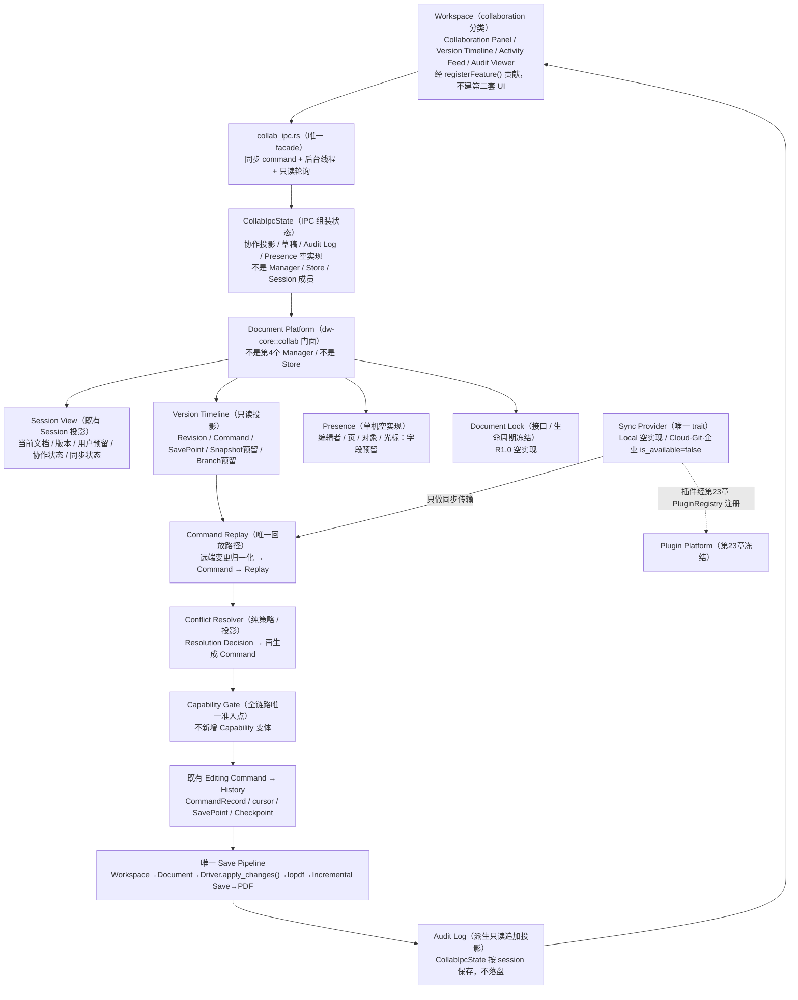
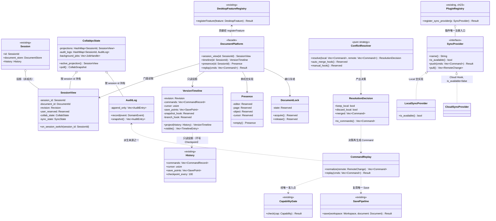

# 规范 25 · 第24章 Document Platform & Collaboration R1

Version：R1.0
Compatible with: Architecture Freeze **R1.1**
Scope：Document Platform / Collaboration Session / Presence / Document Lock / Version Timeline / Conflict Resolution / Sync Provider / Audit Log / Team Workspace（预留）/ Cloud Hook（预留）/ Desktop Integration / Command Replay / Save Pipeline / Collaboration Framework Freeze
Status: RFC Freeze
Depends：00/01/02/03/04/05/15/16/18/19/20/21/22/23/24

> 文件编号 25，对应标题中的“第24章”。章节标题编号与 `docs/spec/` 文件编号允许错位，编号错位沿用第21章 C-14（16 章旧表把“21”分配给 AI，用户当前路线已改为 21 Search / 22 AI / 23 Plugin / 24 Collaboration）；只补记录，不反向修改既有规范。
>
> 编制说明：第23章已冻结 Plugin Platform。第24章的目标**不是简单实现多人协作，而是建立唯一文档平台**——Cloud / Team / Enterprise / Collaboration / Version / Audit 全部建立其上。用户原文要点与全部冲突裁决已纳入；凡与冻结架构冲突处，均在 §3.1 冲突裁决中显式裁决，裁决口径以 `00` / `16` / `18` / `19` / `20` / `21` / `22` / `23` / `24` 的冻结事实为准。本章只写规范与冻结口径，不代表实现已完成；实际状态由实施记录 / 测试报告标记。

---

## 一、章节定位（Why）

### 1. 为什么需要这一章

第23章冻结 Plugin Platform，至此文档工作台已有 Parser / OCR / Annotation / Search / AI / Plugin 六条能力路径，且六条路径的写回出口已统一到 Editing Command → Capability Gate → 唯一 History → 唯一 Save Pipeline。但“围绕文档的协作与平台能力”仍处于空白：版本怎么看、保存点怎么追溯、多人状态怎么投影、远端变更怎么进入本地、审计怎么统一、云 / 团队 / 企业能力挂在哪里——若各能力自建一套，必然出现如下旁路：

1. 版本能力自建第二棵版本树 / 第二个 Store，与既有 `History` + `CommandRecord` + `SavePoint` + `Checkpoint` 并存；
2. 同步逻辑直接 `Document.mutate()` / 直写 lopdf / 直出 PDF，绕过 Editing Command 与唯一 Save Pipeline；
3. 冲突处理直接改 Object 或改 Editing Engine，形成第二套编辑语义；
4. 协作层自建第二套 Session / Manager / Store，与既有 `Session`（Session→DocumentStore→Document）平行；
5. 云 / 团队 / 企业各自绑厂商、各自建 Provider 抽象，形成多套同步框架；
6. 各自采集在线状态 / 引入账号体系，伪装实时多人协作；
7. 各自记审计日志、落盘、写 Checkpoint / Recovery，形成第二套审计框架；
8. 各自建 Sidebar / Inspector / StatusBar / Overlay，形成第二套 UI 框架。

**Document Platform 不是“写一个多人在线协作系统”。** 它是一个平台层：本章的目标不是实现实时协同编辑，而是建立全项目**唯一**的文档平台与协作契约，让后续 Cloud / Team / Enterprise / Remote Collaboration / Version / Audit 都只通过这一条链路接入，不得各建一套。

### 2. 与上一章的关系

- 第23章冻结唯一 `PluginPlatform` / `PluginRegistry` / `PluginRuntime` 门面与 Provider 经既有 Registry 注册的口径；
- 第24章建立文档平台，**消费而不重构**第23章的冻结入口：Sync Provider 只能经第23章 `PluginRegistry` 注册，不得重构 Collaboration；AI 输出仍走第22章 Review → Command；OCR / Annotation / Search 的 Apply / 跳转仍走既有能力路径。

两章共享同一条设计范式：

```text
 Provider / 外部变更只产出领域结果或 Command
 → 能力经 Capability Gate 准入
 → 所有写回归并到 Editing Command → 唯一 Command Timeline / History
 → 复用唯一 Save Pipeline（不新建第二套）
 → UI 贡献经唯一 registerFeature() 注册，不改冻结壳层
```

关键区别：第23章解决“第三方能力如何作为能力提供者接入同一平台”，本章解决“文档与协作状态如何作为**唯一平台**承载一切版本、同步、审计与团队扩展”，且所有写回必须回到既有编辑链，不得另起炉灶。

### 3. 不是“实现多人协作”，而是“建立唯一文档平台”（用户原话裁决）

- 第23章冻结 Plugin Platform；第24章不是简单实现多人协作，而是建立**唯一文档平台**；
- Cloud / Team / Enterprise / Collaboration / Version / Audit 全部建立其上；
- Presence / Document Lock / Team Workspace / Cloud Hook 在 R1.0 **只冻结接口与生命周期**，不实现实时多人、不联网、不引入账号体系；
- 平台完成后正式冻结，后续只能扩展不得重构（见 §二十）。

### 4. 完成后解决什么问题

- 版本分散：统一到只读 `VersionTimeline` 投影，唯一 History 不变；
- 同步直写文档：统一为“远端变更归一化成 Command → Command Replay → 复用 Save Pipeline”；
- 冲突改引擎：统一为 `dw-core::collab` 内的纯策略 / 投影模块，产出 Decision 再生成 Command；
- 第二套 Session / Manager / Store：`CollabIpcState` 只是 IPC 组装状态，协作状态是既有 session id 的投影，不进 Session 固定成员；
- 多套 Provider / 绑厂商：Sync Provider 是 `dw-core::collab` 唯一 trait，Cloud / Git / 企业同步只留 Hook；
- 多套审计：统一审计入口，Audit Log 是派生只读追加日志投影；
- 多套 UI 框架：全部经既有 `registerFeature()` 与既有注册表接入；
- 云端 / 团队 / 企业能力诉求：先冻结接口与生命周期，实现留待后续版本。

---

## 二、章节目标（Goal）

本章完成（建立平台与冻结口径，**不实现实时多人协作、不实现云同步服务**）：

- ✔ Document Platform（Core 内统一门面 / 命名空间，不是新 Manager / Store）
- ✔ Collaboration Session（既有 `Session` 的协作投影状态，非第二 Session）
- ✔ Presence（单机空实现，字段预留）
- ✔ Document Lock（接口 / 生命周期冻结，R1.0 空实现）
- ✔ Version Timeline（只读投影，唯一 History）
- ✔ Conflict Resolution（统一 Command Replay，不改 Editing Engine）
- ✔ Sync Provider（唯一 trait；Local 空实现，Cloud / Git / 企业预留）
- ✔ Audit Log（派生只读追加日志投影，统一审计入口）
- ✔ Team Workspace（**预留**，只留接口）
- ✔ Cloud Hook（**预留**，只留接口）
- ✔ Desktop Integration（统一经既有注册表与 IPC facade）
- ✔ Collaboration Framework Freeze（Document Platform & Collaboration Freeze）

其中若干名词必须先消歧（详细裁决见 §3.1）：

- “Document Platform”不是新 crate、不是新 Manager、不是新 Store，是 `dw-core::collab` 内的**统一门面 / 命名空间**；
- “Collaboration Session”不是第二个 Session、不进 `Session` 固定成员，是以既有 session id 为键、由 `CollabIpcState` 持有的**协作投影状态**，随 Session 切换清空、不持久化；
- “Version Timeline”不是第二版本树、不是 Store，是既有 `History` / `CommandRecord` / `cursor` / `SavePoint` / `Checkpoint` 的**只读投影**；Snapshot / Branch 仅 Hook；
- “Conflict Resolver”不是 Editing Engine 改造，是 `dw-core::collab` 内的纯策略 / 投影模块，产出 Resolution Decision 后再生成 Command 进既有链；
- “Sync Provider”是 `dw-core::collab` 唯一 trait，只负责同步传输、不做文档业务；
- “Audit Log”不是 Store、不落盘、不写 Checkpoint / Recovery，是按 session 保存在 `CollabIpcState` 的派生只读追加日志投影；
- “Presence / Document Lock / Team Workspace / Cloud Hook”R1.0 只冻结接口与生命周期，不采集、不联网、不引入账号体系、不伪装实时在线。

---

## 三、Architecture Freeze（AD-01 ~ AD-15）

| 编号 | 强制裁决 | 落地口径 |
|---|---|---|
| **AD-01** | 协作不得绕过 Editing Command，统一 Editing Engine。 | `dw-core::collab` 是 Core 内统一门面 / 命名空间（不是第 4 个 Manager、不是 Store、不是第二套平台），不新增 crate、不新增 Framework；Cloud / Team / Enterprise / Collaboration / Version / Audit 全部建立其上；禁止 `Document.mutate()` / 直写 lopdf / 直出 PDF / 自造对象写路径，一切写回经 Editing Command → Capability Gate → 既有执行链。 |
| **AD-02** | 协作不得直接修改 Object，统一 Command。 | 不得直接改 Object、不得直写 `Document` / lopdf / PDF；远端变更必须先归一化为 `Command`，经 Command Replay → Capability Gate → 既有 Editing Command 链写回；Conflict 产出的 Resolution Decision 也必须再生成 Command 进既有链。 |
| **AD-03** | 协作不得新增第二套 History，统一 History Framework。 | 唯一 History = 既有 `History` + `CommandRecord` + `cursor` + `SavePoint` + 每 100 条 `Checkpoint`（仅加速）；`VersionTimeline` 是只读投影，不维护第二 version tree、不新增 Store、不写 Checkpoint / Recovery；Snapshot / Branch 仅 Hook。 |
| **AD-04** | 协作不得新增第二套 Review，统一 Review Framework。 | 不新增 Review Framework；协作审阅复用既有 Review 模式（OCR / Annotation / Search / AI 的会话级审阅决策），结论转成 Command 后进入既有写回链；不与 AI Review 混淆。 |
| **AD-05** | 协作不得新增第二套 Save，统一 Save Pipeline。 | 唯一 Save Pipeline：`Workspace→Document→Driver.apply_changes()→lopdf→Incremental Save→PDF`。Sync / Conflict 不得直接写 Document 或 PDF，只能把远端变更归一化为 `Command`，经 Command Replay 后复用 Save；`DocumentSaveState { Clean, Dirty, Saving, Error }` 无 `Saved`。 |
| **AD-06** | 协作不得新增第二套 Session，统一 Document Session。 | 唯一 Document Session 就是既有 `Session`（Session→DocumentStore→Document）；“Collaboration Session”落为以既有 session id 为键的协作投影状态，由 `CollabIpcState` 持有，随 Session 切换清空、不持久化；不得新增 `CollaborationSession`，不得加入 Session 固定成员；`CollabIpcState` 只是 IPC 组装状态，不是 Manager / Store / Session 成员。 |
| **AD-07** | 协作不得新增 Store，统一 Core。 | 3 Store（DocumentStore / CheckpointStore / TabStore）冻结，不新增 Store；`VersionTimeline` 只读投影不新增 Store、不写 Checkpoint / Recovery；Audit Log 是派生只读追加日志投影，按 session 保存在 `CollabIpcState`，不是 Store、不落盘、不写 Checkpoint / Recovery；Cargo Workspace 成员固定，不新增 crate。 |
| **AD-08** | 协作不得新增 Manager，统一 Core 命名空间。 | 3 Manager（SessionManager / TaskManager / DriverManager）冻结，不新增 Manager；协作模块落 `crates/dw-core/src/collab/`，作为 Core 内统一门面 / 命名空间；`CollabIpcState` 只是 IPC 组装状态，不是 Manager / Store / Session 成员。 |
| **AD-09** | 同步不得直接写 Document，统一 Command Replay。 | Sync / Conflict 不得直接写 `Document` 或 PDF；远端变更先归一化为 `Command`，经 Command Replay → Capability Gate → 唯一 History → 唯一 Save Pipeline；`SyncProvider` 只负责同步传输、不做文档业务，Local 为空实现，Cloud / Git / 企业同步 `is_available=false`。 |
| **AD-10** | 冲突解决不得修改 Editing Engine，统一 Conflict Resolver。 | `dw-core::collab::conflict` 是纯策略 / 投影模块，不改 Editing Engine；产出 Resolution Decision，必须再生成 Command 进既有链；自动合并 / 手动处理是 Hook，R1.0 不实现具体算法；放弃本地 / 保留本地是策略声明。 |
| **AD-11** | 所有协作操作必须经过 Capability Gate。 | 协作 / 同步 / AI / 插件操作仍走既有 Capability Gate（Render / Search / Ocr / Convert / Export / Print / Edit / ObjectEditing 八项）；不新增 Capability 变体，无 `Capability::Collaboration`。 |
| **AD-12** | 插件只能注册 Sync Provider，不得重构 Collaboration。 | 插件只能经第23章 `PluginRegistry` 注册 `SyncProvider`；`SyncProvider` 是 `dw-core::collab` 唯一 trait，Local 是本机空实现，Cloud / Git / 企业同步 `is_available=false`；不得改 Collaboration 链路、不得自建同步框架、不得直接操作 Document / Session。 |
| **AD-13** | AI 不得绕过协作协议，输出仍经 Review → Command。 | AI 输出仍为 Review → `CommandSource::Ai` → Editing Command → Command Replay → Capability Gate → 唯一 History → 唯一 Save Pipeline；不得绕过协作协议，不与既有 AI Review / 协作审阅混淆。 |
| **AD-14** | Cloud 为 Provider，不得绑定具体厂商。 | Cloud / Git / 企业同步均为 `SyncProvider` 实现，均为 Hook 且 `is_available=false`；不绑定具体厂商、不引入厂商 SDK / 云服务依赖、不实现云端同步服务。 |
| **AD-15** | Collaboration Framework 完成后正式冻结。 | 接口与生命周期冻结；后续 Cloud / Enterprise / Team / Remote Collaboration 只能扩展不得重构本章链路；改链必须 Architecture Review，必要时 R2.0；Compatibility 18 / 19 / 20 / 21 / 22 / 23 零修改；V1.0 后不再新增基础架构，只做完善与稳定。 |

### 3.1 冲突裁决（C-1 ~ C-13）

| 编号 | 冲突 | 裁决 |
|---|---|---|
| **C-1** | 用户要求 Session / Manager 类协作能力，但冻结架构只有 3 Manager / 3 Store，且 Cargo Workspace 成员固定。 | 3 Manager（SessionManager / TaskManager / DriverManager）、3 Store（DocumentStore / CheckpointStore / TabStore）冻结，不新增 crate。协作模块落 `crates/dw-core/src/collab/`。`CollabIpcState` 只是 IPC 组装状态，**不是** Manager / Store / Session 成员。 |
| **C-2** | 用户要求“Collaboration Session”，但唯一 Session 是既有 `Session`（Session→DocumentStore→Document）。 | 不得新增 `CollaborationSession` 作为第二 Session，也不得加入 Session 固定成员。用户说的“Collaboration Session”落为以既有 session id 为键的**协作投影状态**，由 `CollabIpcState` 持有，随 Session 切换清空，不持久化。 |
| **C-3** | 用户要求 Version Timeline / Revision / Snapshot / Branch，但 History 唯一。 | 唯一 History = 既有 `History` + `CommandRecord` + `cursor` + `SavePoint` + 每 100 条 `Checkpoint`（仅加速）。`VersionTimeline` 是只读投影，不维护第二 version tree、不新增 Store、不写 Checkpoint / Recovery。Snapshot / Branch 仅 Hook。 |
| **C-4** | 用户要求 Sync 直接同步文档，但 Save Pipeline 唯一。 | 既有 Save Pipeline：`Workspace→Document→Driver.apply_changes()→lopdf→Incremental Save→PDF`。Sync / Conflict 不得直接写 Document 或 PDF，只能把远端变更归一化为 `Command`，Command Replay 后复用 Save。`DocumentSaveState` 无 `Saved`。 |
| **C-5** | 用户要求协作 Review，但项目无独立 Review Framework 且已有 AI Review。 | 不新增 Review Framework。协作审阅复用既有 Review 模式（OCR / Annotation / Search / AI 的会话级审阅决策），结论转成 Command；不与 AI Review 混淆。 |
| **C-6** | 用户要求 Conflict Resolver，但不能改 Editing Engine。 | Conflict Resolver 是 `dw-core::collab` 内的纯策略 / 投影模块，不修改 Editing Engine；产出 Resolution Decision，必须再生成 Command 进既有链。自动合并与手动处理是 Hook，R1.0 不实现具体算法；放弃本地 / 保留本地是策略声明。 |
| **C-7** | 用户要求 Sync Provider 且插件可注册，但不得重构 Collaboration。 | Sync Provider 是 `dw-core::collab` 唯一 trait；Local 是本机空实现，Cloud / Git / 企业同步 `is_available=false`。插件只能通过第23章 `PluginRegistry` 注册 SyncProvider，不得重构 Collaboration。Provider 只负责同步传输，不做文档业务。 |
| **C-8** | 用户要求 Audit Log，但 3 Store 冻结、Checkpoint / Recovery 不可写。 | Audit Log 是派生的只读追加日志投影，按 session 保存在 `CollabIpcState`；来源为既有 Command / Save / AI / OCR / Annotation / Plugin / Import / Export 事件；不是 Store，不落盘，不写 Checkpoint / Recovery。 |
| **C-9** | 用户要求 Presence / 在线状态，但项目无账号体系。 | Presence 单机空实现：字段预留但不采集、不联网、不引入账号体系；不得伪装实时在线。 |
| **C-10** | 用户要求 Capability 校验协作 / 同步 / AI / 插件，但 Capability 枚举冻结。 | 不新增变体（仍为八项）；所有协作 / 同步 / AI / 插件操作仍走既有 Capability Gate。AI 输出仍 Review → `CommandSource::Ai` → Editing Command，不得绕过协作协议。 |
| **C-11** | 用户要求 Collaboration Workspace / Panel，但 Desktop Framework 已冻结。 | Desktop 只有既有 `WORKSPACES` / `WorkspaceKind` 与 `registerFeature()` 唯一入口，十类 Framework 注册表不新增；可新增 `collaboration` Workspace 分类，通过 `registerFeature()` 贡献 Inspector / StatusBar / Notification / Workspace，禁止新增第二套 Sidebar / Overlay / Inspector / StatusBar / ContextMenu / Shortcut / Ribbon 页签。 |
| **C-12** | 本章 CT-01 ~ CT-20 与 18-08 Content Stream 的 CT-01 ~ 11 编号重名。 | 保留用户指定编号；验收记录中统一写 `第24章 CT-xx` 或 `COLLAB-CT-xx` 前缀以避免混淆，不改 18-08 文件。 |
| **C-13** | 与 18 / 19 / 20 / 21 / 22 / 23 兼容，且 V1.0 后不再新增基础架构。 | Compatibility 18 / 19 / 20 / 21 / 22 / 23 零修改；V1.0 后不再新增基础架构，只做完善与稳定。 |

---

## 四、数据流（必须画图）

### 4.1 主链路（Workspace → Document Platform → Command Timeline → Conflict Resolver → Save Pipeline）



### 4.2 架构层次与只读边界

```text
Workspace（collaboration 分类，registerFeature() 唯一入口）
  → Document Platform（dw-core::collab 统一门面，不是新 Manager/Store）
      → Session View（既有 Session 的协作投影）/ Version Timeline / Presence
      → Command Timeline（既有 History 只读投影）
      → Conflict Resolver（纯策略/投影，不改 Editing Engine）
      → 既有 Editing Command → Capability Gate → 唯一 History
      → 唯一 Save Pipeline（Workspace→Document→Driver.apply_changes()→lopdf→Incremental Save→PDF）

Sync Provider 只做同步传输：远端变更 → 归一化 Command → Command Replay → 上方写回链
禁止：直接写 Document / PDF、直接改 Object、改 Editing Engine、第二套 History / Save / Session / Store / Manager
```

---

## 五、目录结构

不新增 crate、不新增 Framework。三块落地：

### 5.1 Core（Rust）—— `crates/dw-core/src/collab/`

```text
crates/dw-core/src/collab/
├── mod.rs          # 模块出口：Document Platform 统一门面/命名空间，不导出 Manager/Store
├── session_view.rs # SessionView：既有 session id 为键的协作投影状态（非第二 Session）
├── timeline.rs     # VersionTimeline：History/CommandRecord/SavePoint/Checkpoint 只读投影
├── presence.rs     # Presence：单机空实现，编辑者/页/对象/光标字段预留
├── lock.rs         # DocumentLock：接口与生命周期冻结，R1.0 空实现（预留）
├── conflict.rs     # ConflictResolver：纯策略/投影，Resolution Decision → 再生成 Command
├── sync.rs         # SyncProvider 唯一 trait；Local 空实现，Cloud/Git/企业 is_available=false
├── audit.rs        # AuditLog：派生只读追加日志投影，按 session 保存，不落盘
└── replay.rs       # CommandReplay：远端变更归一化 → Command → 复用既有编辑链
```

### 5.2 Desktop 组装层（Rust）—— `apps/dw-desktop/src/`

```text
apps/dw-desktop/src/
├── collab_ipc.rs       # collab_* 同步 command：唯一 facade；立即返回快照 + 后台线程 + 只读轮询
│                       # CollabIpcState：IPC 组装状态（协作投影 / 草稿 / Audit Log），
│                       # 不是 Manager / Store / Session 成员
└── collab_adapters.rs  # 协作 → 既有 Editing Command / Save Pipeline / PluginRegistry(SyncProvider)
                        # / registerFeature() 的只读组装适配，不建第二套基础设施
```

### 5.3 UI（TypeScript）—— `ui/src/collab/` 与 `ui/src/ipc/collab.ts`

```text
ui/src/collab/
├── controller.ts     # CollabController：调用 collab_* 同步 command、只读轮询状态
├── feature.ts        # registerFeature()：collaboration Workspace / Inspector / StatusBar / Notification 贡献
├── workspace.ts      # 协作工作台外壳：统一 Collaboration Panel / Version Timeline / Activity Feed / Audit Viewer
├── panel.tsx         # Collaboration Panel（复用既有 Panel / Dock / List）
├── timeline.tsx      # Version Timeline 浏览（只读投影；Version 对比入口预留）
├── activity.tsx      # Activity Feed（来自 Audit Log 投影，不落盘）
├── audit.tsx         # Audit Viewer（统一审计入口展示，复用 Inspector）
├── conflict.tsx      # Conflict 提示（保留/放弃本地 + Hook 占位，复用 Notification/Toast）
└── status.tsx        # Save 状态 / Sync 状态 / Busy / Toast（复用既有 StatusBar / Notification）
ui/src/ipc/collab.ts  # 前端 IPC 封装：只调用同步 command + 只读轮询，不用 async command
```

### 5.4 类关系（classDiagram）



---

## 六、Document Session（唯一 Session 的协作投影）

唯一 Document Session 就是既有 `Session`（Session→DocumentStore→Document）。“Collaboration Session”**不是**第二 Session、**不加入 Session 固定成员**，而是以既有 session id 为键的**协作投影状态**，由 `CollabIpcState` 持有。

`SessionView` 维护：

| 字段 | 说明 | R1.0 口径 |
|---|---|---|
| 当前文档 | 指向既有 `DocumentStore` 中的文档 | 只读引用投影，不复制文档 |
| 当前版本 | 指向 `VersionTimeline` 的当前 `Revision` | 只读投影 |
| 用户 | 预留 | 不引入账号体系 |
| 协作状态 | CollabState（空闲 / 回放中 / 冲突待处理） | 投影状态，随 Session 切换清空 |
| 同步状态 | SyncState（Local 空实现 / Provider 预留） | 投影状态，不持久化 |

冻结口径：

- 不得新增 `CollaborationSession` 作为第二 Session，不得加入 Session 固定成员；
- `CollabIpcState` 只是 IPC 组装状态，随 Session 切换清空投影，不落盘、不写 Checkpoint / Recovery；
- 文档真值仍在 `DocumentStore`，协作投影只是视图。

---

## 七、Version Timeline（只读投影）

唯一 History = 既有 `History` + `CommandRecord` + `cursor` + `SavePoint` + **每 100 条 `Checkpoint`（仅加速）**。`VersionTimeline` 是只读投影：

| 维护项 | 来源 | 口径 |
|---|---|---|
| Revision | `History.cursor` / `CommandRecord` 序号投影 | 只读 |
| Command | `CommandRecord` | 只读，不新增记录入口 |
| Save Point | 既有 `SavePoint` | 只读 |
| Snapshot | Hook | 仅预留，R1.0 不实现 |
| Branch | Hook | 仅预留，R1.0 不实现 |

冻结口径：

- 不维护第二 version tree、不新增 Store、不写 Checkpoint / Recovery；
- Version 对比入口仅预留 UI Hook，R1.0 不实现具体 diff 算法；
- 所有版本真值仍来自既有 History。

---

## 八、Presence（单机空实现）

Presence 维护“当前编辑者 / 当前页 / 当前对象 / 光标”，**均为预留字段**：

- 单机版空实现：不采集、不联网、不引入账号体系；
- 不得伪装实时在线、不得显示虚假在线状态；
- 后续 Cloud / Team 实现必须经既有 Notification / StatusBar 注册点，不建第二套 UI。

---

## 九、Document Lock（接口 / 生命周期冻结）

- R1.0 冻结 acquire / release 接口与生命周期口径，空实现；
- 不新增 Lock Store、不落盘、不写 Checkpoint / Recovery；
- 锁定状态只作为 `SessionView` 的协作投影字段，不改 `Document` 本身；
- 与 Conflict Resolver 的关系：Lock 只表达意图，冲突真值仍由 Command Replay + Conflict Resolver 决定。

---

## 十、Conflict Resolution（统一 Command Replay）

冲突解决统一走 Command Replay：**不直接改 Object、不改 Editing Engine**。

| 能力 | 口径 |
|---|---|
| 统一 Command Replay | 远端变更归一化为 `Command`，经 Replay 进入既有链 |
| 自动合并 | Hook，R1.0 不实现具体算法 |
| 手动处理 | Hook，R1.0 不实现具体算法 |
| 放弃本地 | 策略声明 |
| 保留本地 | 策略声明 |

冻结口径：

- `ConflictResolver` 是 `dw-core::collab` 内的纯策略 / 投影模块，产出 `ResolutionDecision`，**必须再生成 Command** 进既有链；
- 不直接写 Document / PDF、不直接改 Object、不修改 Editing Engine；
- 冲突提示经既有 Notification / Toast 展示，复用既有 Review 模式（会话级审阅决策），结论转 Command；不与 AI Review 混淆。

---

## 十一、Sync Provider（唯一 trait）

`SyncProvider` 是 `dw-core::collab` **唯一 trait**，只负责同步传输，不负责业务逻辑：

| Provider | 状态 | 口径 |
|---|---|---|
| Local | 本机空实现 | `is_available()` 语义为本地可用但不产生远端变更 |
| Cloud | **预留** | Hook，`is_available=false` |
| Git | **预留** | Hook，`is_available=false` |
| 企业同步 | **预留** | Hook，`is_available=false` |

冻结口径：

- 远端变更必须先归一化为 `Command`，再经 Command Replay → Capability Gate → 唯一 History → 唯一 Save Pipeline；
- 插件只能通过第23章 `PluginRegistry` 注册 SyncProvider，不得重构 Collaboration；
- 不绑定具体厂商、不引入厂商 SDK / 云服务依赖；
- Provider 后缀沿用冻结豁免（声明 / 查询抽象，不替代 Driver，不进执行链）。

---

## 十二、Audit Log（统一审计入口）

Audit Log 是**派生的只读追加日志投影**，按 session 保存在 `CollabIpcState`：

| 来源事件 | 说明 |
|---|---|
| 编辑 | Editing Command |
| 保存 | 唯一 Save Pipeline 结果 |
| AI 应用 | `CommandSource::Ai` 的 Review → Command |
| OCR 应用 | 既有 OCR Apply |
| Annotation | 既有 Annotation 写入 |
| Plugin 调用 | 第23章 PluginAudit 事件 |
| 导入 / 导出 | Import / Export 事件 |

冻结口径：

- 统一审计入口，所有来源都经 `AuditLog::record()`；
- 不是 Store、不落盘、不写 Checkpoint / Recovery；
- 随 Session 切换清空，进程内存在，可由既有事件重建；
- 仅供 Activity Feed / Audit Viewer 只读展示。

---

## 十三、Workspace（协作工作台）

Workspace 统一四类视图，**全部走既有 Desktop Framework**：

| 视图 | 说明 |
|---|---|
| Collaboration Panel | 协作状态 / Save 状态 / Sync 状态 / Busy / Toast |
| Version Timeline | 只读版本浏览，Version 对比入口预留 |
| Activity Feed | 来自 Audit Log 投影 |
| Audit Viewer | 统一审计入口展示，复用 Inspector |

冻结口径：

- 可新增 `collaboration` Workspace 分类，通过 `registerFeature()` 贡献；
- 不新增第二套 Sidebar / Overlay / Inspector / StatusBar / ContextMenu / Shortcut / Ribbon 页签；
- Team Workspace 仅预留接口，R1.0 不实现在线团队空间。

---

## 十四、Desktop Integration

新增贡献点**仅通过**以下既有入口，不新增 UI 框架：

| 贡献点 | 既有入口 |
|---|---|
| Workspace | `WORKSPACES` / `WorkspaceKind`（新增 `collaboration` 分类） |
| Inspector | `registerFeature()` → inspectors |
| StatusBar | `registerFeature()` → statusItems |
| Notification | 既有 Notification Center |
| IPC | `collab_ipc.rs` 唯一 facade（同步 command + 后台线程 + 只读轮询） |

冻结口径：

- 十类 Framework 注册表不新增；`registerFeature()` 是唯一入口，重复 id 原子回滚；
- 禁止 Tauri async command（本机曾触发 `STATUS_ENTRYPOINT_NOT_FOUND`），禁止新增 emit / listen 事件系统；
- 颜色走 CSS Token，动画走 `--dw-motion-*`，缩放走 `--dw-ui-scale`。

---

## 十五、融合上一章建议（统一接入，不再单独成文）

第22 / 23 章冻结的入口，本章**统一消费、不再单独写入建议文档**：

| 融合项 | 接入方式 |
|---|---|
| Plugin Sync Provider | 插件经第23章 `PluginRegistry` 注册 `SyncProvider`，不得重构 Collaboration |
| AI Command Replay | AI 输出仍 Review → `CommandSource::Ai` → Editing Command，进 Command Replay |
| OCR Apply | 复用既有 OCR Apply 路径，结论转 Command，不做第二套写回 |
| Annotation Apply | 复用既有 Annotation 能力路径，不改对象模型 |
| Search 跳转 | 复用既有 Search 跳转，Timeline / Activity 命中可跳转 |
| Save Pipeline | 一切写回归并 `Workspace→Document→Driver.apply_changes()→lopdf→Incremental Save→PDF` |
| Notification | 冲突 / 保存 / 同步 / 插件事件统一进既有 Notification Center |

冻结口径：Provider 只做同步传输，所有业务写回仍走既有 Editing Command → 唯一 History → 唯一 Save Pipeline。

---

## 十六、V1.0 收官建议（必须单列）

完成第24章后，**立即进入 V1.0 收官，不再新增平台能力**。重点转向以下工作：

1. **UI 全面打磨与一致性**：六区布局、十类 Framework、CSS Token / 动画 / HiDPI 全量对齐，消除风格与交互差异；
2. **已冻结能力全部接入前端**：18 ~ 24 章冻结的编辑 / OCR / Annotation / Search / AI / Plugin / Collaboration 能力全部完成前端接入与可见可点，不留“规范已冻结但 UI 缺席”的空档；
3. **EXE 打包与安装体验**：安装包体积 / 静默安装 / 升级 / 卸载 / 首次启动引导 / 本机依赖完整性；
4. **性能优化**：Timeline Cache / Incremental Replay / Lazy Timeline / Background Sync Hook / Conflict Cache（见附录 C）与启动 / 渲染 / 保存链路实测；
5. **自动化测试与 CI**：CT / PT 矩阵落地为可执行用例，tsc / vite / cargo 全绿纳入 CI，冻结回归常驻；
6. **用户 / 开发 / 插件文档**：使用手册、开发指南、插件开发文档（含 Manifest / SyncProvider 注册）；
7. **示例工程与演示文件**：覆盖核心编辑 / 审阅 / 插件 / 协作投影的示例工程与演示 PDF；
8. **Beta 测试与缺陷修复**：面向真实用户开展 Beta，集中修复缺陷、收敛回归风险。

**原则：V1.0 以后，以完善和稳定为主，不再新增新的基础架构。**

---

## 十七、Capability Matrix（冻结基线）

> 本章为 RFC 规范，矩阵记录“冻结要求”；实际实现状态由本章实施记录 / 测试报告标记 PASS。

| Capability | Core 落点 | UI 落点 | 冻结要求 | 验收状态 |
|---|---|---|---|---|
| Session | `session_view.rs`（既有 Session 协作投影） | Collaboration Panel 状态 | ✅ 必须 | 待实现 |
| Version | `timeline.rs`（Revision / SavePoint 只读投影） | Version Timeline 浏览 | ✅ 必须 | 待实现 |
| Timeline | `timeline.rs` + `replay.rs`（History 只读投影 / Command Replay） | Timeline / Activity Feed | ✅ 必须 | 待实现 |
| Conflict | `conflict.rs`（纯策略 / Resolution Decision） | Conflict 提示 | ✅ 必须 | 待实现 |
| Sync | `sync.rs`（唯一 trait；Local 空实现，其余预留） | Sync 状态 | ✅ 必须 | 待实现 |
| Audit | `audit.rs`（派生只读追加投影） | Audit Viewer | ✅ 必须 | 待实现 |
| Workspace | `registerFeature()`（collaboration 分类） | Workspace / Inspector / StatusBar / Notification | ✅ 必须 | 待实现 |
| Provider | `sync.rs`（SyncProvider 经 PluginRegistry 注册） | Provider 状态展示 | ✅ 必须 | 待实现 |

---

## 十八、测试（CT-01 ~ CT-20）

本章 CT-01~20 与 18-08 Content Stream Rewrite 的 CT-01~11 重名。为避免混淆，本章验收记录统一使用 `第24章 CT-xx` / `COLLAB-CT-xx` 限定前缀，不改 18-08 文件；下表仍沿用 CT-01~CT-20 简写。

| 编号 | 层级 | 判据 | 通过标准 |
| --- | --- | --- | --- |
| CT-01 | Core | 全局唯一既有 Session | CollabIpcState 无 Session 成员；字段/构造点对齐基线，无第二实例 |
| CT-02 | IPC | 切换 session 投影清空 | 切活动 Session 后 timeline/conflict/presence 快照清空重建，无旧 session 残留 |
| CT-03 | Core | VersionTimeline 只读投影 | 仅从 History/CommandRecord/SavePoint/Checkpoint 派生；无第二版本树，条目与 History 一致 |
| CT-04 | Integration | Snapshot/Branch 仅 Hook | 只留 trait/空实现；无真实分支创建与快照落盘动作 |
| CT-05 | Core | 冲突走 Command Replay | 冲突解决只产 Command；Object.version/lifecycle 仅随 Command 变，EditingEngine 无新写入口 |
| CT-06 | Integration | 放弃本地/保留本地策略 | 两策略终态符合预期：放弃丢本地 Command、保留重放，均不新增 History |
| CT-07 | Core | Sync/Conflict 不直写盘 | 两路径无 Document/PDF 写调用；除 Save 外无 lopdf 命中，DocumentSaveState 无 Saved |
| CT-08 | Integration | 远端变更归一化复用 Save | 远端变更转 Command 走同一 apply→Save 链；变更入 PDF 可解析，dirty 真值为 Dirty |
| CT-09 | Integration | 统一审计入口 | 编辑/保存/AI/OCR/Annotation/Plugin/导入导出均产审计事件且格式一致，只驻内存 |
| CT-10 | Core | Provider 可用性分级 | Local 空实现；Cloud/Git/企业 is_available=false、UI 禁用；无真实网络/Git/权限请求 |
| CT-11 | Integration | Provider 经 Registry 不绑厂商 | SyncProvider 经 PluginRegistry 注册；无 vendor 硬编码；不实现 Git/云同步/企业权限 |
| CT-12 | Integration | Replay 稳定且 AI 不绕过 | 同序重放结果一致；AI 仍 Ai→Review→Command→Capability Gate→Editing Engine，未被绕过 |
| CT-13 | UI | 经 registerFeature 贡献 | 无新 Ribbon 页签及第二套 Sidebar/Inspector/StatusBar/ContextMenu/Shortcut，十类注册表零改 |
| CT-14 | Core | Presence 单机空实现（负向） | 无在线状态/人数伪装；不可用显示禁用态 |
| CT-15 | Core | 不新增 Manager/Store/crate（负向） | 3 Manager/3 Store 冻结；无新增 crate 与第4运行时，CollabRuntime 仅门面 |
| CT-16 | Core | 不新增 Capability 变体（负向） | 无 Plugin/Ai/Collab/Sync 变体；枚举项数对齐基线，协同走 needs/声明表 |
| CT-17 | UI | 无第二套唯一设施（负向） | Session/History/Review/Save 各唯一；Review 会话级、Save 唯一 Pipeline |
| CT-18 | Integration | 不实现外部协作服务（负向） | 无实时多人/云同步/Git Provider/企业权限/在线团队，均仅预留 Hook |
| CT-19 | Integration | 审计不持久化（负向） | Audit 不落盘/不写 Store/不进 History/Snapshot；退出后无审计文件 |
| CT-20 | Regression | 18–23 冻结回归 | 基线 HEAD cee6322；冻结规范零 diff；tsc strict/vite build/cargo test -j1 全绿 |

说明：CT-01~08 覆盖 Session/Timeline/Conflict/Save 正向冻结口径，CT-09~13 覆盖 Audit/Provider/Replay/Workspace，CT-14~19 为负向断言，CT-20 冻结回归。

---

## 十九、Out Of Scope

明确不做（仅预留接口与生命周期）：

- 实时多人协作；
- 云端同步服务；
- Git Provider；
- 企业权限系统；
- 在线团队空间；
- Snapshot / Branch 具体实现（仅 Hook）；
- 自动合并 / 手动处理具体算法（仅 Hook）；
- 新增 Manager / Store / crate / Framework；
- Tauri async command / emit-listen（本机曾触发 `STATUS_ENTRYPOINT_NOT_FOUND`）。

---

## 二十、章节冻结

**Document Platform & Collaboration Freeze**：

- Document Platform 门面冻结（`dw-core::collab`，不是新 Manager / Store / crate）；
- 唯一 Session 与协作投影口径冻结（不新增 `CollaborationSession`，不进 Session 固定成员）；
- 唯一 History / VersionTimeline 只读投影口径冻结（不建第二版本树 / Store，Snapshot / Branch 仅 Hook）；
- Command Replay 与唯一 Save Pipeline 口径冻结（Sync / Conflict 不直接写 Document / PDF）；
- Conflict Resolver 纯策略 / 投影与 Decision→Command 口径冻结（不改 Editing Engine）；
- Sync Provider 唯一 trait 与 PluginRegistry 注册口径冻结（Cloud / Git / 企业 `is_available=false`）；
- Audit Log 派生只读追加投影与统一审计入口口径冻结（不是 Store、不落盘）；
- Presence / Document Lock 单机空实现与字段预留口径冻结（不伪装实时在线）；
- Workspace / Desktop Integration 经既有 `registerFeature()` 与既有注册表接入冻结；
- IPC 唯一 facade（同步快照 + 后台线程 + 只读轮询）冻结。

冻结后：

- 后续 Cloud / Enterprise / Team / Remote Collaboration 只能扩展，不得重构本章链路；
- 不得新增第二套 Session / History / Save / Review / Store / Manager / Sync Provider / Audit / UI 框架；
- 任何改链行为必须 Architecture Review，必要时 R2.0；
- V1.0 后不再新增基础架构，以完善和稳定为主。

---

## A. Compatibility（兼容性）

- 与 `00` 兼容：不新增 Manager / Store / crate；3 Manager / 3 Store 冻结；Cargo Workspace 成员固定；不新增 `Capability` 变体；所有操作经 Capability Gate。
- 与 `01` / `02` 兼容：远端变更归一化成 Command 后进既有 `Action → Command → Task → Driver → Runtime` 链路，不自造执行路径。
- 与 `03` 兼容：不新增 Driver、不改 Driver 行为；Sync Provider 是同步传输抽象，不替代 Driver、不进执行链。
- 与 `04` / `05` 兼容：不改技术栈；错误统一 `DwError`；Rust / TS 遵循既有命名与错误处理约定。
- 与 `15` 兼容：协作相关写回经既有测试 / 回归链验证，不绕过集成回归。
- 与 `16` 兼容：只经 `registerFeature()` 注册贡献项；不新增 Ribbon 页签、不改六区布局。
- 与 `18` 兼容：不新增 Sidebar / Inspector / Overlay / StatusBar / ContextMenu / Shortcut / History / Save；写回经 Editing Engine 与唯一 Save Pipeline。
- 与 `19` 兼容：OCR Apply 复用既有路径，不改 `OCRProvider` / `OCRResult`；不改变 `DocumentSaveState`。
- 与 `20` 兼容：Annotation Apply 复用既有能力路径，不改 `AnnotationObject` / `AnnotationMeta`。
- 与 `21` 兼容：Search 跳转复用既有能力，不建第二索引。
- 与 `22` 兼容：AI 输出仍 Review → `CommandSource::Ai` → Editing Command，复用唯一 `AiToolRuntime` 与既有审核入口，不与 AI Review 混淆。
- 与 `23` 兼容：插件只经既有 `PluginRegistry` 注册 SyncProvider，不改 Plugin Platform 规范与实现。
- 与 `18` / `19` / `20` / `21` / `22` / `23` 零修改：本章均为新增 `dw-core::collab` 模块与评审过的注册扩展点。
- 冻结事实：18 / 19 / 20 / 21 / 22 / 23 零修改；V1.0 后不再新增基础架构。

## B. Migration（迁移）

- 旧保存流程统一迁到既有 Save Pipeline 与 Session 协作投影（Save 状态由 `DocumentSaveState` 驱动，无 `Saved`）；
- 旧历史浏览流程统一迁到 `VersionTimeline` 只读投影，移除任何第二版本树 / 第二 Store；
- 旧“直接写文档 / 直出 PDF”的同步路径统一改为“远端变更归一化 Command → Command Replay → 复用 Save”；
- 旧冲突处理改为 `ConflictResolver` 纯策略 / 投影 + Decision→Command，不直接改 Object、不改 Editing Engine；
- 旧散落审计改为 `AuditLog::record()` 统一入口，删除本地落盘与 Checkpoint / Recovery 写入；
- 旧自绘协作 UI 改为经 `registerFeature()` 注册，移除第二套 Sidebar / Inspector / Overlay / StatusBar / ContextMenu / Shortcut；
- 旧 Presence / Lock 模拟实现改为字段预留的空实现，不伪装实时在线；
- 无文档格式变更：不新增协作元数据到 PDF / Object 字段。

## C. Performance（性能）

- Timeline Cache：Version Timeline 只读投影缓存，随 History / cursor 变更失效；
- Incremental Replay：Command Replay 增量回放，避免全量重放；
- Lazy Timeline：版本条目按需加载，未浏览不构造；
- Background Sync Hook：同步传输在后台线程执行，阶段边界可中断，不阻塞主线程；
- Conflict Cache：冲突策略决策缓存，随本地 / 远端 Command 集合变更失效；
- 上述缓存均为**派生缓存**，不是 Store、不持久化、不进 Checkpoint / Recovery；
- 时间线规模 / 回放次数必须实测；未实测前不得宣称“无限版本无压力”。

## D. Future Reserved（未来预留）

| 预留方向 | 本章预留形态 | 禁止行为 |
|---|---|---|
| Real-time Collaboration | Presence / Lock 字段预留 | 不实现实时多人、不引入账号体系 |
| Cloud Sync | SyncProvider Hook，`is_available=false` | 不实现云端同步服务、不绑厂商 |
| Git Provider | SyncProvider Hook | 不实现 Git Provider |
| Enterprise Sync | SyncProvider Hook | 不实现企业权限系统 |
| Team Workspace | `collaboration` Workspace 分类 | 不实现在线团队空间 |
| Snapshot / Branch | VersionTimeline Hook | 不实现第二版本树 / Store |
| Auto Merge / Manual Resolve | ConflictResolver Hook | R1.0 不实现具体算法 |
| Version Compare | UI 入口预留 | 不实现具体 diff 算法 |

---

> 结语：18 ~ 19 章核心编辑能力已实现，20 ~ 24 章平台架构 RFC 全冻结，基础平台已全部具备。V1.0 以后，以完善和稳定为主，不再新增新的基础架构。
